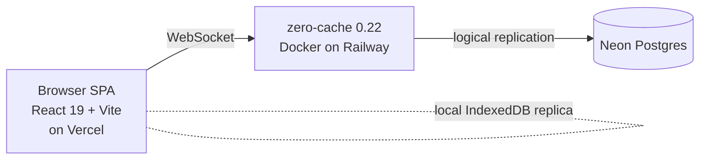
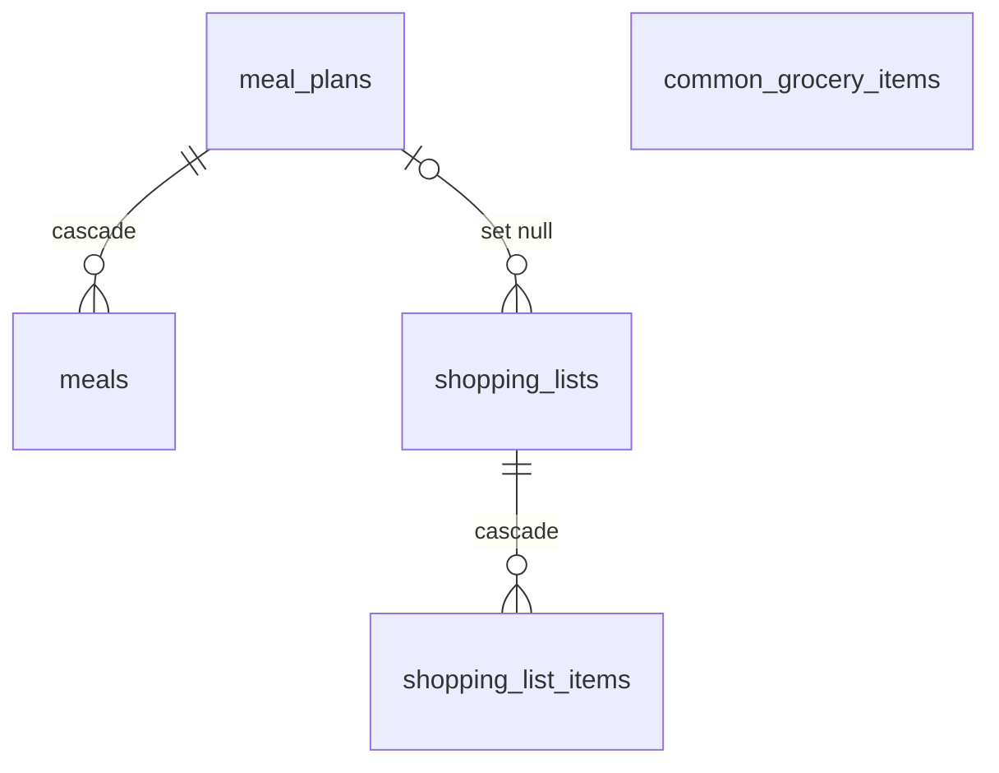
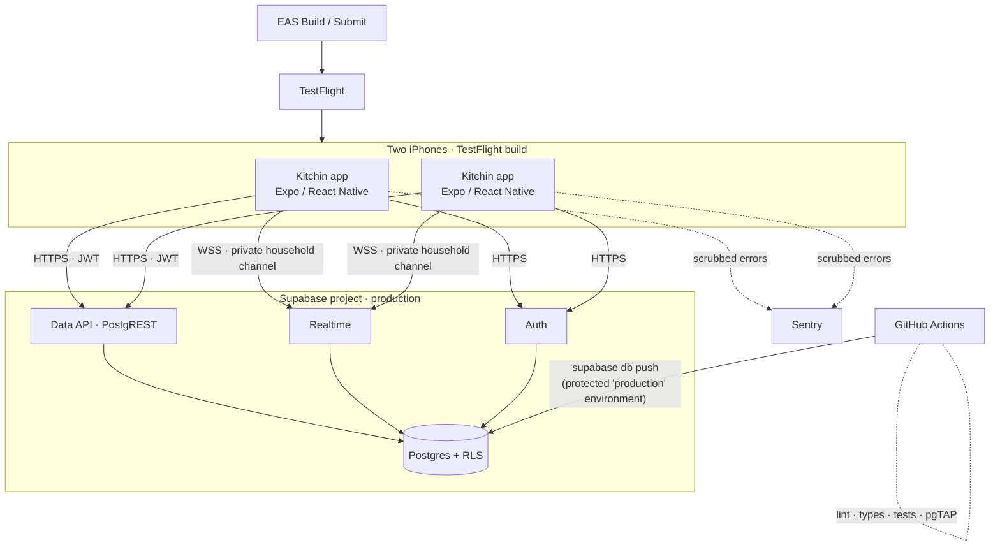
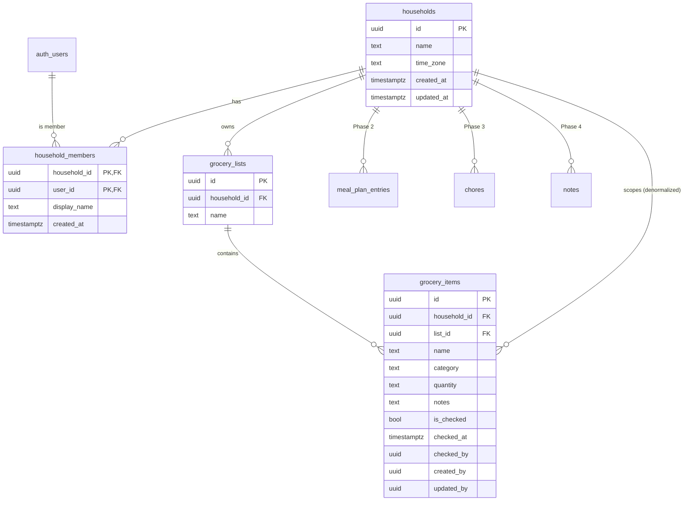

# Kitchin — Rebuild Specification

| | |
|---|---|
| **Status** | **Research record.** For the MVP, [`specs/mvp/1-requirements.md`](../specs/mvp/1-requirements.md) and [`specs/mvp/2-design.md`](../specs/mvp/2-design.md) (both approved 2026-10-18) supersede §3–§11 and §13, and settle every §16 decision. `2-design.md` §1.5 lists the corrections to this document. §2 (legacy assessment), §14 (risks), §15 (costs) and Appendix A (links) remain current. |
| **Date** | 2026-10-18 |
| **Audience** | The project owner, and Claude Code sessions that will implement the work |
| **Companion docs** | [`TASKS.md`](./TASKS.md) (step-by-step plan with manual steps) · [`../CLAUDE.md`](../CLAUDE.md) (rules for agents) |

**How to read this document.** Statements are labelled where it matters:

- **Confirmed**: verified by reading the legacy repositories or official documentation (links in [Appendix A](#appendix-a-documentation-links)).
- **Assumption**: believed true but not verified; called out so it can be corrected.
- **Recommendation**: a proposal that needs approval before implementation.

---

## Contents

1. [Executive summary](#1-executive-summary)
2. [Existing application assessment](#2-existing-application-assessment)
3. [Recommended technology stack](#3-recommended-technology-stack)
4. [Target architecture](#4-target-architecture)
5. [Database schema and entity relationships](#5-database-schema-and-entity-relationships)
6. [Authentication and authorization design](#6-authentication-and-authorization-design)
7. [Row Level Security policy requirements](#7-row-level-security-policy-requirements)
8. [Realtime synchronization design](#8-realtime-synchronization-design)
9. [Error handling and Sentry](#9-error-handling-and-sentry)
10. [Testing and GitHub Actions](#10-testing-and-github-actions)
11. [Environments: development, CI, production](#11-environments-development-ci-production)
12. [Migration approach and implementation sequence](#12-migration-approach-and-implementation-sequence)
13. [MVP scope and milestones](#13-mvp-scope-and-milestones)
14. [Complexity, risks, and hard-to-reverse decisions](#14-complexity-risks-and-hard-to-reverse-decisions)
15. [Costs and free-tier limits](#15-costs-and-free-tier-limits)
16. [Decisions that require approval](#16-decisions-that-require-approval)
- [Appendix A: Documentation links](#appendix-a-documentation-links)
- [Appendix B: New-feature checklist](#appendix-b-new-feature-checklist)

---

## 1. Executive summary

**Which legacy app was used.** `kitchin-app` is the application that was actually built, deployed and used (Confirmed: 49 commits from 2025-06-16 to 2025-07-09, deployed to Vercel with a Zero cache server on Railway and a Neon Postgres database). `kitchin` was an earlier 3-day prototype: a Vite template plus an ambitious Drizzle schema, with no real UI (its `App.tsx` renders "Hello"). Treat `kitchin-app` as the functional reference and `kitchin` only as a source of data-model ideas.

**What we are building.** A private iOS app for exactly two household members that shares one authoritative copy of household data: groceries first, then meal planning, chores and notes. The app is new and starts with **no data migrated** from the legacy app.

**Recommended approach.** Create a **new Expo project** (Approach B in [§12](#12-migration-approach-and-implementation-sequence)) in this repository. Port requirements, domain constants and visual identity from `kitchin-app`. Reuse no web components. Leave the legacy repositories untouched until the new app is validated, then decommission the legacy hosting.

**Target stack.**

- **Mobile:** Expo SDK 58 + React Native 0.88 + TypeScript (strict) + Expo Router, using development builds rather than Expo Go.
- **Server state:** TanStack Query over `supabase-js`.
- **Backend:** Supabase: Postgres, Auth, Realtime and Row Level Security. The app talks to Supabase directly. There is no custom backend, and Edge Functions are not needed for the MVP.
- **Errors:** Sentry, with personal-data collection off and aggressive scrubbing.
- **Delivery:** GitHub Actions for CI and database deploys; EAS Build and Submit for TestFlight.

**Security model in one paragraph.** Every row of household data carries a `household_id`. Membership lives in `household_members`. Only an administrator can write to it, never the app. Two layers of database access control apply: explicit grants (nothing for anonymous callers), and Row Level Security on every table, which limits each signed-in user to the households they belong to. Realtime events go out on private, per-household channels that are authorized by RLS on `realtime.messages`. Public signups are disabled and the two accounts are provisioned by hand. Even an account that somehow exists but has no membership row sees nothing. The mobile app holds only the Supabase publishable key and the Sentry DSN, both of which are designed to be public. Privileged credentials exist only in the Supabase dashboard, GitHub Actions secrets and EAS secrets.

**MVP.** One shared grocery list on both iPhones. You can add items (typed or via quick-add), check them off, edit quantities, delete items and clear checked items. Changes appear on the other phone within about a second. The app is shipped through TestFlight, monitored by Sentry, and every pull request runs lint, type checks, unit tests and database RLS tests.

**Cost.** The Apple Developer Program at $99/year is the only unavoidable cost. Supabase, Expo EAS, Sentry and GitHub can all run on free tiers at this scale. The free tiers have real reliability limits: Supabase pauses projects after inactivity and has no backups on Free, and EAS limits monthly builds. These are covered in [§15](#15-costs-and-free-tier-limits).

**What needs your approval.** See [§16](#16-decisions-that-require-approval). The most consequential choices are the authentication method, the Realtime mechanism, the bundle identifier and Supabase region (both effectively permanent), and whether the repository stays public.

---

## 2. Existing application assessment

### 2.1 Which directory was used

| | `kitchin` | `kitchin-app` |
|---|---|---|
| Commits | 4 (2025-06-14 → 2025-06-16) | 49 (2025-06-16 → 2025-07-09) |
| GitHub remote | `dustinwalkup/kitchin` (not publicly visible; Assumption: private) | `dustinwalkup/kitchin-app` (public) |
| UI | None; `App.tsx` renders "Hello" | Meal planner + shopping list, routed, styled |
| Zero | Schema generated, never wired to UI | Fully wired; zero-cache Dockerfile for Railway |
| Deployment | None | Vercel (`vercel.json` SPA rewrites) + Railway (zero-cache) + Neon |
| Working tree | One uncommitted change (`strictNullChecks` in `tsconfig.json`) | Clean |
| Branches | `master` (work), `origin/main` (GitHub's "Initial commit" only) | `master` (work); `clerk-auth-mess-of-a-branch` (abandoned Clerk auth attempt, 1 commit ahead); `feature/future-ui-updates` (fully merged); `main` (GitHub's "Initial commit" only) |

**Conclusion (Confirmed):** `kitchin-app` on branch `master` is the app that was used. The rest of this section describes it unless stated otherwise.

### 2.2 Architecture and technology stack (Confirmed)



| Layer | Technology |
|---|---|
| UI | React 19, TypeScript ~5.8, Vite 6, Tailwind CSS 4, shadcn/ui ("new-york" style) on Radix primitives, lucide-react icons |
| Routing | TanStack Router 1.125 (file-based, generated `routeTree.gen.ts`) |
| Data sync | Rocicorp Zero `0.22.2025070600` (alpha), `drizzle-zero` to generate the Zero schema from Drizzle |
| Database | Postgres on Neon with Drizzle ORM 0.44; schema applied with `drizzle-kit push` (no migration files committed) |
| Hosting | Vercel (static SPA), Railway (zero-cache container with `/keepalive` health check), Neon (separate dev and prod databases, per comments in `.env`) |
| Unused dependencies | `gel`, `@neondatabase/serverless`, `@radix-ui/react-tabs` (Assumption: unused; no imports found for the first two) |

### 2.3 Screens, navigation, components and flows (Confirmed)

**Navigation:** a root layout with a sticky brand header ("Kitchin" + chef-hat icon) and a two-segment tab control: **Meals** (`/meals`) and **Shopping** (`/shopping-list`). `/` redirects to `/meals`. Route loaders call Zero `preload()` with a one-minute TTL.

**Meal planner** (`src/components/meal-planner.tsx`)
- A fixed Monday–Sunday grid. Each day has three free-text cells (breakfast, lunch, dinner) and an "n/3 planned" badge.
- Days are weekdays, not dates. There is no week navigation and no history.
- Every keystroke writes to the database (`onChange` → `updateMeal`/`createMeal`).

**Shopping list** (`src/components/shopping-list/*`)
- Header with completed/total count, progress bar and percentage, and a view toggle.
- **List view:** every category as a card. Each card has an add-item input, quick-add chips and the items.
- **Category view:** horizontal category tabs with counts, then one category's card.
- Item row: checkbox, name (struck through when checked), inline quantity text field, delete button.
- Quick-add chips come from a hard-coded `COMMON_ITEMS` map: 7 categories, 78 items. Chips already on the list (case-insensitive) are disabled and show ✓.
- Empty states for empty categories.

**User flows:** open the app → plan meals by typing → switch to shopping → add items by typing or quick-add → check items off in the store. There is no sign-in, no "clear completed", no multiple lists and no week change.

### 2.4 Data model (Confirmed, `kitchin-app/src/db/schema.ts`)



| Table | Notable columns |
|---|---|
| `meal_plans` | `name` |
| `meals` | `meal_plan_id`, `day_of_week` (enum), `meal_type` (enum: breakfast/lunch/dinner), `notes` |
| `shopping_lists` | `meal_plan_id?`, `name`, `is_active`, **`view_mode`**, **`active_category`** (UI preferences stored on the shared list), `estimated_budget`/`actual_cost` (cents, unused) |
| `shopping_list_items` | `shopping_list_id`, `category` (enum of 7), `name` varchar(255), `quantity` varchar(50) default `'1'`, `unit`, `estimated_price`/`actual_price` (unused), `notes` (unused), `is_completed`, `completed_at` |
| `common_grocery_items` | Defined but **never read**; the UI uses the hard-coded constant instead |

All tables use UUID primary keys and `timestamp` **without time zone** `created_at`/`updated_at`. No table has a user or household column. There are no unique constraints beyond primary keys.

**The `kitchin` prototype schema** (Confirmed, not deployed) is worth knowing about. It sketched `users`, `households` (with `invite_code`), a `household_members` join table with an `owner`/`member` role, `meal_templates`, `meal_ingredients`, `activity_log`, `user_preferences`, and `created_by`/`added_by`/`completed_by` attribution columns. The household-membership and attribution ideas carry forward. Invite codes do not, because they conflict with admin-only provisioning.

### 2.5 How Zero is used (Confirmed)

- **Client setup:** `ZeroProvider` with a hard-coded `userID: "anon"` and no `auth` token. The server URL comes from `VITE_ZERO_SERVER`.
- **Queries:** unscoped, whole-table queries (`useQuery(z.query.shoppingListItems)`, `z.query.meals`, etc.) with no `where` by list, plan or user. The comments rely on "Zero handles user isolation through permissions", but no such permissions exist.
- **Preloading:** `preloadAllData` runs 1 second after init; route loaders preload again (`ttl: "1m"`).
- **Mutations:** CRUD helpers (`z.mutate.<table>.insert/update/delete`) in `use-mutations.ts`. IDs are client-generated `uuid` v4 and timestamps come from `Date.now()`. There are no custom mutators.
- **Permissions:** `zero-schema-permissions.ts` sets `ANYONE_CAN_DO_ANYTHING` on every table.
- **Sync:** zero-cache replicates Neon through Postgres logical replication; the client keeps a local replica. Offline reads and optimistic writes come for free from Zero.

### 2.6 Business logic, validation and state (Confirmed)

| Concern | Legacy behavior | Carry forward? |
|---|---|---|
| Grouping items by category | `use-shopping-list-items.ts` builds `Record<Category, Item[]>` | Yes, as a pure tested function |
| Progress | `round(completed / total * 100)` | Yes |
| Quick-add de-duplication | Disable chip if an item with the same name exists (case-insensitive), including checked items | Yes, but enforce in the database too (see [§5.4](#54-groceries-mvp)) |
| Item name validation | `trim()` and non-empty only | Extend: length limits plus DB `CHECK` constraints |
| Meal cell upsert | Find by (day, type) in memory, else insert. No unique constraint, so concurrent first keystrokes can create duplicates | Rebuild with a unique key and upsert |
| Default data | `useInitializeData` creates a default plan and list, but is **commented out** | Replace with server-side provisioning |
| View mode / active category | Stored on the shared `shopping_lists` row, so one person's view toggle changes the other person's screen | Move to per-device local storage |
| State management | Zero queries are the state; `useState` for input text | TanStack Query cache + local component state |

### 2.7 Authentication and access control (Confirmed)

- **`master`:** none. Anyone who can reach the zero-cache URL can read and write every row, because permissions are `ANYONE_CAN_DO_ANYTHING` and the user is `"anon"`.
- **`clerk-auth-mess-of-a-branch`:** an abandoned attempt (2025-07-07) adding Clerk sign-in, a `users` table keyed by `clerk_id`, `household_id` columns and a JWKS-verified Zero token. Permissions there were still `ANYONE_CAN_DO_ANYTHING`. It was never merged.
- **`docs/user-authentication-migration.md`** proposed per-user (`user_id`) isolation, not per-household isolation, which would not support a shared household.

### 2.8 Environment variables, integrations and external dependencies (Confirmed; values not reproduced)

| Variable | Purpose |
|---|---|
| `DATABASE_URL` | Neon connection string for Drizzle (dev and prod variants in comments) |
| `ZERO_UPSTREAM_DB` | Neon connection string for zero-cache |
| `ZERO_REPLICA_FILE` | zero-cache SQLite replica path |
| `VITE_ZERO_SERVER` | zero-cache URL used by the browser |
| `VITE_CLERK_PUBLISHABLE_KEY`, `ZERO_AUTH_JWKS_URL`, `ZERO_AUTH_SECRET` | Clerk branch only |

`.env` is gitignored and was **never committed**. A scan of the full public history of `kitchin-app` found only placeholder values.

### 2.9 Tests, tooling and deployment (Confirmed)

- **Tests:** none. No test runner is installed.
- **CI:** none. There is no `.github/` directory.
- **Lint and format:** ESLint 9 flat config (typescript-eslint, react-hooks, react-refresh) and Prettier with the Tailwind plugin. There is no type-check script apart from `tsc -b` inside `build`.
- **Database:** `drizzle-kit push` (schema sync without migration history); `src/db/migrations/` is empty.
- **Codegen:** `postinstall` runs `drizzle-zero generate`.
- **Deploy:** Vercel for the SPA and Railway for zero-cache. Assumption: both deployed from the Git integrations or the dashboard, since there are no deploy scripts.

### 2.10 Reusable assets and resources

| Asset | Location | Reuse plan |
|---|---|---|
| "Desert" palette (**owner wants to keep this**) | `src/index.css`: desert teal `#3d8b82` (primary), sunset blush `#f2a6b3` (secondary), sagebrush `#aabba1` (tertiary), terracotta clay `#d16c48` (accent), pueblo sand `#eed6c4`, cactus flower `#ce5a67`, night horizon `#2b3a42` | Port exactly to `src/ui/theme.ts`. Full token table and usage map in [§4.6](#46-visual-identity-preserved-from-kitchin-app-owner-requirement) |
| Grocery categories with labels and emoji | `src/lib/constants.ts` `CATEGORIES` | Port verbatim |
| Common items (78) | `src/lib/constants.ts` `COMMON_ITEMS` | Port as quick-add seed constant |
| Day and meal-type metadata | `DAYS`, `MEAL_TYPES` | Port for the meal planner phase |
| UI copy | `LABELS` | Port |
| Icon choices | Calendar, ShoppingCart, ChefHat, Trash2, Plus, Grid, List | Map to native icon equivalents |
| Feature-folder and hooks organization | `docs/hooks-pattern.md` | Keep the pattern (feature folders, data hooks, pure helpers) |
| App icon | `public/apple-touch-icon.png` is 180×180 | **Not sufficient.** iOS needs a 1024×1024 source; a new icon must be produced (manual task) |

### 2.11 Technical debt and architectural issues

1. **Critical security gap:** the publicly reachable sync server has no auth and full read/write permissions on every table (§2.7).
2. **No tenancy model:** there are no user or household columns, and every query reads entire tables.
3. **Shared UI state:** view mode and active category live on the shared list row.
4. **Write amplification and races:** the meal planner writes on every keystroke with no debounce and no unique constraint, so duplicate rows are possible.
5. **Fragile defaults:** with no meal plan row, `mealPlan[0].id` throws. With no list, adds silently no-op because `shoppingListId = ""`.
6. **Dead code and paths:** `toggleShoppingListItem` (which sets `completed_at`) is unused, so checking an item never records `completed_at`. `common_grocery_items`, the price/budget columns, the leftover Zero hello-world `schema.ts` and the `use-zero.ts` stub are unused.
7. **Schema management:** `drizzle-kit push` with no migration history, so changes are not reviewable or reproducible.
8. **Timestamps:** `timestamp` without time zone, written from client clocks.
9. **Committed build artifacts:** `.vite/deps`, `tsconfig.tsbuildinfo`, `.zero-types/`.
10. **Styling bug:** `border-sagebrush/20` references a colour token that is never defined (sagebrush is `--tertiary`).
11. **Alpha dependency:** the app is tied to Zero 0.22 (alpha at the time) and a self-hosted cache server. Zero has since reached 1.0 (March 2026), and 0.25 removed the built-in permission system and CRUD mutators, so even staying on Zero would mean a major rewrite.
12. **No tests and no CI.**
13. **Noise:** `console.log` with emoji in the production paths.

### 2.12 Preserve, adapt or rebuild

| Item | Decision | Notes |
|---|---|---|
| Product concept (shared meals + groceries) | **Preserve** | Groceries first |
| Grocery categories, quick-add list, palette, copy | **Preserve** | Port as constants and tokens |
| Category grouping and progress logic | **Adapt** | Pure functions with unit tests |
| Data model | **Rebuild** | Household-scoped, attributed, constrained, `timestamptz` |
| Meal planner | **Rebuild (Phase 2)** | Date-based, upsert on a unique key, debounced saves |
| Zero sync, zero-cache, Drizzle, Neon | **Replace** | Supabase Postgres + Realtime |
| TanStack Router, Tailwind/shadcn/Radix components | **Replace** | Expo Router, React Native primitives |
| Hosting (Vercel/Railway) | **Retire** after validation | See [§12.4](#124-legacy-decommissioning) |
| Existing data | **Not migrated** | Owner decision: start fresh |

---

## 3. Recommended technology stack

Versions below are the current stable releases at the time of writing. Implementation should use whatever `create-expo-app` and the Expo SDK install, and pin them in `package.json`.

| Layer | Choice | Why | Considered and rejected |
|---|---|---|---|
| Framework | **Expo SDK 58** (React Native 0.88, React 19.3; released 2026-10-15; requires Node ≥ 22.13, iOS 16.4+, Xcode 26.4+). The New Architecture is always on (mandatory since SDK 55) | Managed native config (CNG), EAS Build/Submit, first-class config plugins for Sentry, SecureStore and Apple auth | Bare React Native: more native maintenance for no benefit here. SDK 57: see D15 |
| Dev workflow | **Development builds from day one** (`npx expo run:ios` on the Simulator, which is free and uses local Xcode), not Expo Go | Expo now calls Expo Go "first and foremost an educational tool". SDK 58's Expo Go isn't in the App Store yet. Sentry native crash capture and real Sign in with Apple need a dev build anyway | Expo Go |
| Language | **TypeScript, `strict: true`** (template ships TS ~6.0) | Type safety end to end with generated DB types | — |
| Navigation | **Expo Router** (`expo-router@58`: since SDK 55 every Expo package is versioned with the SDK) | File-based routes in `src/app/`, typed routes, `Stack.Protected` guards for the auth/no-household states, deep linking for free | React Navigation directly: more boilerplate; Expo Router is built on it anyway |
| Supabase client | **`@supabase/supabase-js` v2** | Official client for Auth, PostgREST and Realtime | Raw REST: reinvents auth refresh and realtime |
| Server-state cache | **TanStack Query v5** | Loading/error states, retries, refetch on focus/reconnect, optimistic mutations with rollback, request de-duplication. It is a cache, **not** a sync engine. TanStack's React Native guide covers `onlineManager` (NetInfo) and `focusManager` (AppState). Expo has no official page on it | Hand-rolled hooks (more bugs); Zero, PowerSync or TanStack DB (unnecessary sync layer, since offline-first is out of scope) |
| Session storage | **"LargeSecureStore" pattern from the official Supabase Expo tutorial**: a random AES-256 key in `expo-secure-store` (iOS Keychain, `WHEN_UNLOCKED`) encrypts the session, which is stored in AsyncStorage. Uses `aes-js` + `react-native-get-random-values` | Refresh tokens are credentials. Expo no longer enforces SecureStore's old ~2048-byte limit, but notes that some iOS releases rejected larger values; this pattern is size-safe and documented by Supabase | Plain AsyncStorage (the Supabase tutorial's simpler option) or `expo-sqlite/localStorage` (Expo's current Supabase guide). Both store tokens **unencrypted** |
| Device preferences | **`@react-native-async-storage/async-storage`** | View mode, last tab, and other non-sensitive per-device settings | Storing preferences in shared tables (a legacy bug) |
| Connectivity | **`@react-native-community/netinfo`** | Drives TanStack Query `onlineManager` and the offline banner | — |
| IDs | **`expo-crypto` `randomUUID()`** | Client-generated UUIDs make inserts idempotent and optimistic rows reconcilable | Server-only IDs (harder optimistic UI) |
| Styling | **React Native `StyleSheet` + typed theme tokens** | No build plugins, no version churn, easy for agents to get right | NativeWind (Tailwind familiarity, but adds Babel/Metro config and has a history of breaking upgrades); Tamagui (heavy). See D8 |
| Icons | **`@expo/vector-icons`** (bundled) and/or **`expo-symbols`** (SF Symbols) | No extra dependency; native look on iOS | lucide-react-native (needs react-native-svg; fine later if exact icon parity matters) |
| DB schema and migrations | **Plain SQL migrations via Supabase CLI** + `supabase gen types typescript` | RLS, triggers and functions are SQL anyway; one source of truth; first-class in the CLI and CI | Drizzle (a second schema language, and policy support is less proven for this use) |
| DB tests | **pgTAP via `supabase test db`** | Runs inside Postgres, exercises the real RLS policies as real roles | App-level integration tests only (slower, less precise) |
| Unit/component tests | **Jest 30 (`jest-expo@58` preset) + React Native Testing Library 14** (+ `expo-router/testing-library` for route tests) | Official Expo recommendation. Note RNTL 14: `render`, `fireEvent`, `act` and `renderHook` are now **async** (must be awaited); matchers are built in (`@testing-library/jest-native` and `react-test-renderer` are deprecated) | Vitest (not the supported path for React Native) |
| Lint/format | **ESLint (`eslint-config-expo`, flat config) + Prettier** | `npx expo lint` support | — |
| Errors | **`@sentry/react-native` v8** with the Expo config plugin | JS + native crash capture, source maps through EAS; required by the brief | EAS Observe (Expo's own monitoring, GA since Aug 2026, native crashes since Oct 2026, 100K events/month free): a viable future alternative with one less vendor; Bugsnag/Crashlytics (no advantage) |
| Sync engine | **None.** TanStack Query + Supabase Realtime | Online-only MVP; Postgres is the single source of truth | Zero is now stable (1.0 in March 2026) and supports React Native, but it requires hosting `zero-cache` and, since 0.25, implementing permissions in **your own** query/mutate endpoints (a backend server). PowerSync / TanStack DB: offline-first is out of scope |
| CI | **GitHub Actions** | Required; free | — |
| Build/distribution | **EAS Build + EAS Submit → TestFlight** | Cloud iOS builds without maintaining signing locally; `--auto-submit` | Local Xcode archive (possible and free, but manual signing). See [§15](#15-costs-and-free-tier-limits) |

**Deliberately not included in the MVP:** a separate backend server, Edge Functions, global state libraries (Redux/Zustand; React context is enough for the session), offline persistence of the query cache, push notifications, EAS Update (OTA), analytics SDKs, and E2E test frameworks in CI.

**When an Edge Function becomes justified.** Add one only for logic that must not run on the client or needs a privileged key. Examples: sending push notifications to the other member, scheduled jobs (recurring chores), calling a third-party API with a secret key, or admin operations. None exist in the MVP.

---

## 4. Target architecture

### 4.1 System context



The app talks only to Supabase (Auth, Data API, Realtime) and Sentry. There are no other servers.

### 4.2 App layers

```
src/app/ (routes; thin)  → screen components; no data access logic
  ↓
src/features/<feature>/  → hooks.ts (TanStack Query) → api.ts (supabase-js, typed)
                           domain.ts (pure logic, unit tested)
                           realtime.ts (how events for this feature's tables affect the cache)
                           components/
  ↓
src/lib/                 → supabase.ts (client), query-client.ts, realtime/household-channel.ts,
                           sentry.ts, logger.ts, errors.ts (classification), env.ts (validated config)
src/ui/                  → theme tokens + primitives (Screen, Button, TextField, Checkbox, Banner, …)
src/types/database.ts    → generated by `supabase gen types typescript` (never hand-edited)
```

**Rules:**

- Screens never import `supabase` directly; they use feature hooks.
- Feature `api.ts` functions are the only place that build queries.
- `domain.ts` files contain no React or Supabase imports, so they can be unit tested.

### 4.3 Proposed repository layout

```
kitchin-native/
├── src/
│   ├── app/                        # Expo Router routes (SDK 55+ template default is src/app)
│   │   ├── _layout.tsx             # Sentry.wrap, providers, Stack with Protected guards
│   │   ├── sign-in.tsx
│   │   ├── no-household.tsx        # signed in but no membership → explain + sign out
│   │   └── (app)/
│   │       ├── _layout.tsx         # mounts the household realtime channel
│   │       └── (tabs)/
│   │           ├── _layout.tsx
│   │           ├── groceries/index.tsx
│   │           └── settings.tsx    # account email, sign out, app version, env badge
│   ├── features/{auth,household,groceries}/
│   ├── lib/  ui/  types/
├── supabase/
│   ├── config.toml                 # local stack config (signups disabled, etc.)
│   ├── migrations/                 # timestamped SQL; the only way schema changes
│   ├── tests/database/*.test.sql   # pgTAP
│   └── seed.sql                    # LOCAL ONLY: test users + two households for isolation tests
├── scripts/                        # admin SQL snippets (provisioning) — no secrets
├── .github/workflows/{ci.yml,deploy-db.yml}
├── app.config.ts                   # dynamic config + app variants
├── eas.json
└── docs/
```

### 4.4 Provider tree and app states

```
Sentry.wrap(
  <QueryClientProvider>
    <AuthProvider>          // session from supabase.auth; listens to onAuthStateChange
      <HouseholdProvider>   // loads the current user's membership once signed in
        <Stack>             // Stack.Protected guards:
                            //   loading   → splash stays visible
                            //   no session → sign-in
                            //   session, no household → no-household
                            //   session + household → (app)
```

This follows the official Expo Router authentication guide: `Stack.Protected` plus a splash-screen controller that keeps the splash visible while the session loads. SDK 58 adds a `redirectTo` prop on guards. Guards are a **UX mechanism, not security**: Expo notes they are "not a replacement for server-side authentication". Security is enforced by grants and RLS (§7).

**Membership rule:** a user with more than one membership uses the oldest one, and a warning is reported. The schema allows multiple households, but the MVP UI assumes one.

### 4.5 Navigation map

- **MVP:** `sign-in`, `no-household`, `(app)/(tabs)/groceries`, `(app)/(tabs)/settings`.
- **Later tabs:** `meals`, `chores`, `notes`, each added as a feature folder plus a route. See [Appendix B](#appendix-b-new-feature-checklist).

### 4.6 Visual identity (preserved from `kitchin-app`; owner requirement)

The "desert" palette from the legacy app **must be kept**. Values are copied exactly from `kitchin-app/src/index.css` (Confirmed). Usage is taken from the legacy components (Confirmed by grep).

All tokens live in `src/ui/theme.ts`. Components never hard-code hex values. React Native has no `bg-primary/10` syntax, so each opacity variant that was used becomes a named token (for example `primarySoft`) or a small `withAlpha(color, 0.1)` helper.

**Brand colors**

| Token | Hex | Legacy name | Where the legacy app used it |
|---|---|---|---|
| `primary` | `#3d8b82` | desert teal | Logo tile, checked checkbox, dinner icon (+ 10% tint background), item hover border (30%), Monday accent |
| `secondary` | `#f2a6b3` | sunset blush | Lunch icon (+ 20% tint), quick-add chip press state (20%), card borders (20%), Thursday accent |
| `tertiary` | `#aabba1` | sagebrush | Card borders (20%), input borders (30%), Friday accent. The legacy `border-sagebrush/20` class pointed at this colour under a name that didn't exist (bug §2.11 #10); fixed here |
| `accent` | `#d16c48` | terracotta clay | **Meals tab** active background, breakfast icon (+ 10% tint), delete button (+ 10% press tint), Sunday accent |
| `sand` | `#eed6c4` | pueblo sand | App background (at 30% over white), Saturday accent |
| `cactus` | `#ce5a67` | cactus flower | **Shopping tab** active background, add-item button, active category tab, progress bar and %, list header icon tile (20%), Wednesday accent |
| `ink` | `#2b3a42` | night horizon | Headings and primary text; secondary text at 60%; Tuesday accent |

**Neutrals** (from the shadcn base; the legacy app defined them in OKLCH)

| Token | Value | Use |
|---|---|---|
| `background` | `#ffffff` | Cards, surfaces |
| `screen` | `sand` at 30% over white ≈ `#faf3ed` | Screen background |
| `text` | ≈ `#0a0a0a` (oklch 0.145 0 0) | Body text where `ink` isn't used |
| `border` | ≈ `#e5e5e5` (oklch 0.922 0 0) | Default hairlines |
| `muted` | gray-400/500 | Empty states, completed items (struck through, 60% opacity) |
| `destructive` | ≈ `#e7000b` (oklch 0.577 0.245 27.3) | Destructive confirmations |
| `radius` | 10 px (`0.625rem`); cards use 14 px (`radius + 4`) | Corner radii |

The ≈ values are hex approximations of the OKLCH originals; small differences are acceptable.

**Grocery category badges** (Tailwind 100 background / 800 text pairs; hex from the Tailwind v3 palette, visually the same as v4's OKLCH)

| Category | Emoji | Background | Text |
|---|---|---|---|
| Produce | 🥬 | `#dcfce7` | `#166534` |
| Meat & Fish | 🥩 | `#fee2e2` | `#991b1b` |
| Dairy & Eggs | 🥛 | `#dbeafe` | `#1e40af` |
| Pantry | 🥫 | `#fef9c3` | `#854d0e` |
| Frozen | 🧊 | `#cffafe` | `#155e75` |
| Bakery | 🍞 | `#ffedd5` | `#9a3412` |
| Other | 🛒 | `#f3f4f6` | `#1f2937` |

**For the meal planner (Phase 2):**
- Day accents (left border): Mon `primary`, Tue `ink`, Wed `cactus`, Thu `secondary`, Fri `tertiary`, Sat `sand`, Sun `accent`.
- Meal-type icons: breakfast ☕ `accent`, lunch ☀️ `secondary`, dinner 🌙 `primary`.

**Feel to keep:**
- Rounded white cards on a warm sand background, with thin sage/blush borders.
- The chef-hat logo on a teal tile.
- Terracotta for Meals and cactus-flower pink for Shopping.

**Dark mode:** the legacy `.dark` block reused the same brand colours, but nothing ever applied the `.dark` class, so the legacy app was effectively **light-only**. Recommendation (D17): ship the MVP light-only (`userInterfaceStyle: "light"`) to match the legacy look, and design a proper dark palette later if wanted. `theme.ts` is structured as `{ light, dark }` from day one, so adding dark mode doesn't touch components.

---

## 5. Database schema and entity relationships

### 5.1 Conventions (apply to every household-data table)

| Convention | Rule | Why |
|---|---|---|
| Primary key | `id uuid primary key default gen_random_uuid()`; the client may supply it | Idempotent inserts; optimistic rows reconcile by ID |
| Tenancy | `household_id uuid not null references households(id) on delete cascade`, **on every table including child tables** | RLS policies and realtime topics need no joins; one uniform policy template |
| Child consistency | Composite FK `(parent_id, household_id) → parent(id, household_id)`; parent declares `unique (id, household_id)` | Makes it impossible for a row to claim household A while pointing at a parent in household B |
| Attribution | `created_by uuid default auth.uid()` and `updated_by uuid`, both `references auth.users(id) on delete set null`; set by trigger, not trusted from the client | "Who added this?"; cannot be spoofed |
| Timestamps | `created_at timestamptz not null default now()`, `updated_at timestamptz not null default now()`; `updated_at` maintained by trigger | Server clock; time-zone safe |
| Immutability | Trigger rejects changes to `id`, `household_id`, `created_at`, `created_by` on UPDATE | Prevents moving rows between households, even by a member of both |
| Enumerations | `text` + `CHECK (col in (...))` rather than Postgres `ENUM` | Values can be added or renamed in one migration; enum values cannot be removed |
| Text limits | `CHECK (char_length(...) <= N)` on every user-entered text column | Bounded payloads; validation is authoritative in the database |
| Indexes | Index `household_id` and every FK column | RLS and joins stay fast |
| Naming | `snake_case`, plural table names, a feature prefix (`grocery_*`, `meal_*`, `chore_*`) | Readable, groups by feature |
| Calendar dates | Use `date` for "which day" and interpret it in `households.time_zone` | Meal plans and chore due dates are local-calendar concepts |

### 5.2 Entity relationships



### 5.3 Core tables (MVP)

```sql
-- Proposed. Final DDL is written as migrations during implementation.
create table public.households (
  id         uuid primary key default gen_random_uuid(),
  name       text not null check (char_length(name) between 1 and 100),
  time_zone  text not null default 'UTC' check (char_length(time_zone) <= 64),
  created_at timestamptz not null default now(),
  updated_at timestamptz not null default now()
);

create table public.household_members (
  household_id uuid not null references public.households(id) on delete cascade,
  user_id      uuid not null references auth.users(id) on delete cascade,
  display_name text not null check (char_length(display_name) between 1 and 50),
  created_at   timestamptz not null default now(),
  primary key (household_id, user_id)
);
create index on public.household_members (user_id);
```

- **No `profiles` table:** `display_name` on the membership row covers the MVP.
- **No `role` column yet:** both members have equal rights. Adding a role later is a cheap, additive migration (for example, a child account with restricted permissions).
- **Never trust user metadata:** user metadata in `auth.users` (`raw_user_meta_data`) is **user-editable** and is never used for authorization.

### 5.4 Groceries (MVP)

```sql
create table public.grocery_lists (
  id           uuid primary key default gen_random_uuid(),
  household_id uuid not null references public.households(id) on delete cascade,
  name         text not null default 'Groceries' check (char_length(name) between 1 and 100),
  created_at   timestamptz not null default now(),
  updated_at   timestamptz not null default now(),
  created_by   uuid default auth.uid() references auth.users(id) on delete set null,
  updated_by   uuid references auth.users(id) on delete set null,
  unique (id, household_id)
);
create index on public.grocery_lists (household_id);

create table public.grocery_items (
  id           uuid primary key default gen_random_uuid(),
  household_id uuid not null references public.households(id) on delete cascade,
  list_id      uuid not null,
  name         text not null check (char_length(btrim(name)) between 1 and 200),
  category     text not null default 'other'
               check (category in ('produce','meat','dairy','pantry','frozen','bakery','other')),
  quantity     text check (quantity is null or char_length(quantity) <= 50),
  notes        text check (notes is null or char_length(notes) <= 1000),
  is_checked   boolean not null default false,
  checked_at   timestamptz,
  checked_by   uuid references auth.users(id) on delete set null,
  created_at   timestamptz not null default now(),
  updated_at   timestamptz not null default now(),
  created_by   uuid default auth.uid() references auth.users(id) on delete set null,
  updated_by   uuid references auth.users(id) on delete set null,
  foreign key (list_id, household_id)
    references public.grocery_lists (id, household_id) on delete cascade
);
create index on public.grocery_items (household_id);
create index on public.grocery_items (list_id);

-- At most one *unchecked* item per name per list. Prevents duplicate "Milk" when both
-- people quick-add at the same moment; the second insert gets 23505 and the app treats
-- it as "already on the list".
create unique index grocery_items_one_open_per_name
  on public.grocery_items (list_id, lower(btrim(name))) where not is_checked;
```

**Triggers on `grocery_items`:**

- **Audit trigger:** sets `created_by`, `updated_at`, `updated_by` and enforces immutability.
- **Check trigger:** when `is_checked` changes, sets `checked_at = now()` and `checked_by = auth.uid()`, or clears both. The server stays authoritative.
- **Broadcast trigger:** see [§8](#8-realtime-synchronization-design).

**MVP list and quick-add rules:**

- Each household has exactly one list, created at provisioning. The schema already supports several lists if wanted later.
- Quick-add uses the ported hard-coded `COMMON_ITEMS` constant. A household-specific "frequent items" table derived from history is a later enhancement. The legacy `common_grocery_items` design is not carried over.

### 5.5 Shared trigger functions (in a non-exposed `private` schema)

```sql
create schema if not exists private;
revoke all on schema private from public, anon, authenticated;
grant usage on schema private to authenticated;   -- needed so RLS can call helpers

-- Standard audit + immutability trigger for every household-data table.
create or replace function private.handle_audit_fields()
returns trigger language plpgsql set search_path = '' as $$
begin
  if tg_op = 'INSERT' then
    new.created_at := now();
    new.updated_at := now();
    if auth.uid() is not null then new.created_by := auth.uid(); end if;
  elsif tg_op = 'UPDATE' then
    if new.id is distinct from old.id
       or new.household_id is distinct from old.household_id
       or new.created_at  is distinct from old.created_at
       -- allow NULL so the FK action ON DELETE SET NULL (auth user deleted) still works
       or (new.created_by is distinct from old.created_by and new.created_by is not null) then
      raise exception 'immutable column changed' using errcode = '42501';
    end if;
    new.updated_at := now();
    new.updated_by := auth.uid();
  end if;
  return new;
end $$;
```

The function is written once and attached to each table with a `before insert or update` trigger. The `households` table has no `created_by` and gets a variant of it.

### 5.6 Future features (sketches, not MVP)

The same conventions apply to every future table, so each feature is additive: new tables, one migration, policies from the template, a feature folder and a route. No core changes are needed.

| Feature | Sketch | Concurrency notes |
|---|---|---|
| Meal planning (Phase 2) | `meal_plan_entries(id, household_id, date date, meal_type text check in (breakfast,lunch,dinner), notes text ≤ 2000, …, unique (household_id, date, meal_type))` | Upsert on the unique key (`on conflict do update`); debounce saves 600–800 ms; last write wins per cell; show "edited by" |
| Chores / tasks (Phase 3) | `chores(id, household_id, title, notes, due_date date, assigned_to uuid null, recurrence text null, completed_at, completed_by, …)`; `assigned_to` must be a member (composite FK to `household_members(household_id, user_id)`) | Complete is idempotent; recurring generation later via a scheduled Edge Function or `pg_cron` |
| Notes (Phase 4) | `notes(id, household_id, title, body text ≤ 20000, pinned bool, version int not null default 1, …)` | Long text needs **optimistic concurrency**: `update … where id = $1 and version = $2`; a trigger increments `version`; 0 rows means a conflict, so the app shows "changed on the other phone, reload / keep mine" |
| Attachments (later) | Private Storage bucket `household-files`, object path `household_id/…`, policies on `storage.objects` checking the first path segment against membership | — |
| Activity feed (later) | `activity_events` written by triggers (not clients) | — |

**Alternatives rejected for extensibility:**

- **One generic `items` table with a `type` and `jsonb` payload:** loses constraints, typed columns and index-friendly queries.
- **A schema per feature:** unnecessary complexity for one household.

---

## 6. Authentication and authorization design

### 6.1 Sign-in method

| Option | UX | Setup / dependencies | Fit |
|---|---|---|---|
| **Email + password, accounts pre-created by admin** (Recommended) | Type email + password once per device; iOS Passwords autofill and save | None beyond Supabase Auth. No email delivery, no deep links, works in Expo Go and simulators | Simplest secure option |
| Email OTP (6-digit code) | No password; code by email each new sign-in | Built-in Supabase email is "not meant for production": about 2 messages/hour, sent only to members of your Supabase org team. Needs custom SMTP (for example Resend) and ideally a domain | Good later if passwords become a nuisance |
| Magic link | Tap link in email | Deep-link handling plus custom SMTP | More moving parts than OTP |
| Sign in with Apple (native) | Best iOS UX (Face ID) | Dev build + `expo-apple-authentication` → `signInWithIdToken`; native-only needs no Services ID or secret rotation. With signups disabled, a first Apple sign-in **works only if** Apple's verified email matches an existing user (auto-linked); "Hide My Email" relay addresses won't match and are rejected | **Post-MVP:** works for accounts whose Apple email matches; otherwise sign in with a password and link the Apple identity in Settings |

**Recommendation (D1):** email + password for the MVP, plus the following Auth settings in every environment:

- **Public signups disabled** ("Allow new users to sign up" off) in the dashboard, and `enable_signup = false` in local `supabase/config.toml` so local matches production.
- **Anonymous sign-ins disabled.**
- **Minimum password length 12 or more** (the Supabase default is 6). Use generated passwords stored in each person's password manager or iCloud Keychain. Leaked-password protection is a Pro-plan feature, so it is not available on Free.
- **Email confirmation:** "Confirm email" is on by default on hosted projects. Admin-created users are created **already confirmed**, so no email is ever sent.
- **Optional defense in depth:** a "Before User Created" Auth Hook (available on Free) that rejects any email not on an allowlist. It is redundant while signups are off, and becomes useful if signups are ever re-enabled by mistake.
- **Account enumeration:** password sign-in returns the same "Invalid login credentials" error for unknown emails and wrong passwords. The app shows one generic message.

### 6.2 Provisioning the two accounts (no public signup)

Provisioning is done once by the owner in the Supabase dashboard. It requires no secrets on any laptop and no code paths in the app.

1. **Authentication → Users → Add user → Create new user:** enter the email and a generated password, and tick auto-confirm. Repeat for the second person.
   - Admin user creation is not blocked by "signups disabled".
   - Do **not** use "Send invitation". Invited users are *unconfirmed*, and with signups disabled Supabase routes them through the signup path, which then fails.
   - **Fallback**, if the dashboard doesn't offer auto-confirm: create a **temporary secret key** (Project Settings → API Keys). Run a one-off committed script with it passed as an environment variable for that single command. The script calls `auth.admin.createUser({ email, password, email_confirm: true })`. Then **delete the key**. New-style secret keys can be revoked individually.
2. **SQL Editor:** run the committed snippet `scripts/provision-household.sql`. The snippet calls a function, `private.provision_household(name, time_zone, member_emails[], display_names[])`, which runs as `postgres`. It creates the household, both membership rows and the default grocery list in one transaction.
3. **Hand the password to the other person** through a password manager, not by text message.

`private.provision_household` is `security definer`, lives in the non-exposed `private` schema, and has `execute` **revoked from `public`, `anon` and `authenticated`**. The app cannot call it. There is deliberately **no** client path to create a household, join one or invite someone.

### 6.3 Session and token handling

```ts
// src/lib/supabase.ts — shape, not final code
export const supabase = createClient<Database>(env.supabaseUrl, env.supabasePublishableKey, {
  auth: {
    storage: largeSecureStore,       // AES key in Keychain, encrypted session in AsyncStorage (§3)
    persistSession: true,
    autoRefreshToken: true,
    detectSessionInUrl: false,       // no URL-based auth flows on native
  },
});
// Refresh only while foregrounded (official React Native guidance):
AppState.addEventListener('change', (s) =>
  s === 'active' ? supabase.auth.startAutoRefresh() : supabase.auth.stopAutoRefresh());
```

- **Token lifetimes:**
  - The access token is a short-lived JWT (default 1 hour). New projects sign JWTs with asymmetric keys by default; the app doesn't need to care.
  - Refresh tokens never expire but are single-use: rotation is on, with a 10-second reuse window. The two people therefore stay signed in until they sign out or are revoked.
  - Time-boxed sessions and inactivity timeouts are Pro-only and not needed.
- **Tokens never leave secure storage** except in `Authorization` headers to Supabase. They are never logged and never sent to Sentry ([§9](#9-error-handling-and-sentry)).
- **Sign out:** `supabase.auth.signOut()` (revokes the refresh token server-side), then clear the TanStack Query cache, remove the realtime channel, and clear the Sentry user.
- **Refresh failure:** if a refresh token is revoked or invalid, `onAuthStateChange` emits `SIGNED_OUT`. The app clears state and the router guard shows sign-in with "Please sign in again". This is not an error report.
- **Lost or stolen phone:** the owner signs that user out of all sessions from the dashboard (or `auth.admin.signOut` from an admin context) and changes their password. Optional Face ID app lock (`expo-local-authentication`) is a post-MVP option.
- **Password reset:** the admin sets a new password in the dashboard. There is no self-service reset in the MVP, which avoids email deep links.

### 6.4 Authorization model

- `household_members` is the **single source of truth** for who may see what.
- Every policy asks "is `household_id` one of the current user's households?" through one helper, `private.my_household_ids()` ([§7.2](#72-helper-functions)).
- Membership rows are **readable** by fellow members (so the app can show display names) but **never writable** through the Data API, because there are no INSERT/UPDATE/DELETE policies. That blocks self-assignment to another household and privilege escalation by design.
- Authorization never depends on client-supplied claims, user metadata, client-side filters or hidden UI. The API is assumed to be called directly by an attacker holding a valid session for some other account.

---

## 7. Row Level Security policy requirements

### 7.1 Non-negotiable rules

1. **RLS is enabled on every table in every exposed schema** (`public`, and any added later). A pgTAP test fails CI if any table lacks RLS ([§10](#10-testing-and-github-actions)).
2. Policies target **`to authenticated`** only. **No policy grants anything to `anon`**, and no policy uses `using (true)` on household data.
3. Every household-data policy uses **both** `USING` and `WITH CHECK` where the operation supports them, so a row can't be inserted into, or updated into, a household the user doesn't belong to.
4. Policies reference membership through `private.my_household_ids()`. Do not use joins written ad hoc in each policy, `auth.jwt()` user metadata, or client-provided values.
5. **Wrap auth calls for performance:** `(select auth.uid())`, and `household_id in (select private.my_household_ids())`, so Postgres evaluates them once per statement instead of once per row.
6. **`security definer` functions** live only in `private`, set `search_path = ''`, use fully qualified names, and have `execute` explicitly revoked from `public`/`anon` and granted only where needed.
7. **Views** in exposed schemas must be created `with (security_invoker = true)`, otherwise they bypass RLS.
8. **Explicit, minimal grants (two layers: grants *and* RLS).**
   - Supabase no longer exposes new `public` tables to the Data API automatically. This is the default for new projects since 2026-05-30 and applies to **all** projects from **2026-10-30**. A table with no grants returns `42501` for every request.
   - Each migration therefore **grants exactly the privileges the app needs to `authenticated`**, in the same migration as the table, RLS and policies (for example `grant select on household_members to authenticated`, with no insert/update/delete).
   - It grants **nothing to `anon`**. Anonymous access is denied at the grant layer even if a policy is ever mis-written.
   - Functions get `EXECUTE` for `public` by default, so every function in `private` explicitly revokes it.
9. The **secret key** (`sb_secret_…`, or the legacy `service_role`, deprecated and being removed in late 2026) **bypasses RLS**. It is never used by the app and never stored in the repository.
10. The Supabase **Security Advisor** (`supabase db advisors --type security`) must report no warnings before merge. It covers lints such as RLS disabled in public, mutable function `search_path`, and security-definer functions callable by anon/authenticated. `supabase db lint` (plpgsql_check) must report no errors.
11. **Don't use column-level privileges.** Supabase advises against them for most cases. Restrict columns with triggers instead (§5.5).

### 7.2 Helper functions

```sql
-- Households the current user belongs to. SECURITY DEFINER so that the policy on
-- household_members can use it without recursive RLS evaluation.
create or replace function private.my_household_ids()
returns setof uuid
language sql stable security definer set search_path = '' as $$
  select hm.household_id
  from public.household_members hm
  where hm.user_id = (select auth.uid())
$$;
revoke all on function private.my_household_ids() from public, anon;
grant execute on function private.my_household_ids() to authenticated;
```

### 7.3 Policy matrix

| Table | SELECT | INSERT | UPDATE | DELETE |
|---|---|---|---|---|
| `households` | member | ✗ (provisioning only) | member, `WITH CHECK` member; trigger allows changes to `name`/`time_zone` only | ✗ |
| `household_members` | member of the same household | ✗ | ✗ | ✗ |
| `grocery_lists` | member | member (`WITH CHECK`) | member (`USING` + `WITH CHECK`) | member |
| `grocery_items` | member | member (`WITH CHECK`) | member (`USING` + `WITH CHECK`) | member |
| every future household table | member | member | member | member, unless the feature needs stricter rules |
| `realtime.messages` | member of the topic's household (see §8) | ✗ (clients cannot broadcast on household topics) | n/a | n/a |
| `storage.objects` (later) | member of the household in the first path segment | same | same | same |

"Member" means `household_id in (select private.my_household_ids())`. "✗" means **no grant and no policy**: the operation is denied for `authenticated` and `anon` at both layers.

**Grants that accompany the matrix:**
- `households`: `select, update` to `authenticated`.
- `household_members`: `select` to `authenticated`.
- Feature tables: `select, insert, update, delete` to `authenticated`.
- `anon`: nothing anywhere.

### 7.4 Policy template

Copy this for each new household table:

```sql
alter table public.grocery_items enable row level security;

-- Layer 1: grants. Tables are not exposed to the Data API unless granted.
revoke all on public.grocery_items from anon, authenticated;
grant select, insert, update, delete on public.grocery_items to authenticated;

-- Layer 2: row-level policies.

create policy "grocery_items: members read"
  on public.grocery_items for select to authenticated
  using (household_id in (select private.my_household_ids()));

create policy "grocery_items: members insert"
  on public.grocery_items for insert to authenticated
  with check (household_id in (select private.my_household_ids()));

create policy "grocery_items: members update"
  on public.grocery_items for update to authenticated
  using      (household_id in (select private.my_household_ids()))
  with check (household_id in (select private.my_household_ids()));

create policy "grocery_items: members delete"
  on public.grocery_items for delete to authenticated
  using (household_id in (select private.my_household_ids()));

create trigger grocery_items_audit before insert or update on public.grocery_items
  for each row execute function private.handle_audit_fields();
```

### 7.5 Threats this design handles

| Attack (with a valid session for a non-member account, or by calling the REST API directly) | Blocked by |
|---|---|
| Read another household's rows | SELECT policy |
| Insert a row with someone else's `household_id` | INSERT `WITH CHECK` |
| Move one of your rows into another household | UPDATE `WITH CHECK` + immutability trigger |
| Insert a child row in your household pointing at another household's parent | Composite foreign key |
| Add yourself to a household / change your membership | No write policies on `household_members` |
| Spoof `created_by` / `checked_by` | Triggers overwrite from `auth.uid()` |
| Call provisioning or other privileged functions via RPC | Functions in `private` (not exposed) + revoked `execute` |
| Subscribe to another household's realtime events | `realtime.messages` SELECT policy on private channels ([§8](#8-realtime-synchronization-design)) |
| Use the publishable key without signing in (`anon` role) | No grants to `anon` + no `anon` policies |
| Sign up a new account | Signups disabled; even if enabled, no membership means no data |

---

## 8. Realtime synchronization design

### 8.1 Options

| | Postgres Changes | **Broadcast from Database + private channels** (Recommended) |
|---|---|---|
| How it works | Realtime reads the WAL and checks each change against each subscriber's RLS | A trigger calls `realtime.broadcast_changes()` to send to topic `household:<id>`; clients join that **private** channel; RLS on `realtime.messages` decides who may join |
| Authorization | INSERT/UPDATE are authorized against each subscriber's RLS (and the role needs a SELECT grant). **"RLS policies are not applied to DELETE statements"**, so delete events reach every subscriber of the table. With the default replica identity, the old record holds only the primary key | Every event, including deletes, is authorized by the channel policy. Nothing goes to non-members |
| Filtering | Client-specified filters (`household_id=eq.<id>`; supabase-js 2.109+ adds more operators). A convenience, not security; deletes can't be filtered without `replica identity full` | The topic is chosen by the database trigger, not the client |
| Scale and recommendation | "Simpler" but "does not scale as well" (single-threaded) | Supabase calls Broadcast "the recommended method for scalability and security". Broadcast from Database launched April 2025; Realtime Authorization (private channels) carries no beta label in the current docs. Available on Free |
| Extra setup | Add tables to the `supabase_realtime` publication | One trigger function, one trigger per table, one policy on `realtime.messages` |

**Recommendation (D2): Broadcast from Database with private channels.** It authorizes every event server-side, does not leak delete events, and the extra setup is a few lines per table and covered by tests. Postgres Changes stays a documented fallback. The app isolates the choice behind one module (`src/lib/realtime/household-channel.ts`), so switching is a contained change.

### 8.2 Database side

```sql
create or replace function private.broadcast_household_change()
returns trigger language plpgsql security definer set search_path = '' as $$
begin
  perform realtime.broadcast_changes(
    'household:' || coalesce(new.household_id, old.household_id)::text,  -- topic
    tg_op,              -- event name
    tg_op,              -- operation
    tg_table_name,
    tg_table_schema,
    new,
    old
  );
  return null;
end $$;

create trigger grocery_items_broadcast
  after insert or update or delete on public.grocery_items
  for each row execute function private.broadcast_household_change();

-- Who may receive messages on a household topic.
create policy "household members receive household broadcasts"
  on realtime.messages for select to authenticated
  using (
    realtime.messages.extension = 'broadcast'
    and (select realtime.topic()) in (
      select 'household:' || h::text from private.my_household_ids() as h
    )
  );
-- No INSERT policy: clients cannot publish on household topics.
```

**Database-side notes:**

- `realtime.messages` already has RLS enabled. Running `alter table realtime.messages enable row level security` errors with `42501`, so migrations must only add the policy.
- **Production setting:** in Realtime settings, turn **off "Allow public access"** so that *only* private (authorized) channels are possible (TASKS M7).
- **Policy caching:** Realtime caches the policy result **per connection until the JWT is refreshed**. If a membership were removed, that person keeps receiving events for up to about 1 hour (the access-token lifetime) unless their sessions are revoked. This is acceptable for this app, and revoking sessions (§6.3) makes it immediate.
- **Never block a write on the broadcast:** a broadcast failure must not roll back the user's write. Messages are stored in daily partitions of `realtime.messages`, created when a client connects; with no client connected that day, `realtime.send` emits a warning instead of inserting. M5 must include a pgTAP test proving that a write succeeds when the broadcast cannot be delivered. If needed, wrap the call in `begin … exception when others then raise warning … end`.
- **Payload limits:** 256 KB per broadcast on Free. Row payloads here are tiny.
- **Retention:** messages are kept 72 hours to 4 days. supabase-js 2.74+ can **replay** up to 25 recent messages (`since`). The MVP doesn't need it, because refetch-on-reconnect covers gaps.

### 8.3 Client side

- **One channel per signed-in household:** `supabase.channel('household:<id>', { config: { private: true } })` is mounted in `src/app/(app)/_layout.tsx`. Call `await supabase.realtime.setAuth()` before subscribing, as in the official example. supabase-js re-reads the access token on each heartbeat (every 25 s), so token refreshes propagate. Each feature registers handlers keyed by table name.
- **MVP strategy: events are invalidation signals.** On any event for `grocery_items`, the handler calls `queryClient.invalidateQueries({ queryKey: ['household', hid, 'grocery', listId] })`, coalesced over about 150 ms so a bulk "clear checked" causes one refetch.
  - The list is small (tens to low hundreds of rows), so a refetch takes milliseconds.
  - The cache is always an exact server snapshot, which removes a whole class of merge and ordering bugs.
  - Duplicates are impossible.
  - Applying payloads directly to the cache (`setQueryData`, newer `updated_at` wins) is a later optimization, and the payload already carries the records.
- **Echo of own writes:** our own mutations also produce events. These are harmless with invalidation. While a mutation for the same query key is pending, realtime-triggered invalidations are **deferred** until the mutation settles, to avoid flicker over optimistic state.
- **Subscription status:**

  | Status | What the app does |
  |---|---|
  | `SUBSCRIBED` | Mark connected. If this follows a disconnect, invalidate all `['household', hid]` queries to catch anything missed |
  | `CHANNEL_ERROR` / `TIMED_OUT` | Show a subtle "Reconnecting…" pill after 3 s; supabase-js retries with backoff (1 s, 2 s, 5 s, then every 10 s) |
  | `CLOSED` | Same as above |

  Persistent failure (over 2 minutes in the foreground) records one Sentry event carrying the error code only.
- **App lifecycle:** iOS suspends sockets in the background. Supabase publishes no official React Native background guidance for Realtime, so this is our design. On `AppState → active` the app restarts token auto-refresh, makes sure the channel is joined (re-creating it if needed), and refetches household queries (TanStack Query `focusManager`). Supabase's `heartbeatCallback` option, which reports `'disconnected'`, can be used to trigger a reconnect. Realtime is treated as **best-effort**. Correctness comes from refetching on subscribe, foreground and reconnect.
- **Sign-out / household change:** `supabase.removeChannel(channel)` before clearing the cache.

### 8.4 Loading, error and connection states

| State | UI |
|---|---|
| First load | Skeleton rows (no full-screen spinner after the first launch; the cache persists for the session) |
| Query error | Inline "Couldn't load groceries" with Retry; cached data stays visible if present |
| Offline (NetInfo) | Top banner "Offline — changes will send when you're back online"; reads show cached data |
| Realtime reconnecting | Small header pill; no blocking UI |
| Mutation failed | Roll back the optimistic change and show a toast with Retry |

### 8.5 Optimistic updates and concurrency

- **Optimistic actions:** add, check/uncheck, edit quantity, delete and clear checked all apply instantly through TanStack Query `onMutate`, with a snapshot for rollback, and are reconciled `onSettled` by invalidation.
- **Idempotent writes:**
  - Inserts carry a client UUID, so a retry can't create a duplicate (PK conflict).
  - Check and uncheck **set** `is_checked = true/false` rather than toggling server-side, so repeating them is harmless.
  - Updates send only changed columns, so two people editing *different* fields of the same item don't overwrite each other.
- **Concurrent edits:**

  | Scenario | Result |
  |---|---|
  | Both check the same item | Same end state |
  | Both edit quantity at once | Last write wins; both phones converge through realtime within about a second. Acceptable for groceries |
  | Edit an item the other person just deleted | Update affects 0 rows; the app drops the item and shows "That item was removed on another device" |
  | Both quick-add "Milk" at once | Partial unique index; the second insert gets `23505` and is treated as success ("already on the list") |
  | Long text (notes, Phase 4) | Version-column optimistic concurrency ([§5.6](#56-future-features-sketches-not-mvp)) |

- **Offline behavior (MVP):** online is assumed. If connectivity drops, TanStack Query **pauses** mutations and resumes them when NetInfo reports online, as long as the app is still running. Paused mutations are **not persisted** across app restarts. This is best-effort, not offline-first. Full offline-first sync is out of scope; revisit only with evidence it's needed (for example, poor in-store reception).

### 8.6 Consistency and recovery summary

- Postgres is the only source of truth. The client cache is disposable.
- Every reconnect, foreground and subscribe triggers a refetch.
- Constraint violations are mapped to friendly outcomes ([§9](#9-error-handling-and-sentry)). Unknown errors roll back and are reported.

---

## 9. Error handling and Sentry

### 9.1 Error classification

`src/lib/errors.ts` maps every failure to one category and decides the UX and reporting for it:

| Category | Examples | UX | Report to Sentry? |
|---|---|---|---|
| `offline` / `network` | fetch failed, timeout, NetInfo offline | Banner; automatic retry | No (breadcrumb only) |
| `auth_expired` | refresh failed, 401 after refresh | Return to sign-in, "Please sign in again" | No |
| `forbidden` | Postgres `42501` (RLS / insufficient privilege) | "You don't have access to that" | **Yes**: it means a client bug or a policy bug |
| `conflict_duplicate` | `23505` on the open-item unique index | Treat as success ("already on the list") | No |
| `not_found` | update/delete affected 0 rows | Drop the item; "removed on another device" | No |
| `validation` | `23514` check violation, client validation | Inline field message | Only `23514`, since the client should have caught it first |
| `server` | 5xx, `PGRST*` unexpected, `23503` FK violation | Toast + Retry | Yes |
| `realtime_degraded` | Channel error for more than 2 minutes in the foreground | Pill | Once per session |
| `edge_function` (future) | non-2xx from `functions.invoke` | Toast + Retry | Yes, with function name and status only |
| `crash` | Render error, unhandled promise, native crash | Error boundary "Something went wrong — Try again" | Yes (automatic) |

**Invalid or incomplete data:**

- Generated types plus DB constraints catch most problems. Each feature's `api.ts` also checks invariants the types can't express (for example, a non-null category for known values).
- Rows that fail these checks are skipped in the UI and reported **once**, with table, ID and failing field name. Values are not included.

**Error boundaries:** Expo Router `ErrorBoundary` exports on the root and `(app)` layouts.

### 9.2 Sentry configuration (privacy-first)

- **Setup:**
  - `npx expo install @sentry/react-native`, the `@sentry/react-native/expo` config plugin (org/project slugs) and `getSentryExpoConfig` in `metro.config.js`.
  - `Sentry.init` in the root layout, then `export default Sentry.wrap(RootLayout)`.
  - Navigation: `Sentry.expoRouterIntegration()` (first-class since v8.12; no navigation-ref wiring).
  - **Configure by hand, not with `@sentry/wizard`.** The wizard can write the auth token into project files, and **Sentry's own Expo snippet sets `sendDefaultPii: true`**, which we override.
- **DSN:** comes from `EXPO_PUBLIC_SENTRY_DSN`. A DSN is **not a secret**; it only allows sending events.
- **Source maps:**
  - Uploaded automatically at EAS build time (release builds) using `SENTRY_AUTH_TOKEN`, stored as an EAS environment variable with **secret** visibility. It is never committed and never added to the app bundle.
  - Secret-visibility variables aren't available to `eas build --local`; for local builds, export the token in that shell only.
  - If EAS Update is adopted later, upload with `npx @sentry/expo-upload-sourcemaps dist` after `eas update`.
- **`environment`:** `development` or `production`, from `EXPO_PUBLIC_APP_ENV`. **`release`/`dist`:** set automatically by the plugin.

| Setting | Value | Why |
|---|---|---|
| `sendDefaultPii` | `false` (the SDK default; Sentry's sample snippet sets `true`, so set it explicitly) | No headers, cookies or IP inference. Since v8.14, route params are also recorded only with PII on |
| User context | `Sentry.setUser({ id: <auth user uuid> })` only; no email, no name | Correlate the two people's issues without personal data |
| `attachScreenshot`, `attachViewHierarchy` | `false` (also the defaults; set explicitly) | Screens show household data |
| Session Replay | **Off** (it masks all text and images by default, but it isn't needed) | Avoid recording household data at all |
| Tracing | `tracesSampleRate: 0` initially (or `0.1` in production if useful) | Free-tier quota; performance is not a concern yet |
| Network breadcrumbs | XHR breadcrumbs are on by default on mobile and **include the full URL with query string**. In `beforeBreadcrumb`, keep method, URL path and status; **strip query strings**. Keep `enableCaptureFailedRequests` off (default) | PostgREST query strings contain filters and IDs |
| Console breadcrumbs | `breadcrumbsIntegration({ console: false })` in production (on by default) | Could contain data |
| Accessibility identifiers | Use static, content-free `testID`s (iOS reports them by default, not gated by `sendDefaultPii`) | Never put item names in `testID`s |
| `beforeSend` | Final scrubber: remove `request.headers`, `request.data`, cookies; redact strings matching JWT (`eyJ…`), `sb_publishable_`/`sb_secret_`, `apikey=`, `Bearer ` and email patterns | Belt and braces |
| Server-side | Data scrubbing is on by default (password, secret, token, api_key, auth, bearer …). Also enable **"Prevent Storing of IP Addresses"**, since Sentry's docs disagree on whether the SDK infers IPs without PII | Second line of defense |
| Dev builds | `enabled: !__DEV__` (or send to a separate `development` environment) | Keep the free quota for real issues |

### 9.3 What goes where

| Destination | Contents |
|---|---|
| **Local (dev only)** | `logger.debug/info/warn` → `console` when `__DEV__`; nothing in production builds except Sentry breadcrumbs |
| **Sentry** | Error category, Postgres/PostgREST error **codes**, HTTP status, table/feature/operation names, row IDs (UUIDs), app version, OS version, realtime channel status, the user's UUID |
| **Never logged anywhere** | Passwords, access/refresh tokens, JWTs, API keys, DSN-adjacent secrets, emails, display names, **household content** (item names, notes, meal text), full request/response bodies, Supabase URLs with query strings |

---

## 10. Testing and GitHub Actions

### 10.1 Test strategy

| Layer | Tool | What | When |
|---|---|---|---|
| Types | `tsc --noEmit` | Whole project incl. generated DB types | Every PR |
| Lint/format | `expo lint` (ESLint), `prettier --check` | Code quality, hooks rules | Every PR |
| Unit | Jest (`jest-expo`) | `domain.ts`: grouping/sorting, progress, validation, quick-add de-dupe, error classification, realtime handler coalescing/deferral, Sentry scrubber (**test that tokens/emails are redacted**) | Every PR |
| Component | React Native Testing Library 14 (async API) + `expo-router/testing-library` (`renderRouter`) | Grocery screen with a mocked feature API: add, check, delete, optimistic rollback on failure, offline banner; auth guards route to the right screen | Every PR |
| Database / RLS | pgTAP via `supabase test db` | See §10.2 | Every PR touching anything (fast enough to always run) |
| Migrations | `supabase db start` (applies all migrations from zero), `supabase db advisors --local --type security`, `supabase db lint` | Migrations apply cleanly; no security-advisor warnings; no plpgsql errors | Every PR |
| Type drift | `supabase gen types typescript --local` + `git diff --exit-code` | Generated types match migrations | Every PR |
| Secrets guard | Simple script: fail if `sb_secret_`, `service_role`, or private-key headers appear in tracked files or `app.config.ts`/`eas.json` | Every PR |
| Two-device realtime | Manual checklist (TASKS.md) on two simulators locally, then two phones on TestFlight | Each milestone touching sync |
| E2E | Maestro (optional, post-MVP, run locally; Expo documents a `maestro` job for EAS Workflows) | Sign in → add → check flow | Not in CI initially (macOS runners are expensive) |

### 10.2 Required RLS / isolation tests (pgTAP)

The local seed creates **User A and User B in Household 1** and **User C in Household 2**, plus **anon**.

**Structural tests**, which fail when someone forgets something:

1. Every table in `public` has `relrowsecurity = true`.
2. Every table in `public` (except an explicit allowlist: `households`, `household_members`) has a `household_id uuid not null` column.
3. No policy in `public` is granted to `anon` or `public`, and none has the qual `true`.
4. **Grants:** `anon` holds **no** table privileges on any table in `public`. `authenticated` holds exactly the expected privileges per table (for example only `SELECT` on `household_members`), checked with `has_table_privilege` / `information_schema.role_table_grants`.
5. Every function in `private` that is `security definer` has a fixed `search_path`, and `anon` has no `execute` on any of them.
6. `private.provision_household` is not executable by `authenticated`.

**Behavioral tests**, run as each role via `set local role authenticated` plus JWT claims:

| # | Test | Expected |
|---|---|---|
| 1 | A selects grocery_items | Sees Household 1 rows only |
| 2 | C selects grocery_items / lists / households / members | 0 rows from Household 1 |
| 3 | anon selects any table | 0 rows or permission denied |
| 4 | C inserts an item with `household_id = H1` | Fails with `42501` |
| 5 | C updates / deletes an H1 item by ID | 0 rows affected; row unchanged |
| 6 | A updates own item setting `household_id = H2` | Fails |
| 7 | A inserts an item in H1 with `list_id` of an H2 list | Fails (FK) |
| 8 | A inserts into `household_members` (self → H2, or another user → H1) | Fails `42501` |
| 9 | A updates own membership row | Fails or 0 rows |
| 10 | A inserts with `created_by = B` | Stored `created_by = A` |
| 11 | Two open items with the same name in one list | Second fails `23505`; allowed once the first is checked |
| 12 | `realtime.messages` policy: as A with topic `household:H1` | Allowed; with `household:H2` → denied (set `realtime.topic` config in the test) |
| 13 | A calls `private.provision_household` | Permission denied |
| 14 | A updates `households.name` of H1 | Allowed; H2 → 0 rows |
| 15 | A inserts an item while the broadcast can't be delivered | Insert succeeds (a broadcast failure never rolls back a write) |

**Test helpers:** use small **hand-written helpers** committed to `supabase/tests/`, in a `tests` schema that is never exposed:
- `tests.create_user(email)`, which inserts into `auth.users` (local test DB only)
- `tests.authenticate_as(email)`, which runs `set local role authenticated` and `set local request.jwt.claims = '{"sub": …, "role": "authenticated"}'`
- `tests.clear_authentication()`

The community basejump `supabase_test_helpers` package is documented by Supabase, but installing it needs `pg_tle`, `http` and network access via dbdev, which is fragile in CI. Its repository was last updated in May 2024.

### 10.3 GitHub Actions workflows

`ci.yml` runs on every pull request and on pushes to `main`:

```yaml
# Sketch — pin action versions at implementation time (Dependabot keeps them current).
name: CI
on: { pull_request: {}, push: { branches: [main] } }
permissions: { contents: read }
concurrency: { group: ci-${{ github.ref }}, cancel-in-progress: true }
jobs:
  app:
    runs-on: ubuntu-latest
    steps:
      - uses: actions/checkout@v7
      - uses: actions/setup-node@v7
        with: { node-version-file: .nvmrc, cache: npm }
      - run: npm ci
      - run: npm run lint
      - run: npm run format:check
      - run: npm run typecheck
      - run: npm test -- --ci
      - run: npm run check:secrets
  database:
    runs-on: ubuntu-latest
    steps:
      - uses: actions/checkout@v7
      - uses: supabase/setup-cli@v3     # v3 is current (installs from npm); pin the CLI version
        with: { version: <pinned CLI version> }
      - run: supabase db start          # Postgres only; applies all migrations from scratch
      - run: supabase db advisors --local --type security --fail-on warning
      - run: supabase db lint --fail-on error
      - run: supabase test db
      - run: |
          supabase gen types typescript --local > src/types/database.ts
          git diff --exit-code src/types/database.ts
```

`deploy-db.yml` runs on pushes to `main` that change `supabase/migrations/**`, or manually:

```yaml
jobs:
  deploy:
    runs-on: ubuntu-latest
    environment: production        # GitHub Environment with YOU as required reviewer
    env:
      SUPABASE_ACCESS_TOKEN: ${{ secrets.SUPABASE_ACCESS_TOKEN }}
      SUPABASE_DB_PASSWORD:  ${{ secrets.SUPABASE_DB_PASSWORD }}
      SUPABASE_PROJECT_ID:   ${{ vars.SUPABASE_PROJECT_ID }}
    steps:
      - uses: actions/checkout@v7
      - uses: supabase/setup-cli@v3
      - run: supabase link --project-ref "$SUPABASE_PROJECT_ID"
      - run: supabase db push --dry-run
      - run: supabase db push
```

**Mobile builds are not run on GitHub-hosted macOS runners.**

- **Cost:** macOS runners cost $0.062/min vs $0.006/min for Linux (2026 pricing), about 10×. Standard runners are free for public repos; private repos get 2,000 included minutes/month on GitHub Free.
- **Where builds run:** on EAS, triggered from the laptop (`eas build --profile production --platform ios --auto-submit`).
- **Later, optionally:** a `workflow_dispatch` job can call `eas build --non-interactive --no-wait` from an Ubuntu runner using `EXPO_TOKEN` (`expo/expo-github-action@v9`).

**The `production` Environment depends on repository visibility (D5).**

- **GitHub Free, private repo:** environments aren't available at all, and *required reviewers* are available only on public repos (on Free, Pro and Team plans).
- **If the repo stays public:** use the Environment with you as required reviewer, as sketched above.
- **If it goes private:**
  - Drop the `environment:` line.
  - Store the two secrets as **repository** secrets.
  - Make `deploy-db.yml` **`workflow_dispatch` only** (no `push` trigger), so production migrations run only when you click "Run workflow" on `main`.
  - Add a guard step that fails unless `github.ref == 'refs/heads/main'`.

**Repository settings:**

- Branch ruleset on `main`: PR required; status checks `app` and `database` required.
- Dependabot for `npm` and `github-actions`.
- Secret scanning with push protection.

**Mobile schema compatibility rule:** installed TestFlight builds lag behind the database. Every migration must be **backward compatible with the currently installed app version** (expand → migrate → contract). Destructive changes (drop or rename a column, tighten a constraint) ship in a later migration, after both phones run a build that no longer depends on the old shape.

---

## 11. Environments: development, CI, production

| Environment | Supabase | App variant | Data | Who/what can write schema |
|---|---|---|---|---|
| **Local development** | Supabase CLI stack in Docker (`supabase start`) at `http://127.0.0.1:54321` | `development`: bundle ID `…kitchin.dev`, name "Kitchin Dev", orange "DEV" badge | `seed.sql` test users/households; reset any time with `supabase db reset` | Developer / Claude Code via migrations |
| **CI** | Ephemeral local stack in the runner | — | Seed only | Nobody (read-only checks) |
| **Production** | Supabase cloud project (Free) | `production`: bundle ID `…kitchin`, name "Kitchin" | Real household data | **Only** `deploy-db.yml` after your approval in the `production` environment |
| Staging (optional, D10) | Second cloud project | `preview` | Throwaway | CI |

**Recommendation (D10):** local + production only for the MVP.

- A staging project pauses after a week of low activity on Free, and counts toward the 2 active free projects.
- Supabase Branching isn't available on Free.
- It adds setup for little benefit at this size.

Add a staging project later if a risky migration calls for it. Supabase's guide says it must be a fresh project.

**Guardrails against touching production during development:**

1. Development builds read `.env.local`, which contains only local URLs and keys. Production values exist **only** in the EAS `production` environment and are injected at build time.
2. `src/lib/env.ts` throws at startup, and `app.config.ts` fails at build time, for: (a) a `development` variant whose Supabase URL is not local or private-network, or (b) a `production` variant whose URL is local.
3. The local Supabase CLI is **not linked** to the production project (`supabase link` is used only inside the deploy workflow).
4. The production database password, secret key and Supabase access token are never placed in `.env` files on the laptop and **never given to Claude Code**. Claude Code works against the local stack only (see `CLAUDE.md`).
5. Migrations reach production only through a reviewed PR → merge → manual approval of the `production` environment.
6. The DEV badge and separate app name/icon make it obvious which build you're holding.

**Environment variables and secrets:**

| Name | Lives in | Secret? | Used by |
|---|---|---|---|
| `EXPO_PUBLIC_SUPABASE_URL` | `.env.local` (local) · EAS env `production` | No | App |
| `EXPO_PUBLIC_SUPABASE_PUBLISHABLE_KEY` | same (the `sb_publishable_…` key; same variable name as the official Supabase Expo tutorial) | No: Supabase calls it "safe to expose", since grants + RLS protect data | App |
| `EXPO_PUBLIC_SENTRY_DSN` | EAS env | No | App |
| `EXPO_PUBLIC_APP_ENV` | `eas.json` profile env / `.env.local` | No | App (badge, Sentry environment) |
| `APP_VARIANT` | `eas.json` profile env | No | `app.config.ts` |
| `SENTRY_AUTH_TOKEN` | EAS env, **secret** visibility ("not readable outside of the EAS servers", including on the website and in the CLI) | **Yes** | Build-time source map upload |
| `SUPABASE_ACCESS_TOKEN` | GitHub Environment `production` secret | **Yes** | `deploy-db.yml` |
| `SUPABASE_DB_PASSWORD` | GitHub Environment `production` secret | **Yes** | `deploy-db.yml` |
| `SUPABASE_PROJECT_ID` | GitHub Environment variable (the project ref) | No | `deploy-db.yml` |
| Supabase secret key (`sb_secret_…`; legacy `service_role` is deprecated and isn't issued to projects created after Nov 2025) | Supabase dashboard only; auto-injected into Edge Functions as `SUPABASE_SECRET_KEYS` if ever used | **Yes** | **Never** the app, repo, CI or laptop `.env`. A *temporary* key may be created for one-off provisioning and then deleted (§6.2) |
| App Store Connect API key (`.p8`) | EAS managed credentials | **Yes** | `eas submit` |
| `EXPO_TOKEN` (optional) | GitHub secret | **Yes** | Only if CI triggers EAS |

**Rules for environment variables:**

- **`EXPO_PUBLIC_*` values are inlined into the JavaScript bundle** and are "visible in plain-text in your compiled application". Never put a secret behind that prefix. EAS "secret" visibility does not change this for values that end up in the bundle.
- **Use dot access only** (`process.env.EXPO_PUBLIC_X`). Destructuring and bracket access are not inlined, so `src/lib/env.ts` reads each variable explicitly and validates them at startup.
- **Which `.env` files load (SDK 58):** only `.env`, `.env.local`, `.env.development[.local]` and `.env.production[.local]`. Others such as `.env.staging` are ignored, and the CLI forces `NODE_ENV` per command. Local development uses `.env.local` (gitignored). A committed `.env.example` lists names with dummy values.
- **Managing EAS variables:** use `eas env:set` (`env:create`/`env:update` are deprecated; `eas secret:*` is gone), or the expo.dev website. **Enter secrets on the website**, so they never land in shell history.
- **Don't use `eas integrations:supabase:connect`.** It writes the same Supabase URL and key to *all* EAS environments, which would break the local-for-development rule.

**Edge Function secrets (future):**

- **Setting them:** `supabase secrets set NAME=value` (or the dashboard). Names can't start with `SUPABASE_`. Functions read them from `Deno.env`, and changes need no redeploy.
- **Authenticating the caller:** `verify_jwt` (default on) now also accepts publishable and secret keys "for migration compatibility", so it **does not prove a user is signed in**. Every function must authenticate the caller explicitly, with `supabase.auth.getClaims()` or `withSupabase({ auth: 'user' })` from `@supabase/server`.
- **Database access:** query with a client built from the **caller's JWT** so RLS still applies. Use the secret key only for operations that truly need it.

---

## 12. Migration approach and implementation sequence

### 12.1 Approaches compared

| Criterion | A. Convert `kitchin-app` to Expo in place | **B. New Expo project, port selectively** |
|---|---|---|
| Implementation complexity | High. Every component is DOM/Tailwind/Radix and must be rewritten anyway; the router, data layer and build system all change | Moderate. Clean scaffold, port constants and logic deliberately |
| Risk to the existing app | High: the web app breaks during conversion | None: the legacy repo is untouched |
| Code reuse | Illusory. UI is about 0% reusable; hooks are Zero-specific; schema is replaced | Constants, palette, copy, pure logic and requirements are reused intentionally |
| Web vs native differences | Must be handled in a tangled hybrid | Handled once, natively |
| Zero → Supabase | Rip-and-replace inside a live codebase | Never introduced |
| Long-term maintainability | Legacy debt (no tenancy, no migrations, artifacts) carried along | Clean conventions from the first commit |

**Recommendation: B.** The legacy app's value is its requirements and design, not its code. Nothing in `kitchin-app` is a React Native component, and its data layer is being replaced.

### 12.2 Data

**Not migrated (owner decision).** Production starts empty except for the provisioned household and list.

### 12.3 Feature rebuild order

1. **Groceries (MVP).** It's the most-used flow, it exercises every architectural piece (auth, RLS, optimistic updates, realtime), and it's simple enough to get right.
2. **Meal planning.** Rebuilt date-based with a unique key and debounced upsert. Optionally, "add ingredients to groceries" later.
3. **Chores / tasks.** Introduces assignment and due dates.
4. **Notes.** Introduces optimistic concurrency for long text.
5. **Cross-cutting enhancements**, each only when there's a felt need: push notifications to the other member (Edge Function + Expo push), Sign in with Apple linking, Face ID lock, EAS Update, home-screen widget, offline persistence.

### 12.4 Legacy decommissioning

The legacy repositories (`kitchin`, `kitchin-app`) stay **read-only references** and are not modified.

After the new app has been used on both phones for about two weeks without issues:

1. Shut down the Railway zero-cache service. It is publicly writable and may be incurring charges; Assumption: check your Railway billing.
2. Remove or pause the Vercel project.
3. Delete or archive the Neon databases.
4. Archive both GitHub repositories (Settings → Archive), so they stay readable and frozen.

These are manual tasks in `TASKS.md`. Until then, consider pausing the Railway service now. Its data is grocery lists, but it is an open, writable endpoint.

---

## 13. MVP scope and milestones

### 13.1 MVP scope

**In scope:**

- Sign in / sign out (email + password).
- "No household access" state.
- One shared grocery list:
  - view grouped by category, with section counts and overall progress
  - add item (name, category, optional quantity)
  - quick-add from common items, with existing-item de-duplication
  - check / uncheck (with who and when)
  - edit quantity
  - delete
  - clear checked
- Realtime updates between two phones.
- Offline, reconnecting and error states.
- Per-device view preference (grouped list vs single-category tabs); optional, see D9.
- Settings screen: who is signed in, app version, environment, sign out.
- Sentry.
- CI with RLS tests.
- Production database deployment workflow.
- TestFlight build on both phones.

**Out of scope for the MVP:** meal planning, chores, notes, multiple lists, prices/budgets, push notifications, Sign in with Apple, offline-first, iPad/Android/web layouts (Expo keeps Android possible later), analytics.

### 13.2 Milestones

Each milestone is one or more PRs and ends with an explicit check. `TASKS.md` breaks them into steps and marks which are **manual (you)** and which are **Claude Code**.

| # | Milestone | Exit criteria |
|---|---|---|
| **M0** | Accounts, tools and approvals | §16 decisions answered; Apple Developer enrollment submitted (can take days, so start first); Expo, Supabase and Sentry accounts exist; tools verified |
| **M1** | Expo + TypeScript foundation **with CI from day one** | App runs on the iOS Simulator as a development build (`npx expo run:ios`); strict TS; Expo Router skeleton with placeholder screens; lint/format/typecheck/test scripts; `ci.yml` `app` job green; app variants + DEV badge; theme tokens ported |
| **M2** | Supabase foundation: local stack, core schema, RLS, tests | `supabase start` works; migrations for `households`, `household_members`, `private` helpers, triggers, provisioning function; seed with 3 users / 2 households; pgTAP structural + behavioral tests green; `ci.yml` `database` job green; generated types; Supabase client in the app connecting to local |
| **M3** | Authentication | Sign-in screen; secure session storage; `Stack.Protected` guards (signed out / no household / app); sign-out clears everything; AppState refresh; local signups disabled; unit tests for the auth state machine |
| **M4** | Grocery list workflow | Grocery migrations + RLS + tests; feature API/hooks; full MVP grocery UI; optimistic updates with rollback; validation; error classification; component tests |
| **M5** | Realtime | Broadcast trigger + `realtime.messages` policy + pgTAP tests; household channel module; reconnection/foreground refetch; manual two-simulator checklist passed (add/check/edit/delete/clear on A appear on B within about 1 s; airplane-mode recovery) |
| **M6** | Sentry | SDK + config plugin; scrubbing with unit tests; error boundaries; test event received from a dev build with no PII; source maps verified on an EAS build |
| **M7** | Production environment + deploy pipeline | Production Supabase configured (signups off, password policy); `deploy-db.yml` with protected environment; migrations applied to production; two real accounts + household provisioned; EAS env vars set |
| **M8** | TestFlight | App Store Connect app record; EAS production build submitted; both phones install via TestFlight; two-phone acceptance checklist passed on production |

**Why this order differs slightly from the brief.** GitHub Actions starts in M1 and grows each milestone, because the brief asks for CI "from the beginning". The household schema and RLS (M2) come **before** the auth UI (M3): RLS is testable with seeded users without any UI, and the sign-in screen then lands on a real, protected data model.

### 13.3 After the MVP

Repeat this loop for each feature (Appendix B):

- one migration (tables + template policies + audit/broadcast triggers + pgTAP tests)
- one feature folder (api/hooks/domain/realtime/components)
- one tab route
- one PR
- a two-phone check
- a TestFlight build

**Suggested cadence:** meals, then chores, then notes, shipping each to TestFlight and using it for a week before starting the next.

---

## 14. Complexity, risks, and hard-to-reverse decisions

### 14.1 Estimated complexity

S = under half a day of agent work plus review · M = about 1 day · L = 2–3 days. These are rough, and assume Claude Code does the implementation and you review.

| Milestone | Size | Main effort |
|---|---|---|
| M0 | S (your time; Apple enrollment wait is external) | Accounts and settings |
| M1 | M | Scaffold, configs, CI, variants |
| M2 | L | SQL, policies, pgTAP harness: the most important code in the project |
| M3 | M | Auth state machine, guards, secure storage |
| M4 | L | Grocery UI + optimistic mutations |
| M5 | M | Channel lifecycle, coalescing, manual testing |
| M6 | S–M | Config + scrubber tests |
| M7 | S–M | Mostly your dashboard steps + workflow |
| M8 | S–M | Mostly your Apple steps; first submission friction |

### 14.2 Risk register

| Risk | Likelihood | Impact | Mitigation |
|---|---|---|---|
| RLS mistake exposes or blocks data | Medium | High | Structural + behavioral pgTAP tests in CI; template policies; Security Advisor |
| Supabase Free project pauses after "low activity over a 7-day period" (for example, a two-week vacation) | Low (daily use) | Medium (app unusable until you click "Resume project"; data and config are kept for up to 1 year; warning email about a week before) | Watch for the warning email; resume from the dashboard; upgrade to Pro if it bites |
| No automated backups on Free (Pro: daily, 7-day retention) | — | Medium (grows as notes/meals accumulate) | Monthly manual `supabase db dump` to an encrypted local file (task); move to Pro when data becomes precious (D11) |
| Supabase platform changes (Data API grants change on 2026-10-30; legacy keys removed late 2026) | Certain | Low for us | Built on the new model from day one: explicit grants, publishable/secret keys, asymmetric JWTs |
| Free database over 500 MB becomes read-only | Very low (text-only grocery data) | Medium | Clear checked items; watch usage on the dashboard |
| Missed realtime events (iOS background, flaky network) | High | Low | Refetch on subscribe/foreground/reconnect; realtime is best-effort by design |
| EAS Free quota: 15 iOS builds/month, low-priority queue, 45-minute timeout, 1 concurrent macOS build; no overages (builds stop until the 1st of next month) | Low | Low | Day-to-day development uses local `npx expo run:ios` (no quota); EAS builds only for TestFlight releases; `eas build --local` as a fallback (marked experimental; local builds don't consume quota, per Expo's billing FAQ) |
| Apple Developer enrollment delay or verification | Medium | Medium (blocks M8) | Start in M0 |
| TestFlight builds expire ("you can test a build for up to 90 days") | Certain | Low | Ship a fresh build at least every ~80 days (reminder task); EAS Update later can reduce rebuilds |
| **Apple Guideline 2.2:** "Any app submitted for beta distribution via TestFlight should be intended for public distribution." A permanently private TestFlight-only app is outside that stated intent | Low (internal-tester builds aren't App Reviewed) | Medium (TestFlight access could in theory be challenged) | Accept the risk, as many personal apps do. Fallback: **ad hoc "internal distribution"** via EAS (register both iPhones with `eas device:create`; install from a link). It has no 90-day expiry but needs a yearly profile renewal. Details UNVERIFIED until needed |
| Expo SDK 58 is 3 days old (SDK 58 Expo Go not yet in stores; some libraries may lag) | Medium | Low | We use dev builds, not Expo Go; if a key library isn't SDK 58-ready at M1, start on SDK 57 and upgrade later (D15) |
| Expo SDK upgrades (SDKs track React Native's ~6 releases/year; 4 in 2026) | Certain | Low–Medium | Upgrade one SDK at a time with `npx expo install --fix`, perhaps every other SDK; CI catches breaks |
| Sentry accidentally captures household data | Low | Medium | Scrubber + unit tests; Replay/screenshots off; server-side scrubbing |
| Secrets leak through a public repo | Low | High | No secrets in the repo by design; secret-scan CI step; GitHub push protection; D5 (private repo) |
| Schema change breaks installed build | Medium | Medium | Expand/contract rule (§10.3) |
| Claude Code runs a destructive command against production | Low | High | Production credentials never on the laptop or given to the agent; deploys only via protected workflow |

### 14.3 Decisions that are expensive to reverse

| Decision | Why it's costly later | Recommendation |
|---|---|---|
| **Household-scoped data model** (`household_id` everywhere) | Retrofitting tenancy means touching every table, policy and query | Adopt now |
| **Auth provider = Supabase Auth; user IDs = `auth.users.id`** | User UUIDs become FKs everywhere; switching providers means re-keying | Adopt now; adding sign-in *methods* later (Apple, OTP) is cheap |
| **iOS bundle identifier** | Tied to the App Store Connect app record; changing means a new app and losing TestFlight history | Decide in M0 (D6) |
| **Supabase region** | Can't be changed; requires a new project + data migration | Pick closest to home (D7) |
| **Client-generated UUID primary keys** | Changing key strategy later is a full migration | Adopt now |
| **`text` + CHECK vs Postgres ENUM** | Enums can't drop values easily | Use text + CHECK |
| **Repository visibility** | History pushed while public is public forever | Decide before first push of anything sensitive (D5) |
| Realtime mechanism | Moderate: isolated behind one module + one trigger function | Broadcast (D2) |
| TanStack Query as cache layer | Moderate: confined to feature `hooks.ts` | Adopt (D3) |

---

## 15. Costs and free-tier limits

All figures were checked against the vendors' pricing pages and docs on 2026-10-18. Prices change, so re-check before upgrading anything.

| Service | Plan | Relevant free limits | Reliability caveats | When you'd pay | Paid price |
|---|---|---|---|---|---|
| **Apple Developer Program** | Required | — | — | Always | **$99/year** |
| **Supabase** | Free | 2 active projects; 500 MB database (read-only above that) on shared "Nano" compute; 5 GB egress; 1 GB file storage; 50,000 MAU; 500K Edge Function invocations; Realtime: 200 concurrent connections, 2M messages/month, 100 messages/s, 256 KB broadcast payload; 1-day log retention | Pauses after 7 days of low activity (resume restores data for up to 1 year); **no backups**; no Branching; built-in email only 2/hour and only to org team members; leaked-password protection unavailable | You want daily backups, no pausing, longer logs or more compute | **Pro from $25/month** per org (includes $10 compute credit, which covers one Micro instance; spend cap on by default): daily backups (7 days), never paused, 8 GB disk, 250 GB egress. PITR is a $100/month add-on (not needed) |
| **Expo EAS** | Free | 15 iOS + 15 Android builds/month; EAS Submit included; EAS Update 1,000 MAU; 60 EAS Workflows CI minutes | Low-priority queue (waits can be long); 45-minute build timeout; 1 concurrent macOS build; **no overage**: builds stop until the next month | You want faster or more frequent cloud builds | Starter **$19/month** + usage (includes a $45 build credit; iOS builds about $2 each beyond that) |
| **Sentry** | Developer (free) | 1 user; 5,000 errors; 5M spans; 50 replays; 1 GB attachments; 30-day lookback | Events dropped over quota; single seat | You want more than one Sentry seat or a higher error volume | Team from **$26/month** (billed annually) |
| **GitHub** | Free | Public repos: standard Actions runners free. Private: 2,000 Actions minutes/month, 500 MB artifacts, 10 GB cache per repo | Private repos on Free can't use Environments (no required-reviewer gate). Without a payment method, Actions stop when minutes run out | Heavy CI on a private repo, or you want Environments on a private repo | Pro (about **$4/month**) adds private-repo Environments (but still no required reviewers); Linux minutes $0.006/min beyond the quota |
| **Expo push notifications** (later) | Free | 600 notifications/second per project | — | — | Free |
| **Custom SMTP** | Not needed with password auth | — | — | Only if OTP or magic link is adopted | Often has a free tier (for example Resend) |

**Expected MVP cost:** $99/year (Apple). Everything else is $0.

---

## 16. Decisions that require approval

Reply with "approve all", or list the numbers you want changed. Items marked ★ are expensive to reverse.

| # | Decision | Recommendation | Alternatives |
|---|---|---|---|
| **D1** | Sign-in method | Email + password, admin-provisioned, signups disabled | Email OTP code (needs custom SMTP); Sign in with Apple (post-MVP via linking) |
| **D2** | Realtime mechanism | Broadcast from Database + private channels + RLS on `realtime.messages` | Postgres Changes (simpler, but delete events aren't RLS-filtered) |
| **D3** | Server-state layer | TanStack Query v5 | Hand-written hooks |
| **D4** | Migration approach | B: new Expo project; no data migration (already decided by you) | A: convert in place |
| **D5** ★ | Repository visibility | **Keep public** (current state). Security doesn't depend on hiding code: no secrets are committed, and grants + RLS protect data. Public gives free Actions minutes **and** the `production` Environment with you as required reviewer (unavailable for private repos on GitHub Free). The cost: the code, schema and plans are visible to anyone | **Private**: deploys become manual `workflow_dispatch` with repository secrets (§10.3), CI uses the 2,000-minute quota, and Environments need GitHub Pro (about $4/month; still no required reviewers) |
| **D6** ★ | iOS bundle identifier and app name | `com.dustinwalkup.kitchin` (prod) / `com.dustinwalkup.kitchin.dev` (dev); display name "Kitchin" | Your choice of reverse-DNS prefix |
| **D7** ★ | Supabase region | Closest AWS region to your home (for example `us-east-1` / `us-west-1`) | — |
| **D8** | Styling approach | React Native `StyleSheet` + theme tokens | NativeWind (Tailwind classes) |
| **D9** | Grocery UX for MVP | One grouped list (sections by category) + quick-add sheet; the legacy single-category tab view as a per-device toggle **only if you want it** | Port both legacy views exactly |
| **D10** | Environments | Local + production only | Add a staging cloud project |
| **D11** | Backups | Manual encrypted `supabase db dump` monthly on Free; upgrade to Pro when meals/notes data matters | Pro from day one |
| **D12** | Duplicate open items | Enforce "one unchecked item per name per list" in the database | Allow duplicates |
| **D13** | Household time zone | Store `households.time_zone` (IANA, for example `America/Chicago`) now | Defer until meal planning |
| **D14** | Sentry tracing | Errors only (`tracesSampleRate: 0`) | Low-rate tracing (0.1) |
| **D15** | Expo SDK | **SDK 58** (current; released 2026-10-15), created with `--template default@sdk-58`. During the transition, `create-expo-app` still defaults to SDK 57. Fall back to 57 only if a required library isn't compatible yet | SDK 57 (more settled; one extra upgrade soon) |
| **D16** | Distribution channel | **TestFlight internal testing** (per the brief), accepting the Guideline 2.2 note in §14.2 | Ad hoc internal distribution via EAS (no 90-day expiry; device registration) |
| **D17** | Theme | Legacy desert palette, light-only for the MVP (matches the legacy app, which never used dark mode); `theme.ts` ready for dark later | Light + dark from day one (needs a dark palette designed) |

---

## Appendix A: Documentation links

All links were checked on 2026-10-18.

**Expo**
- SDK versions and requirements: <https://docs.expo.dev/versions/latest/>, SDK 58 changelog: <https://expo.dev/changelog/sdk-58>
- create-expo-app templates: <https://docs.expo.dev/more/create-expo/>
- New Architecture: <https://docs.expo.dev/guides/new-architecture/>
- Development builds: <https://docs.expo.dev/develop/development-builds/introduction/>
- Environment variables: <https://docs.expo.dev/guides/environment-variables/>; EAS environment variables: <https://docs.expo.dev/eas/environment-variables/>
- App config: <https://docs.expo.dev/workflow/configuration/>; app variants: <https://docs.expo.dev/build-reference/variants/>
- SecureStore: <https://docs.expo.dev/versions/latest/sdk/securestore/>; Apple Authentication: <https://docs.expo.dev/versions/latest/sdk/apple-authentication/>
- Unit testing: <https://docs.expo.dev/develop/unit-testing/>; ESLint: <https://docs.expo.dev/guides/using-eslint/>
- Building on CI: <https://docs.expo.dev/build/building-on-ci/>; EAS Workflows: <https://docs.expo.dev/eas/workflows/introduction/>
- Local builds: <https://docs.expo.dev/build-reference/local-builds/>
- Submit to TestFlight: <https://docs.expo.dev/submit/ios/>, <https://docs.expo.dev/submit/testflight/>
- Apple privacy manifests: <https://docs.expo.dev/guides/apple-privacy/>
- Pricing: <https://expo.dev/pricing>; billing FAQ: <https://docs.expo.dev/billing/faq/>
- Push notifications (later): <https://docs.expo.dev/push-notifications/push-notifications-setup/>

**Expo Router**
- Protected routes: <https://docs.expo.dev/router/advanced/protected/>
- Authentication: <https://docs.expo.dev/router/advanced/authentication/>
- Typed routes: <https://docs.expo.dev/router/reference/typed-routes/>
- Testing: <https://docs.expo.dev/router/reference/testing/>

**Supabase**
- API keys (publishable/secret): <https://supabase.com/docs/guides/api/api-keys>
- Securing the Data API (explicit grants): <https://supabase.com/docs/guides/api/securing-your-api>; the 2026 change: <https://supabase.com/changelog/45329-breaking-change-tables-not-exposed-to-data-and-graphql-api-automatically>
- Row Level Security: <https://supabase.com/docs/guides/database/postgres/row-level-security>; RLS performance: <https://supabase.com/docs/guides/troubleshooting/rls-performance-and-best-practices-Z5Jjwv>
- Expo/React Native tutorial (session storage): <https://supabase.com/docs/guides/getting-started/tutorials/with-expo-react-native>
- Auth general configuration (disable signups): <https://supabase.com/docs/guides/auth/general-configuration>
- Users (admin create/invite): <https://supabase.com/docs/guides/auth/users>; `auth.admin.createUser`: <https://supabase.com/docs/reference/javascript/auth-admin-createuser>
- Passwords: <https://supabase.com/docs/guides/auth/passwords>; sessions: <https://supabase.com/docs/guides/auth/sessions>
- Auth hooks: <https://supabase.com/docs/guides/auth/auth-hooks>
- SMTP and rate limits: <https://supabase.com/docs/guides/auth/auth-smtp>, <https://supabase.com/docs/guides/auth/rate-limits>
- Sign in with Apple: <https://supabase.com/docs/guides/auth/social-login/auth-apple>; identity linking: <https://supabase.com/docs/guides/auth/auth-identity-linking>
- JWT signing keys: <https://supabase.com/docs/guides/auth/signing-keys>
- `startAutoRefresh` (AppState): <https://supabase.com/docs/reference/javascript/auth-startautorefresh>

**Supabase Realtime**
- Choosing Broadcast vs Postgres Changes: <https://supabase.com/docs/guides/realtime/subscribing-to-database-changes>
- Broadcast (incl. from Database): <https://supabase.com/docs/guides/realtime/broadcast>
- Realtime Authorization: <https://supabase.com/docs/guides/realtime/authorization>
- Postgres Changes: <https://supabase.com/docs/guides/realtime/postgres-changes>
- Limits: <https://supabase.com/docs/guides/realtime/limits>; pricing: <https://supabase.com/docs/guides/realtime/pricing>
- Silent disconnections in backgrounded apps: <https://supabase.com/docs/guides/troubleshooting/realtime-handling-silent-disconnections-in-backgrounded-applications-592794>

**Supabase CLI, testing and environments**
- CLI getting started: <https://supabase.com/docs/guides/local-development/cli/getting-started>
- Managing environments (CI deploys): <https://supabase.com/docs/guides/deployment/managing-environments>
- Testing in CI: <https://supabase.com/docs/guides/deployment/ci/testing>
- Database testing (pgTAP): <https://supabase.com/docs/guides/database/testing>, <https://supabase.com/docs/guides/local-development/testing/pgtap-extended>
- Database advisors: <https://supabase.com/docs/guides/database/database-advisors>
- `setup-cli` action: <https://github.com/supabase/setup-cli>
- Edge Functions secrets: <https://supabase.com/docs/guides/functions/secrets>; auth in functions: <https://supabase.com/docs/guides/functions/auth>

**Supabase platform**
- Pricing: <https://supabase.com/pricing>; billing: <https://supabase.com/docs/guides/platform/billing-on-supabase>
- Free project pausing: <https://supabase.com/docs/guides/platform/free-project-pausing>
- Backups: <https://supabase.com/docs/guides/platform/backups>

**PostgreSQL**
- Row Security Policies: <https://www.postgresql.org/docs/current/ddl-rowsecurity.html>
- CREATE POLICY: <https://www.postgresql.org/docs/current/sql-createpolicy.html>
- ALTER TABLE (replica identity, FORCE RLS): <https://www.postgresql.org/docs/current/sql-altertable.html>

**TanStack Query**
- React Native guide (onlineManager, focusManager): <https://tanstack.com/query/latest/docs/framework/react/react-native>

**Sentry**
- Expo setup: <https://docs.sentry.io/platforms/react-native/manual-setup/expo/>; Expo's guide: <https://docs.expo.dev/guides/using-sentry/>
- Expo Router integration: <https://docs.sentry.io/platforms/react-native/tracing/instrumentation/expo-router/>
- Source maps with EAS: <https://docs.sentry.io/platforms/react-native/sourcemaps/uploading/expo/>
- Options (`sendDefaultPii`, attachments): <https://docs.sentry.io/platforms/react-native/configuration/options/>
- Data collected: <https://docs.sentry.io/platforms/react-native/data-management/data-collected/>; scrubbing sensitive data: <https://docs.sentry.io/platforms/react-native/data-management/sensitive-data/>
- Server-side scrubbing: <https://docs.sentry.io/security-legal-pii/scrubbing/server-side-scrubbing/>
- DSN explainer: <https://docs.sentry.io/concepts/key-terms/dsn-explainer/>
- Pricing: <https://sentry.io/pricing/>

**GitHub Actions**
- Actions billing: <https://docs.github.com/en/billing/concepts/product-billing/github-actions>; runner pricing: <https://docs.github.com/en/billing/reference/actions-runner-pricing>
- Secrets: <https://docs.github.com/en/actions/reference/security/secrets>
- Environments (plan availability): <https://docs.github.com/en/actions/how-tos/deploy/configure-and-manage-deployments/manage-environments>
- `actions/setup-node`: <https://github.com/actions/setup-node>

**Apple / TestFlight**
- Developer Program enrollment: <https://developer.apple.com/programs/enroll/>
- TestFlight overview: <https://developer.apple.com/help/app-store-connect/test-a-beta-version/testflight-overview/>; add internal testers: <https://developer.apple.com/help/app-store-connect/test-a-beta-version/add-internal-testers/>
- Add App Store Connect users: <https://developer.apple.com/help/app-store-connect/manage-your-team/add-and-edit-users/>
- Export compliance: <https://developer.apple.com/documentation/security/complying-with-encryption-export-regulations>
- App Review Guidelines (2.2, 4.8): <https://developer.apple.com/app-store/review/guidelines/>
- Upcoming requirements (Xcode/SDK minimums, privacy manifests): <https://developer.apple.com/news/upcoming-requirements/>

## Appendix B: New-feature checklist

Use this for meals, chores, notes and anything later. Each item is required unless marked optional.

1. **Migration** `supabase migration new <feature>_init`:
   - tables follow §5.1 conventions (`household_id`, audit columns, CHECKs, composite FKs, indexes)
   - explicit grants to `authenticated` (none to `anon`) + `enable row level security` + four template policies (§7.4)
   - audit trigger + broadcast trigger
2. **pgTAP tests**: copy the isolation test file for the new tables. The structural tests will already fail if you forgot RLS or `household_id`.
3. **Types**: `supabase gen types typescript --local > src/types/database.ts`.
4. **Feature folder** `src/features/<feature>/`: `api.ts`, `hooks.ts` (query keys under `['household', hid, '<feature>', …]`), `domain.ts` + tests, `realtime.ts` (register table handlers), `components/`.
5. **Route**: add a tab under `src/app/(app)/(tabs)/`.
6. **Sentry**: no new data fields leak (scrubber tests still pass; never log content).
7. **Backward compatibility**: the migration works with the currently installed TestFlight build.
8. **Two-device check**, then a PR, CI green, merge, approve the production DB deploy, then a TestFlight build.
