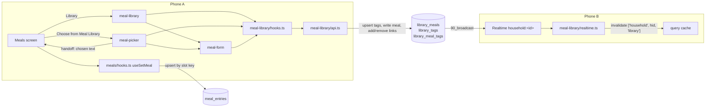
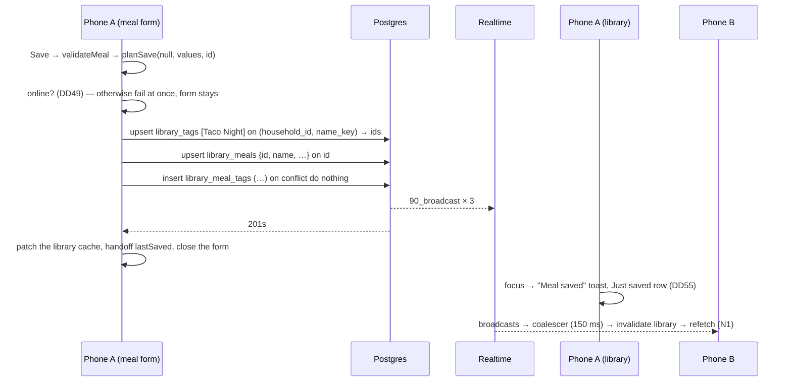

# Kitchin Meal Library — Design Document

> **Phase 2 of 4** in the EARS spec-driven process: 1-requirements → **2-design** → 3-tasks → 4-test-plan.
> **Status:** Approved by the owner, 2026-10-19, including DD43–DD60 and the 45.7 amendment. Implements [1-requirements.md](./1-requirements.md), also approved 2026-10-19.

## 1. Overview

The Meal Library adds three tables, one feature module, three routes and two buttons in Meals. It reuses everything else in [`specs/mvp/2-design.md`](../mvp/2-design.md) and [`specs/meals/2-design.md`](../meals/2-design.md) unchanged:

- household isolation through grants, RLS and the shared triggers (MVP §4.1–§4.4)
- the generic broadcast trigger and the household channel (MVP §3.6, §4.5)
- the query client, mutation scopes and error classification (MVP §3.5.3, §3.7, §3.8)
- reporting and the scrubber (MVP §3.9)
- the theme, UI primitives, keyboard toolbar and toasts (MVP §3.10)
- the meals slot editor and its save rules (meals §3.5)

Four ideas run through the design:

1. **A save is a plan of idempotent writes.** The form turns the member's changes into a plan: new tags, then the meal, then the tag links added and removed. Each write can be repeated safely, so Retry repeats the whole plan and a lost reply never leaves a duplicate (46.4). There's no RPC, and the structural test that forbids functions in `public` stays as it is (Constraint 3).
2. **Copy, never link.** Choosing a meal hands its text to Meals, which saves it through the existing slot mutation. Nothing in `meal_entries` knows the library exists (K19, 47.7).
3. **One browser, two screens.** The library and the picker are the same list, search and tag filter. They differ only in what a tap does and in the header (N29).
4. **Household content never travels in a route.** Route params carry IDs, dates and meal types. Text such as a search to start a name from goes through an in-memory hand-off (§3.6).

**Numbering** continues from meals and app-deploy: decisions start at **DD43**, open items at **OI-20** and tasks at **15**.

### 1.1 Inputs

Decisions K1–K27 in the requirements, DD1–DD22 in the MVP design, DD23–DD36 in the meals design and DD37–DD42 in the app-deploy spec are inputs to this design and aren't revisited here.

### 1.2 Design Decisions

This table settles the requirements' Open Items for Design Phase. **Approving this document approves these decisions.** ★ marks a decision that's expensive to reverse.

| # | Decision | Choice | Why | Req |
|---|---|---|---|---|
| DD43 ★ (OI 5) | Tables | `library_meals`, `library_tags` and `library_meal_tags`. The link table has its own `id` and the audit columns, like every household table | The `library_` prefix can't be confused with `meal_entries`. The shared audit trigger and the structural tests apply unchanged | 47.1, N30 |
| DD44 ★ (OI 5) | Normalized tag name | A stored generated column, `name_key = lower(regexp_replace(name, '\s+', ' ', 'g'))`, unique per household. The app's `tagKey` mirrors it | The database enforces 47.4 for any caller, and the key can't drift from the name (finding 1) | 43.5, 47.4 |
| DD45 | Creating tags | New tags are upserted on `(household_id, name_key)`. A trigger keeps a tag's first spelling and rejects a change to its key, so the upsert returns the existing tag's ID and name | Two members creating "Taco Night" at once both get the one tag (46.8). Renaming is out of scope (K22) and now impossible through the API too | 43.5, 43.11, 46.8 |
| DD46 ★ (OI 3) | Saving a meal | Ordered, idempotent writes with no RPC: upsert new tags, then write the meal, then add and remove tag links. A new meal gets a phone-generated ID and is upserted on `id` with every field. An edit updates only changed fields and checks that a row came back. Links are added with `on conflict do nothing` and removed by pair | Every step can be repeated, so Retry finishes a partial save (46.4). DB-S-11 keeps `public` free of functions | 42.9–42.11, 46.4–46.7 |
| DD47 (OI 4) | Starter tags | `private.add_starter_tags(uuid)` adds the seven tags, skipping any that exist. The migration runs it for every household, and `provision_household` calls it for new ones | `groceries_init` replaced `provision_household` the same way to add the grocery list. No trigger on a core table | 43.8, amends R23.2 |
| DD48 | Grants | Meals: `select, insert, update, delete`. Tags: `select, insert, update`, with no `delete`. Links: `select, insert, delete`, with no `update` | Least privilege: the app never deletes a tag (43.11) and never changes a link | 47.1, 47.6 |
| DD49 (OI 10) | Library mutations | Not optimistic. `networkMode: 'always'`, `retry: false`, and a check of the online manager before anything is sent, so an offline save fails at once. One mutation scope per household, `library:<hid>` | K24 and 46.2–46.3. The scope keeps two saves in the order they were made | 42.8, 46.2, 46.3 |
| DD50 (OI 1) | Routes | `meal-library`, a pushed card with Back to Meals. `meal-form`, a full-screen modal. `meal-picker`, a page-sheet modal over Meals. The form presents over the picker when opened from it | Native presentations, no custom navigator. The form is full screen as 42.1 asks, so only Cancel can close it | 40.2, 42.1, 45.2, 45.8 |
| DD51 | Hand-offs between screens | `handoff.ts` holds three in-memory values: the name to start a new meal with, the meal just saved or deleted, and the meal chosen for a slot. Each carries a one-time ID so it's applied once | Route params never carry household content (idea 4). Toasts and the Just saved row show on the screen the member returns to | 42.6, 42.9, 44.3, 45.3 |
| DD52 (OI 2) | Choosing a meal | Opening the picker closes the slot's editor, which saves its draft (32.3), as opening Add to groceries does. When Meals regains focus, it saves the chosen text with `useSetMeal` and reopens that slot's editor. Closing the picker without choosing reopens the editor too | Uses the existing editor and save path unchanged. Meals stays mounted, so its toasts can report a failed save (35.5) | 45.3–45.7 |
| DD53 (OI 7) | Browser and filter | One `MealBrowser`: a search field, a collapsed Filter by tags row that expands in place to chips, Clear filters, and a virtualized list | No sheet and no state to pass back. Compact until opened (41.3) | 41, 45.2, N29 |
| DD54 (OI 6) | Search and order | Search folds both sides with `normalize('NFD')`, removes U+0300–U+036F and lower-cases, then checks "contains". Order uses one cached `Intl.Collator(undefined, { sensitivity: 'base', numeric: true })`, then exact text, then ID | Hermes on iOS normalizes through CoreFoundation and collates through Foundation with the device locale (finding 2). The tie-breaks make the order stable | 41.1, 40.4, K25 |
| DD55 (OI 9) | Showing a meal just saved | A "Just saved" row at the top of the list shows the meal that was just saved, whatever the search and tags, until the member changes the search or tags or leaves the screen. The meal also sits in its usual place | No scrolling to a row of unknown height, and the member's filters stay as they were | 42.9, 45.9 |
| DD56 | Field limits in the form | `maxLength` set to the field's UTF-16 length plus the characters it has left, recomputed on each change, with the value clamped again on save | The approach meals OI-16 recommends: native input stops at the limit, so there's no flicker or cursor jump. If the owner settles OI-16 differently, the form follows the same choice | 42.3 |
| DD57 | Terracotta controls | `Chip` and `Button` gain an optional `tone: 'accent'`. Selected tag chips are terracotta with bold white text and a leading ✓. Tag pills in the list are ink on `accentSoft` | Meals' colour (40.12). The ✓ marks selection by more than colour (43.1, N13). Existing callers keep cactus | 40.12, 43.1 |
| DD58 | Rejected values | `classifyError` also keeps a CHECK constraint's name for `23514`, as it already does for a unique constraint's name for `23505`. The form maps the constraint to its field | 42.10 asks for the message at the field. A constraint name holds no row content | 42.10, 14.4 |
| DD59 | Loading | One query, `['household', hid, 'library']`, fetches tags and meals in parallel, each meal with its link tag IDs embedded, in pages of 1,000. `gcTime: Infinity` | A list under the API's 1,000-row cap could otherwise be cut short without warning (finding 5). The picker shows a library loaded earlier immediately (45.11) | 40.3, 45.11, 46.1 |
| DD60 (OI 8) | Toasts | The library and the picker each have their own `ToastProvider placement="top"`, as Meals does (meals DD35). The form shows failures in an inline box with Retry instead of a toast | Both screens have a search field, so a bottom toast would sit under the keyboard. A failure in the form must stay until the member acts (42.10) | 42.9, 42.10, 44.3 |

### 1.3 Research Findings

These were checked on 2026-10-19 against the installed stack: Expo SDK 58.0.14, Expo Router 58.0.23, React Native 0.88.0, react-native-screens 4.30.0, Hermes V1 (`hermes-engine` 260318099.0.4), Postgres 17 on the local Supabase stack, and `postgrest-js` 2.118.0.

1. **The schema holds under RLS and the shared triggers.** A probe ran the §4 tables, triggers, grants and policies on the local stack in one transaction that was rolled back:
   - `lower(text)` and `regexp_replace(text, text, text, text)` are immutable, so the generated `name_key` column is accepted. `lower` handles non-ASCII letters ("ÉCLAIR" → "éclair").
   - The backfill added seven tags to each household, unattributed. Running it again added none.
   - Upserting "quick  &  EASY" and "Taco Night" on `(household_id, name_key)` as member A returned "Quick & Easy", the existing starter tag with its spelling unchanged, and created "Taco Night". Upserting "TACO   night" as B returned "Taco Night". One row each.
   - Two rows with the same key in one upsert failed with `21000` ("cannot affect row a second time"), so the app sends each key once.
   - A plain update that renamed a tag failed the name trigger (`42501`). One that only changed case was accepted, but the name stayed as first spelled. A plain duplicate insert failed `library_tags_one_per_name` (`23505`).
   - Tag names with a leading space, a line feed, U+2028, 31 characters, or nothing at all failed `library_tags_name_check` (`23514`).
   - Member C's upsert or insert into Household One failed RLS (`42501`). C saw none of Household One's tags.
   - A new meal upserted on `id` as A, then the same ID upserted again as B with other text, left one row with B's text, `created_by` A and `updated_by` B. C upserting that ID failed RLS whether C named Household Two or Household One. C's update and delete of it affected 0 rows.
   - A's update of one field returned 1 row. An update of an ID that doesn't exist returned 0, which is how the app detects a meal deleted elsewhere (46.7).
   - A 100-character name of `é` and a description with a line break were accepted. A name with CR LF, 101 characters, an empty description, and 2,001 characters of ingredients failed their checks (`23514`).
   - Adding two links, then repeating one with `on conflict do nothing`, left 2 links. A link from a Household One meal to a Household Two tag failed the composite foreign key (`23503`), even as `postgres`, which bypasses RLS.
   - A's update of a link and delete of a tag both failed for lack of a grant (`42501`).
   - Deleting a tag, as `postgres`, removed its link and kept the meal. A's delete of the meal returned 1 row and removed its links but no tag. A second delete returned 0 rows without an error.
   - The writes produced 22 broadcasts on Household One's topic.
2. **Strings on Hermes V1 (iOS).** Hermes builds its Unicode support on CoreFoundation on Apple platforms ([`PlatformUnicodeCF.cpp`](https://github.com/facebook/hermes/blob/hermes-v260318099.0.4/lib/Platform/Unicode/PlatformUnicodeCF.cpp)):
   - `String.prototype.normalize` calls `CFStringNormalize` for all four forms, so `'jalapeño'.normalize('NFD')` splits off the combining tilde.
   - `Intl.Collator` compares with `-[NSString compare:options:range:locale:]` ([`PlatformIntlApple.mm`](https://github.com/facebook/hermes/blob/hermes-v260318099.0.4/lib/Platform/Intl/PlatformIntlApple.mm)). `sensitivity: 'base'` maps to `NSDiacriticInsensitiveSearch | NSCaseInsensitiveSearch`, and `numeric: true` to `NSNumericSearch`.
   - Jest runs on Node's ICU, so it proves the logic but not the engine. OI-22 checks it on a phone.
3. **Discarding changes.** Expo Router 58 exports `usePreventRemove`. Its native stack passes the prevention to react-native-screens as `preventNativeDismiss` and reports a blocked swipe through `onNativeDismissCancelled` (`NativeStackView.native.js`). So a blocked Cancel, or a blocked swipe on a sheet, both reach the same callback.
4. **Routes in error reports.** Sentry's navigation breadcrumbs keep `from`, `to` and `pathname` with query strings removed (`sentry-scrub.ts`). The library's routes carry only IDs, dates and meal types anyway (DD51), so nothing more needs scrubbing.
5. **The API caps responses at 1,000 rows** (`max_rows` in `supabase/config.toml`, the same in production), without an error. Embedded links count toward their parent row, not toward the cap.
6. **Contrast**, measured with WCAG 2.x relative luminance:
   - `ink` on `accentSoft` (tag pills): 10.50
   - `onBrand` on `accent` (selected chips, primary buttons): 3.53, bold only
   - `accent` on `background` (Library, Add meal, Save, Choose from Meal Library): 3.53, bold only
   - `destructive` on `background` (Delete meal): 4.77
7. **Clamping a controlled field.** Meals OI-16 found that clamping in `onChangeText` flickers and moves the cursor at the limit on iOS, and that native `maxLength` doesn't. DD56 uses `maxLength` sized from the code points left, which stops plain text exactly at the limit. A pasted run of emoji may stop about half-way, which is stricter than 42.3 and accepted, as OI-16 describes.

### 1.4 Requirement Amendments

This was found during design and is written into 1-requirements as *(changed during design)*. Approving this design approves it.

| Item | Change | Reason |
|---|---|---|
| 45.7 | "WHEN the member closes the picker without choosing THEN the app SHALL return to the slot as it was when the picker opened, with its editor open. Text typed before the picker opened SHALL be kept; it's saved when the picker opens, as when the member moves to another slot (32.3)." It previously said the text stays unsaved | Opening a screen over Meals closes the slot's editor and saves it, as Add to groceries already does (meals §3.5). Keeping an unsaved draft alive across a modal would need a second save path (DD52) |

The amendments listed in 1-requirements (the MVP glossary, 11.2, 13.2, 14.1, 23.2, 26.4, and the meals out-of-scope lines and N24) are written into `specs/mvp/1-requirements.md` and `specs/meals/1-requirements.md` when this design is approved. DD47 confirms the 23.2 amendment: provisioning also creates the starter tags.

### 1.5 Changes to Existing Files

N30 allows changes to existing features only for the Library button, the Choose button and provisioning. These are the existing files that change. None is a core table, a policy or grocery code.

| File | Change | Why |
|---|---|---|
| `src/app/(app)/_layout.tsx` | Add the three routes (§3.8–§3.10). `TABLE_HANDLERS` adds `libraryTableHandlers` | DD50, 46.1 |
| `src/app/(app)/(tabs)/_layout.tsx` | Meals gets `headerLeft`: the Library button | 40.1 |
| `src/app/(app)/(tabs)/meals.tsx` | Pass the Choose action to the editor, push the picker, and apply a chosen meal when Meals regains focus | DD52, 45 |
| `src/features/meals/components/slot-editor.tsx` | An optional `onChooseFromLibrary` prop, which shows "Choose from Meal Library" beside Clear | 45.1 |
| `src/ui/chip.tsx`, `src/ui/button.tsx` and their tests | An optional `tone: 'accent'`. The default stays cactus | DD57 |
| `src/ui/theme.ts`, `theme.test.ts` | `TEXT_PAIRS` adds `ink` on `accentSoft` | DD57, N13 |
| `src/lib/errors.ts`, `errors.test.ts` | Keep a CHECK constraint's name for `23514` | DD58 |
| `jest.config.js` | Put `src/features/meal-library/hooks.ts` in the 90/85 group. Its `domain.ts` and `api.ts` already match the existing globs | As meals |
| `supabase/tests/database/00_structure.test.sql` | Add the library grants. DB-S-09 needs no change: the new private functions grant nothing to `authenticated` | §4.3 |
| `supabase/tests/database/30_realtime.test.sql` | Broadcast cases for the three tables | 47.1 |
| `supabase/tests/database/40_provisioning.test.sql` | A provisioned household has the seven starter tags, and a failed provisioning leaves none | 43.8, R23.3 |
| `supabase/seed/10_seed_data.sql` | A few meals with tags per household | §4.6 |
| `scripts/provision-household.sql` | The comment adds "and its starter tags". The call doesn't change | R23.2 as amended |
| `src/test/factories.ts` | `makeLibraryMeal` and `makeLibraryTag` | §7 |
| `src/types/database.ts` | Regenerated | R27.2 |
| `src/__tests__/meals.test.tsx`, `routing.test.tsx` | The Library and Choose buttons, and the new routes | 40.1, 45.1 |

---

## 2. Architecture

### 2.1 Where the Library Fits



The household channel, coalescer and query client are the MVP's. The library registers one handler for its three tables. The only path from the library into a plan is the chosen text, saved by Meals' own mutation.

### 2.2 Repository Layout

New files:

```
src/
  features/
    meal-library/
      constants.ts                    # limits, starter tags, copy (§3.1)
      domain.ts   domain.test.ts      # rows, search, order, tags, validation, save plans (§3.2)
      api.ts      api.test.ts         # fetch, tag upsert, meal and link writes, delete (§3.3)
      hooks.ts    hooks.test.tsx      # library query, save and delete mutations (§3.4)
      realtime.ts realtime.test.ts    # table handler (§3.5)
      handoff.ts  handoff.test.ts     # in-memory hand-offs between screens (§3.6)
      components/
        library-button.tsx  meal-browser.tsx  search-field.tsx  tag-filter.tsx
        meal-row.tsx  tag-pill.tsx  tag-chip.tsx  tag-picker.tsx  meal-form.tsx
        form-error.tsx  library-states.tsx
        *.test.tsx
  app/(app)/
    meal-library.tsx                  # the Meal Library (§3.8)
    meal-form.tsx                     # add or edit a meal (§3.9)
    meal-picker.tsx                   # choose a meal for a slot (§3.10)
  __tests__/meal-library.test.tsx     # route tests for all three
supabase/
  migrations/<ts>_meal_library_init.sql   # §4
  tests/database/60_meal_library.test.sql
```

### 2.3 Key Flows

#### Save a new meal with a new tag on phone A; it appears on phone B



#### Choose a meal for Thursday dinner

1. Thursday dinner's editor is open with "Pasta", typed but not yet saved. The member taps Choose from Meal Library.
2. Meals records `returning = Thursday dinner` and pushes `/meal-picker?date=2026-10-22&mealType=dinner`. Meals loses focus, so its focus cleanup closes the editor, which saves "Pasta" (32.3, 45.7).
3. The picker shows the library. The member taps "Tacos" (description "Beef, corn tortillas"). The picker sets the pick hand-off to `{ date, mealType, text: "Tacos\nBeef, corn tortillas" }` and goes back.
4. Meals regains focus. It takes the pick for Thursday dinner, sees that the slot's text differs, and calls `setMeal` with it. The slot shows the text at once (12.1). Meals reopens Thursday dinner's editor, which starts from the new text, and VoiceOver announces "Thursday dinner: Tacos" (45.3).
5. The member adds "— no cheese" and taps Done. The editor saves as usual (45.5).

Had the member closed the picker instead, step 4 would only reopen the editor, showing "Pasta" (45.7).

#### Add a meal from the picker

1. In the picker, the member searches "lasag", finds nothing and taps "+ Add new meal". The picker sets the name hand-off to "lasag" and pushes `/meal-form`, which opens full screen over the picker with Name "lasag" (42.6).
2. The member finishes the name, "Lasagna", and taps Save. On success the form sets `lastSaved` and closes.
3. The picker regains focus. It shows "Meal saved" and a Just saved row with Lasagna at the top, above the search's results (45.9, DD55). The member taps it, and the flow continues at step 3 above.

#### Both members edit one meal

1. A and B open Tacos, with tags Dinner. A adds Quick & Easy. B changes the description.
2. A's plan adds one link. B's plan updates only `description`. Both land, and both phones converge on the new description with both tags (46.5).
3. Had both changed the description, the later update would win (46.6).
4. Had B deleted Tacos first, A's update would return 0 rows. A's form would say "This meal was deleted on another device" and offer Save as new meal, which saves A's values under a new ID (46.7).

---

## 3. Components and Interfaces

### 3.1 `constants.ts`

```ts
/** The database's limits, in characters (K21, 47.2, 47.3). */
export const LIMITS = { name: 100, description: 300, ingredients: 2000, tag: 30 } as const;
/** The counter shows once fewer than this remain (42.3). */
export const COUNTER_FROM = { name: 20, description: 50, ingredients: 50 } as const;

/** What `private.add_starter_tags` creates (43.8). The database owns them; tests and the seed check this list. */
export const STARTER_TAGS = ['Quick & Easy', 'Family Favorite', 'High Protein', 'Breakfast', 'Lunch',
                             'Dinner', 'Meal Prep'] as const;

export const COPY = {
  title: 'Meal Library',                       // 40.2
  libraryButton: 'Library',                    // 40.1
  search: 'Search meals',                      // 41.1
  filter: 'Filter by tags',                    // 41.2
  clearFilters: 'Clear filters',               // 41.7
  addMeal: 'Add meal',                         // 40.6
  addNewMeal: '+ Add new meal',                // 45.8
  choose: 'Choose from Meal Library',          // 45.1
  emptyTitle: 'No saved meals yet',            // 40.9
  emptyBody: 'Save the meals you make often, then choose them when you plan the week.',
  noMatch: 'No meals match',                   // 41.8
  loadError: "Couldn't load meals",            // 40.10
  justSaved: 'Just saved',                     // DD55
  saved: 'Meal saved',                         // 42.9
  deleted: 'Meal deleted',                     // 44.3
  nameRequired: 'Enter a meal name',           // 42.5
  fieldRejected: "This couldn't be saved. Check it and try again.", // 42.10, DD58
  offline: "You're offline. Try again when you're connected",       // 46.3
  saveError: "Couldn't save this meal",        // 42.10
  deleteError: "Couldn't delete this meal",    // 44.4
  deletedElsewhere: 'This meal was deleted on another device', // 46.7
  saveAsNew: 'Save as new meal',               // 46.7
  discardTitle: 'Discard changes?',            // 42.12
  deleteTitle: (name: string) => `Delete “${name}”?`,                       // 44.2
  deleteBody: "It's removed from the library. Meals already planned won't change.",
} as const;
```

### 3.2 `domain.ts`

Pure functions, under the existing `domain.ts` lint rule: no React, React Native, Supabase or TanStack imports.

```ts
export interface Tag { id: string; name: string; key: string }
export interface Meal {
  id: string; name: string; description: string | null; ingredients: string | null;
  tagIds: string[];        // alphabetical by tag name (40.4)
  searchKey: string;       // foldForSearch(name), computed once per load (N25)
  updatedAt: string;
}
export interface Library { meals: Meal[]; tags: Tag[]; tagsById: ReadonlyMap<string, Tag> }

/** Rows as api.ts selects them. The parse functions check them at runtime (14.8). */
export type MealRow = Pick<Tables<'library_meals'>, 'id' | 'name' | 'description' | 'ingredients' | 'updated_at'>
  & { library_meal_tags: { tag_id: string }[] };
export type TagRow = Pick<Tables<'library_tags'>, 'id' | 'name' | 'name_key'>;

export function buildLibrary(meals: MealRow[], tags: TagRow[]): { library: Library; reportKeys: string[] };
//   parses every row; a bad row is left out and named in reportKeys (46.9); links to an unknown tag are
//   dropped, since a tag created moments ago arrives with the next refetch; sorts both lists (K25)

// Text rules
export function charLength(s: string): number;            // code points, as Postgres char_length (32.5)
export function clampTo(s: string, max: number): string;   // the first `max` code points
export function maxLengthFor(s: string, max: number): number; // s.length + (max - charLength(s)), DD56
export function charactersLeft(s: string, max: number, from: number): number | null;
export function trimField(s: string): string;              // trim() plus U+0085 (meals finding 6)
export function oneLine(s: string): string;                // CR, LF, U+0085, U+2028, U+2029 → space (42.2)
export function cleanTagName(s: string): string;           // trimField, then each whitespace run → ' '
export function tagKey(s: string): string;                 // cleanTagName(s).toLowerCase(), as name_key (DD44)

// Search and order (DD54)
export function foldForSearch(s: string): string;          // NFD, strip U+0300–U+036F, toLowerCase, trim
export function compareNames(a: { name: string; id: string }, b: { name: string; id: string }): number;
export function filterMeals(meals: Meal[], f: { query: string; tagIds: ReadonlySet<string> }): Meal[];
//   a meal shows if its searchKey contains foldForSearch(query) and it has every tag in tagIds (41.4–41.6)

// Choosing (K20)
export function copiedText(meal: Pick<Meal, 'name' | 'description'>): string;
//   name, or name + '\n' + description. At most 401 characters, inside ENTRY_MAX (K21)

// The form
export type TagChoice = { kind: 'existing'; id: string } | { kind: 'new'; name: string };
export interface FormValues { name: string; description: string; ingredients: string; tags: TagChoice[] }
export function formValuesOf(meal: Meal | null, prefill?: string): FormValues; // 42.6, 42.7
export function addTypedTag(values: FormValues, tags: Tag[], typed: string):
  { values: FormValues; result: 'added' | 'selected-existing' | 'already-selected' | 'empty' };
//   43.4–43.6: matches by tagKey against household tags, then against new tags in this form
export function isDirty(initial: FormValues, current: FormValues): boolean;          // 42.12

export type FormField = 'name' | 'description' | 'ingredients' | 'tags';
export interface CleanMeal { name: string; description: string | null; ingredients: string | null; tags: TagChoice[] }
export function validateMeal(v: FormValues):
  { ok: true; meal: CleanMeal } | { ok: false; field: FormField; message: string };
//   trims every field (42.4); an empty name → nameRequired (42.5); over a limit → "Shorten this to N characters"

export interface SavePlan {
  newTags: string[];                                    // clean names, one per key (finding 1, 21000)
  meal:
    | { kind: 'upsert'; row: { id: string } & Omit<CleanMeal, 'tags'> }   // a new meal, or Save as new
    | { kind: 'update'; id: string; changes: Partial<Omit<CleanMeal, 'tags'>> }
    | { kind: 'check'; id: string };                    // an edit that changes only tags
  addTags: TagChoice[];
  removeTagIds: string[];
}
export function planSave(base: Meal | null, meal: CleanMeal, mealId: string): SavePlan | null;
//   null when an edit changes nothing (42.11). For an edit, fields and tags are compared with `base`,
//   the meal as it was when the form opened, so a change the other member made meanwhile is never
//   written back over (46.5, as meals DD27)

export function constraintField(constraint: string | undefined): FormField | null;   // DD58
//   library_meals_name_check → name, …_description_check → description, …_ingredients_check →
//   ingredients, library_tags_name_check → tags
```

`charLength`, `clampTo`, `trimField` and the counter rule repeat the one-line meals helpers instead of importing across features, as meals did with groceries. `foldForSearch` feature-detects `String.prototype.normalize` and falls back to `toLowerCase` alone, so a surprise on the device degrades to case-only matching instead of failing (OI-22).

### 3.3 `api.ts`

As in groceries and meals, every failure leaves through `toApiError(error, { table, operation, recordId? })`, so raw PostgREST text never reaches the hooks. The app never sends attribution or timestamps.

```ts
const MEALS = 'library_meals', TAGS = 'library_tags', LINKS = 'library_meal_tags';
const MEAL_COLUMNS = 'id, name, description, ingredients, updated_at, library_meal_tags(tag_id)';
const TAG_COLUMNS = 'id, name, name_key';
const PAGE = 1000;                                       // the API's max_rows (finding 5)

/** Every meal, with its tag IDs, and every tag, in pages of PAGE ordered by id (DD59). */
export function fetchLibrary(householdId: string): Promise<{ meals: MealRow[]; tags: TagRow[] }>;
//   from(MEALS).select(MEAL_COLUMNS).eq('household_id', hid).order('id').range(n, n + PAGE - 1) until a
//   page is short; the same for TAGS. Both run in parallel.

/** Creates tags that don't exist and returns all of them, as stored (DD45). */
export function upsertTags(householdId: string, names: string[]): Promise<TagRow[]>;
//   from(TAGS).upsert(names.map(name => ({ household_id, name })), { onConflict: 'household_id,name_key' })
//             .select(TAG_COLUMNS)

/** A new meal, or a repeat of that save (DD46). */
export function upsertMeal(householdId: string, row: Extract<SavePlan['meal'], { kind: 'upsert' }>['row']): Promise<void>;
//   from(MEALS).upsert({ id, household_id, name, description, ingredients }, { onConflict: 'id' })

/** Changes only the given fields. 'missing' when no row came back: deleted, or never visible (46.7). */
export function updateMeal(id: string, changes: object): Promise<'updated' | 'missing'>;
//   from(MEALS).update(changes).eq('id', id).select('id')
export function mealExists(id: string): Promise<boolean>;
//   from(MEALS).select('id').eq('id', id)

export function addTagLinks(householdId: string, mealId: string, tagIds: string[]): Promise<void>;
//   from(LINKS).upsert(rows, { onConflict: 'meal_id,tag_id', ignoreDuplicates: true })
export function removeTagLinks(mealId: string, tagIds: string[]): Promise<void>;
//   from(LINKS).delete().eq('meal_id', mealId).in('tag_id', tagIds)

/** Deleting a meal that's already gone still succeeds (44.5). Links go with it (47.6). */
export function deleteMeal(id: string): Promise<void>;
//   from(MEALS).delete().eq('id', id)
```

**Running a plan** (`runSavePlan(hid, plan)`, also in `api.ts`):

1. If `newTags` isn't empty, `upsertTags` it. Map each returned row's `name_key` to its ID. If a new tag's `tagKey` matches no returned key, throw `ApiError('server', { operation: 'tag_key_mismatch' })`. That can only happen if JavaScript and Postgres lower-case a character differently, and it's reported.
2. `upsert` → `upsertMeal`. `update` with changes → `updateMeal`, and `'missing'` throws `ApiError('not_found', …)`. `update` without changes, and `check` → `mealExists`, which throws the same if it's false.
3. `addTagLinks` with the existing IDs and the IDs from step 1, if any.
4. `removeTagLinks`, if any.

Each step is safe to repeat, and the order means a link never points at a meal or tag that isn't there yet. A failure stops the run. Retry runs the same plan again from step 1 (46.4).

### 3.4 `hooks.ts`

```ts
export const libraryKeys = { all: (hid: string) => ['household', hid, 'library'] as const };
const mutationKey = (hid: string) => ['library-mutation', hid] as const;
const scope = (hid: string) => ({ id: `library:${hid}` });                  // DD49

export interface LibraryView {
  library: Library;                                   // empty until loaded
  status: 'loading' | 'ready' | 'error' | 'waiting';  // as MealWeek (40.8, 40.10, 13.1)
  refetch(): Promise<void>;                           // pull to refresh (40.11)
  refreshFailedAt: number | null;                     // a failed reload while data is shown (40.10)
}
export function useLibrary(): LibraryView;

export type SaveOutcome =
  | { ok: true; mealId: string }
  | { ok: false; reason: 'offline' | 'deleted' | 'forbidden' | 'failed' }
  | { ok: false; reason: 'invalid'; field: FormField | null };
export function useSaveMeal(): (v: { base: Meal | null; meal: CleanMeal; mealId: string }) => Promise<SaveOutcome>;

export type DeleteOutcome = { ok: true } | { ok: false; reason: 'offline' | 'forbidden' | 'failed' };
export function useDeleteMeal(): (id: string) => Promise<DeleteOutcome>;
```

**`useLibrary`:** `gcTime: Infinity` (DD59, 45.11). `select` runs `buildLibrary`, and each report key is sent once with `reportOnce('invalid_library_row:<table>:<id>:<field>')` (46.9, 14.8). Status and the refresh-failed signal work as in `useMealWeek`.

**`useSaveMeal`** and **`useDeleteMeal`** share these options and phases:

| Phase | Behaviour |
|---|---|
| Options | `mutationKey(hid)`, `scope(hid)`, `networkMode: 'always'` and `retry: false` (DD49) |
| `mutationFn` | If `onlineManager.isOnline()` is false, throw `ApiError('network', { operation: 'offline' })` before sending anything (46.3). Otherwise `planSave` and `runSavePlan`, or `deleteMeal` |
| `onSuccess` | Patch the cached library: put the saved meal, with its resolved tag IDs, and any new tags in place, re-sorted, or remove the deleted meal. The form closes on a library that already shows the change (42.9, 44.3) |
| `onError` | Report if the category is reportable. Nothing is undone, because nothing was shown early (46.2) |
| `onSettled` | If this is the last pending library mutation, invalidate `libraryKeys.all(hid)` (12.6) |

The returned function calls `mutateAsync` and maps the error to an outcome. The form shows the outcome itself (§3.9), so the hooks show no toasts.

| Error | Outcome |
|---|---|
| `network` (offline, or the connection dropped mid-save) | `offline` |
| `not_found` from step 2 | `deleted` (46.7) |
| `forbidden` | `forbidden` |
| `validation` | `invalid`, with `constraintField(meta.constraint)` (DD58) |
| anything else | `failed` |

A delete that affects no row is a success (44.5), so a delete has no `deleted` outcome.

### 3.5 `realtime.ts`

```ts
export function onLibraryTableChange(qc: QueryClient, hid: string): void {
  // A save in progress refetches when it settles; a refetch now could show it half done (11.5).
  if (qc.isMutating({ mutationKey: ['library-mutation'] }) > 0) return;
  void qc.invalidateQueries({ queryKey: libraryKeys.all(hid) });
}
export const libraryTableHandlers: TableHandlers = {
  library_meals: onLibraryTableChange,
  library_tags: onLibraryTableChange,
  library_meal_tags: onLibraryTableChange,
};
```

The coalescer runs a handler listed for several tables once per flush, so a save that touches all three tables refetches once (11.4). Deleting a meal cascades to its links, and each deleted link broadcasts. The coalescer folds those into the same single refetch.

### 3.6 `handoff.ts`

```ts
export interface Handoff<T> {
  set(value: T): void;
  read(): { id: number; value: T } | null;   // doesn't consume
  clear(): void;
}
export const newMealName: Handoff<string>;                                       // 42.6
export const lastSaved:   Handoff<{ mealId: string; kind: 'saved' | 'deleted' }>; // 42.9, 44.3
export const mealPick:    Handoff<{ date: IsoDate; mealType: MealType; text: string }>; // 45.3
```

Each `set` gets a new `id`. A reader remembers the last `id` it applied in a ref and ignores a repeat, so React's development double-invoke, or a second focus event, can't apply one twice. Readers clear what they've applied. The values live in memory only and never reach storage, routes or reports (26.4).

- **`newMealName`.** The library and the picker set it from the search field, or clear it, just before they push `/meal-form`. The form reads it once in its initial state (42.6).
- **`lastSaved`.** The form sets it after a successful save or delete. The library or picker reads it when it regains focus, shows "Meal saved" or "Meal deleted", and for a save shows the Just saved row (DD55).
- **`mealPick`.** The picker sets it when the member chooses, then goes back. Meals reads it when it regains focus (§3.11).

### 3.7 Components

| Component | Renders | Notes |
|---|---|---|
| `LibraryButton` | "Library", bold terracotta, in the Meals header | 44 × 44 pt. VoiceOver label "Meal Library" (40.1) |
| `MealBrowser` | `SearchField`, `TagFilter`, Clear filters, the list and its states, and an optional header slot | Used by the library and the picker (N29). Holds the search and selected tags in local state (41.9) |
| `SearchField` | A field with a magnifying glass, placeholder "Search meals" and the native clear button | `accessibilityLabel` "Search meals". Return dismisses the keyboard |
| `TagFilter` | Collapsed: "Filter by tags" with the count, then the selected names. Expanded: every tag as a `TagChip`, and Done | `accessibilityState.expanded`. Read as "Filter by tags, 2 selected" (N27) |
| `MealRow` | The name, then the tags as `TagPill`s | A `Pressable` of at least 44 pt. Read as "Tacos. Tags: Dinner, Quick & Easy" (N27). Memoised |
| `TagPill` | A tag name, `ink` on `accentSoft` | Not interactive. Wraps (40.5) |
| `TagChip` | `Chip` with `tone: 'accent'`, and "✓ " before the name when selected | VoiceOver reads the name without the ✓, plus "selected" from `accessibilityState` (43.1) |
| `TagPicker` | The form's tag chips, then "＋ New tag", which opens an inline field and Add | 43.1–43.6. Announces "Added Taco Night" or "Selected Dinner" |
| `MealForm` | The four fields, counters, `TagPicker`, `FormError` and, when editing, Delete meal | §3.9 |
| `FormError` | A message, with Retry or Save as new meal when they apply | `accessibilityLiveRegion`, and announced when it appears |
| `LibraryStates` | `SkeletonRows`, `LoadError`, `WaitingForConnection`, `EmptyLibrary` and `NoMatch` | The grocery and meals states' layout with library copy |

None of them touches Supabase. `testID`s hold only static parts and IDs: `library-search`, `library-filter`, `library-clear-filters`, `library-list`, `library-just-saved`, `meal-row-<id>`, `tag-chip-<id>`, `meal-form-name`, `meal-form-save`, `meal-form-delete`, `slot-choose`. None contains household text (26.7).

### 3.8 Meal Library Screen (`src/app/(app)/meal-library.tsx`)

```
┌──────────────────────────────────────┐
│ ‹ Meals       Meal Library  Add meal │  native header; Add meal bold terracotta (40.6)
├──────────────────────────────────────┤
│ Offline — changes will send when …   │  banner only while offline (13.1)
│ ┌🔍 Search meals ─────────────────┐  │  41.1
│ └─────────────────────────────────┘  │
│ Filter by tags · 2 ▾   Clear filters │  41.2, 41.3, 41.7
│ Dinner, Quick & Easy                 │  which tags (41.3)
│ JUST SAVED                           │  DD55, after a save only
│ ┌ Chicken tacos ──────────────────┐  │
│ │ [Dinner] [Quick & Easy]         │  │
│ └─────────────────────────────────┘  │
│ ┌ Beef stew ──────────────────────┐  │  alphabetical (40.4)
│ │ [Dinner] [Family Favorite]      │  │
│ └─────────────────────────────────┘  │
└──────────────────────────────────────┘
```

- **Route options.** In `(app)/_layout.tsx`: `{ title: 'Meal Library', headerBackTitle: 'Meals' }`. The screen sets `headerRight` to Add meal. Meals stays mounted underneath, so Back returns to the same week and scroll position (40.2).
- **Structure.** `<ToastProvider placement="top"><Screen edges={['left', 'right', 'bottom']}><MealBrowser … /></Screen></ToastProvider>` (DD60). Tapping a row pushes `/meal-form?id=<id>` (40.7). Add meal sets `newMealName` from the search, or clears it, and pushes `/meal-form` (42.6).
- **List.** A `FlatList` keyed by ID, with memoised rows, `keyboardShouldPersistTaps="handled"`, `keyboardDismissMode="on-drag"` and a `RefreshControl` (40.11). The root keyboard toolbar shows over it, as on the other card screens.
- **Focus.** On focus, the screen reads `lastSaved`: "Meal saved" with the Just saved row, or "Meal deleted" (42.9, 44.3).
- **States.**

  | Library state | Shows | Requirement |
  |---|---|---|
  | First load | `SkeletonRows` | 40.8 |
  | Error with nothing cached | `LoadError` with Retry | 40.10 |
  | Error with the library cached | The list, plus a "Couldn't load meals" toast with Retry | 40.10 |
  | Paused with nothing cached (offline) | The banner, and "Waiting for connection…" | 13.1 |
  | Ready with no meals | `EmptyLibrary`: "No saved meals yet", the sentence and Add meal. The search and filter are hidden | 40.9 |
  | Ready, nothing matches | `NoMatch`: "No meals match" and Clear filters, below the search and filter | 41.8 |
  | Ready | The list | 40.3 |

### 3.9 Meal Form (`src/app/(app)/meal-form.tsx`)

```
┌──────────────────────────────────────┐
│ Cancel         New meal         Save │  Save bold terracotta; a spinner while saving (42.8)
├──────────────────────────────────────┤
│ ⚠ You're offline. Try again …  Retry │  FormError, only after a failure (42.10)
│ Name                                 │
│ ┌ Lasagna ────────────────────────┐  │  one line (42.2)
│ Description (optional)               │
│ ┌ Beef and ricotta ───────────────┐  │  multi-line
│ Ingredients (optional)               │
│ ┌ 1 lb ground beef ───────────────┐  │  multi-line, "One per line" placeholder
│ │ 1 box lasagna noodles           │  │
│ Tags                                 │
│ [✓ Dinner] [Family Favorite] [High   │  TagChips, alphabetical (43.10)
│  Protein] … [＋ New tag]             │
│                                      │
│          [ Delete meal ]             │  editing only, destructive (44.1)
└──────────────────────────────────────┘
```

- **Route options.** `{ presentation: 'fullScreenModal' }`, with the native header. Params: `id`, present when editing. The screen sets the title, "New meal" or "Edit meal", `headerLeft` Cancel and `headerRight` Save (42.1).
- **Initial state.** `formValuesOf(meal, newMealName.read()?.value)`. A new meal gets its ID from `randomUUID()` (`expo-crypto`) now, so every Save from this form repeats the same upsert (DD46). The values are read once. Later changes to the meal from the other phone don't reach the fields (42.13).
- **Missing meal.** If `id` isn't in a loaded library, the form shows "This meal isn't in the library any more" with Close, and nothing else.
- **Fields.** `TextField`s inside a `FormScrollView`, with the form's own `KeyboardToolbar`, since the modal covers the root's. Name has `submitBehavior="submit"` and moves focus to Description. Each field's `onChangeText` applies `oneLine` (Name only) and `clampTo`, and its `maxLength` is `maxLengthFor(value, limit)` (DD56). The counter shows below a field per `charactersLeft` (42.3).
- **Save.**
  1. `validateMeal`. On failure, set that field's message, focus it, announce it, and stop (42.5).
  2. `planSave(base, meal, mealId)`. `null` means an unchanged edit: close without a write (42.11).
  3. Call `useSaveMeal`. Save shows a spinner, and Save and Cancel are disabled until it settles (42.8).
  4. `ok`: set `lastSaved`, turn off discard prevention, and go back in the next effect (42.9).
  5. Not `ok`: show `FormError` and keep every value (42.10):

     | Outcome | `FormError` |
     |---|---|
     | `offline` | `offline`, with Retry |
     | `invalid` with a field | `fieldRejected` at that field, and `saveError` without Retry |
     | `invalid` without a field | `saveError`, without Retry |
     | `forbidden` | "You don't have access to that", without Retry (14.3) |
     | `deleted` | `deletedElsewhere`, with Save as new meal (46.7) |
     | `failed` | `saveError`, with Retry |

     Retry saves again with the form's current values. Save as new meal makes a new ID and saves with `base = null`, so every field and tag is written.
- **Delete (44).** Delete meal opens a native alert with `deleteTitle(name)`, `deleteBody`, Cancel and a destructive Delete. On confirming, it calls `useDeleteMeal`. `ok`: set `lastSaved` to `deleted` and go back to the library. Not `ok`: `FormError` with `deleteError` and Retry, or the offline or forbidden message. The meal stays listed, because nothing was removed early (44.4).
- **Discard (42.12).** `usePreventRemove(isDirty(initial, current) && !leaving, …)` asks `discardTitle`, with Keep editing and a destructive Discard that repeats the blocked action. A full-screen modal has no swipe to dismiss, so Cancel is the only way out (finding 3).
- **Accessibility.** Each field is labelled by its `TextField` label. Counters are read as "12 characters left", announced when they first appear and at zero. Save, Cancel and Delete meal are buttons with their text as label.

### 3.10 Picker (`src/app/(app)/meal-picker.tsx`)

```
┌──────────────────────────────────────┐
│ Cancel        Choose a meal          │  page sheet; swipe down = Cancel (45.7)
├──────────────────────────────────────┤
│ For Thursday dinner                  │  45.2
│ [ + Add new meal ]                   │  secondary Button, accent tone (45.8)
│ ┌🔍 Search meals ─────────────────┐  │
│ Filter by tags ▾                     │
│ ┌ Chicken tacos ──────────────────┐  │  tap = choose (45.3)
│ │ [Dinner] [Quick & Easy]         │  │
│ └─────────────────────────────────┘  │
└──────────────────────────────────────┘
```

- **Route options.** `{ presentation: 'modal', title: 'Choose a meal' }`, with `headerLeft` Cancel. Params: `date` and `mealType`. If either fails `parseIsoDate` or isn't a known meal type, the picker goes back at once and reports `picker_bad_params` once.
- **Structure.** `<ToastProvider placement="top">`, a `Screen`, the "For Thursday dinner" line from `formatDay` and the meals `slotName`, then `MealBrowser` with "+ Add new meal" in its header slot, and the picker's own `KeyboardToolbar` (DD60).
- **Choose (45.3).** A row's hint is "Chooses this meal". Tapping sets `mealPick` to `{ date, mealType, text: copiedText(meal) }`, then `router.back()`.
- **Add new meal (45.8, 45.9).** Sets `newMealName` from the search and pushes `/meal-form`, which presents full screen over the picker. On return, the picker reads `lastSaved` and shows the Just saved row and "Meal saved". Cancelling the form leaves the picker as it was.
- **States (45.12).** As the library's, except that the empty state's action is "+ Add new meal". The cached library shows at once and refreshes in the background (45.11).
- **Not offered.** No pull to refresh beyond the library's own, and no edit or delete (45.10).

### 3.11 Changes to Meals

**Header (40.1).** The Meals tab's options add `headerLeft: () => <LibraryButton onPress={() => router.push('/meal-library')} />` and `headerLeftContainerStyle: { paddingLeft: 8 }`. Opening the library takes focus from Meals, so an open slot closes and saves (32.3).

**Slot editor (45.1).** `SlotEditor` takes an optional `onChooseFromLibrary`. When it's given, the footer shows a "Choose from Meal Library" button before Clear: bold terracotta text, at least 44 pt, `testID="slot-choose"`. The footer already wraps, so the counter, Choose and Clear stack at large text sizes (N12). The editor's own save behaviour doesn't change.

**Screen (DD52).** `MealsWeek` adds:

```ts
const returning = useRef<SlotKey | null>(null);   // the slot the picker was opened for
const appliedPick = useRef<number | null>(null);  // the last mealPick id applied

const chooseFromLibrary = useCallback((slot: SlotKey) => {
  returning.current = slot;
  router.push({ pathname: '/meal-picker', params: { date: slot.date, mealType: slot.mealType } });
}, [router]);
```

`renderEditor` passes `onChooseFromLibrary={() => chooseFromLibrary(slot)}`. The existing `useFocusEffect` gains a setup step:

1. If `returning.current` is null, do nothing.
2. Read `mealPick`. If it's for that slot and its `id` isn't `appliedPick.current`, record the `id`, clear the hand-off, and compare its text with the slot's entry in the loaded week. If they differ, `setMeal({ date, mealType, body: text })`, and announce "Thursday dinner: Tacos" (45.3, 45.5).
3. `setEditing(returning.current)` and set `returning.current` to null. The editor mounts with `autoFocus`, and its draft starts from the slot's entry, which is now the copied text (45.3, 45.7).

The cleanup still sets `editing` to null, which is what saves the draft when the picker opens.

`useSetMeal` is unchanged. A failed save of the chosen text shows Meals' own "Couldn't save that meal" toast with Retry (35.5), and undoes the slot only while it still shows that text (DD14).

### 3.12 Theme and UI Primitives

- **`Chip`** gains `tone?: 'cactus' | 'accent'`, default `'cactus'`. With `'accent'`, a selected chip is `accent` with bold `onBrand` text. `TagChip` adds the ✓ itself, so category chips don't change.
- **`Button`** gains the same `tone`. With `'accent'`, the primary variant is `accent` with bold `onBrand` text, and the secondary variant has bold `accent` text on its outline.
- **`TEXT_PAIRS`** adds `{ fg: ink, bg: accentSoft, min: 4.5 }` (10.50) for tag pills. Every other pair the library uses is already listed: `onBrand` on `accent`, `accent` on `background` and `screen`, `destructive` on `background`, and `inkMuted` on `background` and `screen` (finding 6).
- **`classifyError`** adds `CHECK_CONSTRAINT = /check constraint "([^"]+)"/` and copies the name into `meta.constraint` when the category is `validation`, as it does for unique constraints. The name is safe to keep; nothing else from the message is (R26.4).

---

## 4. Data Model

Migration `meal_library_init`, created with `npx supabase migration new meal_library_init`.

### 4.1 Tables

```sql
create table public.library_meals (
  id           uuid primary key default gen_random_uuid(),   -- the app sends a phone-generated id (DD46)
  household_id uuid not null references public.households(id) on delete cascade,
  name         text not null constraint library_meals_name_check
                 check (char_length(name) between 1 and 100 and name !~ '^\s' and name !~ '\s$'
                        and name !~ '[\n\r\u0085

]'),                            -- 47.2
  description  text constraint library_meals_description_check
                 check (description is null or (char_length(description) between 1 and 300
                        and description !~ '^\s' and description !~ '\s$')),               -- 47.2
  ingredients  text constraint library_meals_ingredients_check
                 check (ingredients is null or (char_length(ingredients) between 1 and 2000
                        and ingredients !~ '^\s' and ingredients !~ '\s$')),               -- 47.2, 47.9
  created_at   timestamptz not null default now(),
  updated_at   timestamptz not null default now(),
  created_by   uuid references auth.users(id) on delete set null,
  updated_by   uuid references auth.users(id) on delete set null,
  unique (id, household_id)                                   -- the links' composite key (19.6)
);
create index library_meals_household_id_idx on public.library_meals (household_id);

create table public.library_tags (
  id           uuid primary key default gen_random_uuid(),
  household_id uuid not null references public.households(id) on delete cascade,
  name         text not null constraint library_tags_name_check
                 check (char_length(name) between 1 and 30 and name !~ '^\s' and name !~ '\s$'
                        and name !~ '[\n\r\u0085

]'),                            -- 47.3
  name_key     text not null generated always as (lower(regexp_replace(name, '\s+', ' ', 'g'))) stored,
  created_at   timestamptz not null default now(),
  updated_at   timestamptz not null default now(),
  created_by   uuid references auth.users(id) on delete set null,
  updated_by   uuid references auth.users(id) on delete set null,
  constraint library_tags_one_per_name unique (household_id, name_key),                   -- 47.4, DD44
  unique (id, household_id)
);

create table public.library_meal_tags (
  id           uuid primary key default gen_random_uuid(),
  household_id uuid not null references public.households(id) on delete cascade,
  meal_id      uuid not null,
  tag_id       uuid not null,
  created_at   timestamptz not null default now(),
  updated_at   timestamptz not null default now(),
  created_by   uuid references auth.users(id) on delete set null,
  updated_by   uuid references auth.users(id) on delete set null,
  constraint library_meal_tags_one_per_pair unique (meal_id, tag_id),                     -- 47.5
  foreign key (meal_id, household_id)
    references public.library_meals (id, household_id) on delete cascade,                 -- 19.6, 47.6
  foreign key (tag_id, household_id)
    references public.library_tags (id, household_id) on delete cascade                   -- 19.6, 47.6
);
create index library_meal_tags_household_id_idx on public.library_meal_tags (household_id);
create index library_meal_tags_tag_id_idx       on public.library_meal_tags (tag_id);
```

- **Naming.** The `library_` prefix keeps these apart from `meal_entries` (DD43). The CHECK constraints are named, so DD58 can map each one to its field.
- **Indexes.** DB-S-15 needs a full index that starts with `household_id` on each table. `library_tags` gets it from `library_tags_one_per_name`. `library_meal_tags_one_per_pair` serves the cascade from a meal, and `library_meal_tags_tag_id_idx` the cascade from a tag. As on the other tables, attribution isn't indexed.
- **Description and ingredients** may contain line breaks. Only the name and tag names are one line (42.2).
- **No reference to `meal_entries`,** and none from it (47.7).

### 4.2 Functions and Triggers

```sql
-- DD45: a tag keeps its first spelling. A change to its key is a rename, which is out of scope (K22).
-- The upsert's conflict path sets name to a spelling with the same key, which this quietly undoes.
create function private.handle_library_tag_name()
returns trigger language plpgsql set search_path = '' as $$
begin
  if lower(regexp_replace(new.name, '\s+', ' ', 'g'))
     is distinct from lower(regexp_replace(old.name, '\s+', ' ', 'g')) then
    raise exception 'immutable column changed' using errcode = '42501';
  end if;
  new.name := old.name;
  return new;
end $$;
revoke all on function private.handle_library_tag_name() from public, anon, authenticated;

-- DD47: the starter tags (43.8). Skips any that exist, so it's safe to run again.
create function private.add_starter_tags(p_household uuid)
returns void language sql set search_path = '' as $$
  insert into public.library_tags (household_id, name)
  select p_household, t.name
    from unnest(array['Quick & Easy', 'Family Favorite', 'High Protein', 'Breakfast', 'Lunch',
                      'Dinner', 'Meal Prep']) as t(name)
  on conflict (household_id, name_key) do nothing
$$;
revoke all on function private.add_starter_tags(uuid) from public, anon, authenticated;

create trigger library_meals_10_audit         before insert or update on public.library_meals
  for each row execute function private.handle_audit_fields();               -- 19.5, 19.7, 19.8, 47.8
create trigger library_meals_90_broadcast     after insert or update or delete on public.library_meals
  for each row execute function private.broadcast_household_change();        -- 11, 22, 46.1
create trigger library_tags_10_audit          before insert or update on public.library_tags
  for each row execute function private.handle_audit_fields();
create trigger library_tags_20_name           before update on public.library_tags
  for each row execute function private.handle_library_tag_name();          -- DD45
create trigger library_tags_90_broadcast      after insert or update or delete on public.library_tags
  for each row execute function private.broadcast_household_change();
create trigger library_meal_tags_10_audit     before insert or update on public.library_meal_tags
  for each row execute function private.handle_audit_fields();
create trigger library_meal_tags_90_broadcast after insert or update or delete on public.library_meal_tags
  for each row execute function private.broadcast_household_change();
```

`handle_audit_fields` and `broadcast_household_change` are reused unchanged. Both new functions are invokers, and only `postgres` can run them, so DB-S-07 to DB-S-09 hold without changes.

### 4.3 Grants and Policies

| Table | `authenticated` grants | SELECT | INSERT | UPDATE | DELETE |
|---|---|---|---|---|---|
| `library_meals` | `select, insert, update, delete` | member | member (`WITH CHECK`) | member (`USING` + `WITH CHECK`) | member |
| `library_tags` | `select, insert, update` | member | member (`WITH CHECK`) | member (`USING` + `WITH CHECK`) | — |
| `library_meal_tags` | `select, insert, delete` | member | member (`WITH CHECK`) | — | member |

These are the MVP §4.4 template policies, named `"library_meals: members read"` and so on, with only the rows the grants need. `anon` gets nothing (19.3). Tags need UPDATE because the upsert's conflict path runs under it (DD45). Links need no UPDATE, because `on conflict do nothing` never updates (DD48). Finding 1 confirms each grant and policy, including the ones that are missing on purpose.

### 4.4 Starter Tags and Provisioning

The migration replaces `private.provision_household` with the `groceries_init` version plus one line after the grocery list insert:

```sql
  perform private.add_starter_tags(v_household);                               -- 43.8, DD47
```

The signature, the single statement and the permissions don't change, so a failure still creates nothing (R23.3), and `scripts/provision-household.sql` keeps its call. The migration then backfills existing households:

```sql
select private.add_starter_tags(h.id) from public.households h;              -- 43.8
```

Starter tags have no creator, because no member created them (47.8). They're otherwise ordinary tags (43.9).

### 4.5 Realtime

No change to `realtime.messages` or its policy. The three 90 triggers broadcast on the existing `household:<id>` topic. Payloads include names, descriptions and ingredients, but only that household's members receive them (22.1), and the handler reads only `payload.table`.

### 4.6 Seed

`10_seed_data.sql` provisions through `provision_household`, so both seeded households get the starter tags automatically. It then adds, with member A's claims set:

- Household One: "Chicken tacos" (Dinner, Quick & Easy, plus a custom "Taco Night"), "Beef stew" (Dinner, Family Favorite, with ingredients on three lines), "Overnight oats" (Breakfast, Meal Prep), and "Jalapeño poppers", with no tags, for checking accent-insensitive search.
- Household Two: "Shepherd's pie" (Dinner).

### 4.7 App Types and Device Storage

Regenerate `src/types/database.ts` (R27.2). The generated column appears as `name_key` in `Row` and is never sent. The library stores nothing on the device. The search and selected tags live in screen state (41.9), and the hand-offs live in memory (§3.6).

---

## 5. Migration Strategy

| Order | Migration | Contents |
|---|---|---|
| 5 | `<ts>_meal_library_init.sql` | The three tables, the two functions, the seven triggers, grants, RLS, the policies, the replaced `provision_household`, and the backfill |

- **Additive (R28.5).** The installed build never reads the new tables, and `provision_household` keeps its signature. The migration deploys first through "Deploy database", then the app ships as an over-the-air update, because it adds no native package (Assumption 4, 39.9).
- **No data migration.** Nothing existed before.
- **Later changes.** Structured ingredients would add a table alongside `ingredients` (N31). Allowing tag renames would relax `handle_library_tag_name`. Both are additive. Tightening a CHECK follows expand → migrate → contract.

---

## 6. Error Handling

The MVP table (§6 of the MVP design) applies. These rows are specific to the library.

| Case | Detected from | What the member sees | Reported? | Requirement |
|---|---|---|---|---|
| Save or delete while offline | `onlineManager.isOnline()` is false | `FormError`: "You're offline. Try again when you're connected", with Retry. Nothing is sent | No | 46.3 |
| Connection lost mid-save | `network` | The same message. Retry runs the whole plan again | No | 46.3, 46.4 |
| Edit of a meal deleted elsewhere | `not_found` from `updateMeal` or `mealExists` | "This meal was deleted on another device", with Save as new meal | No | 46.7 |
| Not allowed | `forbidden` (`42501`) | "You don't have access to that" | Yes | 14.3 |
| A value rejected | `validation` (`23514`) with a known constraint | "This couldn't be saved. Check it and try again." at that field. The app checks the same rules first, so this means the app and database disagree | Yes | 42.10, 14.4 |
| Save fails otherwise | `server`, including a link's `23503` and `tag_key_mismatch` | "Couldn't save this meal", with Retry | Yes | 42.10 |
| Delete fails | `server` | "Couldn't delete this meal", with Retry. The meal stays listed | Yes | 44.4 |
| Load fails | `useLibrary` error | `LoadError` with Retry, or a toast over the cached list | If reportable | 40.10 |
| Bad row | `buildLibrary` | Left out | Once per table, ID and field | 46.9, 14.8 |
| Bad picker params | `parseIsoDate`, meal type | The picker closes | Once (`picker_bad_params`) | 45.2 |
| Chosen text fails to save | `useSetMeal`'s existing path | Meals' "Couldn't save that meal" toast, with Retry | As meals | 35.5 |

Messages stay on the device. Reports carry only `SafeExtras`, never meal names, descriptions, ingredients or tag names (26.3, 26.4 as amended).

---

## 7. Testing Strategy

`4-test-plan.md` will list the cases and their IDs. This section fixes what each layer covers.

| Layer | Tool | Covers |
|---|---|---|
| Unit: `domain.test.ts` | Jest | `foldForSearch` ("Jalapeño" matches "jalapeno", "JALA"); `filterMeals` with AND tags, search and both, and no tags; `compareNames` with accents, case, numbers ("Soup 2" before "Soup 10") and exact ties; `tagKey` against the SQL examples in finding 1; `oneLine`; `trimField` with U+0085; `clampTo`, `maxLengthFor` and `charactersLeft` with emoji; `copiedText` with and without a description, and at 401 characters; `addTypedTag`'s four results; `validateMeal`; every branch of `planSave`, including an edit that changes only tags, an unchanged edit, keys repeated among new tags, and a change made elsewhere since the form opened; `buildLibrary`'s parsing, ordering and unknown tag IDs; `constraintField` |
| Unit: `api.test.ts` | Jest, stub client | Payloads carry no attribution or timestamps; `onConflict` for tags, meals and links, and `ignoreDuplicates` for links; paging stops on a short page; `runSavePlan`'s order and its stop on the first failure; `'missing'` becomes `not_found`; failures arrive as `ApiError` without server text |
| Unit: `handoff.test.ts` | Jest | `set` gives a new `id`; `read` doesn't consume; `clear` |
| Hooks: `hooks.test.tsx` | Jest, a real `QueryClient`, mocked `api.ts` | Offline refusal sends nothing; no automatic retry; each error maps to its outcome; success patches the cache; scope order; only the last to settle refetches; `gcTime`; bad rows reported once |
| Realtime: `realtime.test.ts` | Jest | Deferral while a library mutation is pending; otherwise invalidates `library`; one handler for three tables |
| Components | RNTL 14 (async) | `MealBrowser` states, filter expand and collapse, the count and summary, Clear filters, the Just saved row; `TagChip` labels and state; `TagPicker`'s new-tag results; `MealForm` validation, counters, `maxLength`, each `FormError`, Save as new meal, the discard prompt and the delete confirmation; `SlotEditor` with and without `onChooseFromLibrary`; static test IDs |
| Routes: `meal-library.test.tsx`, `meals.test.tsx`, `routing.test.tsx` | `renderRouter` | Library from the Meals header and Back; add, edit and delete from the library with toasts; the picker from a slot; choosing saves the slot and reopens the editor with the text; Cancel reopens the editor; add from the picker, then choose the new meal; bad params; the name starts from the search |
| Theme, errors | Jest | The new `TEXT_PAIRS` row; `Chip` and `Button` tones; the CHECK constraint name in `classifyError` |
| DB structural: `00_structure` | pgTAP | The new grants. The existing checks cover RLS, `household_id`, the audit and broadcast triggers, indexes, no `public` functions and private function privileges for the new objects |
| DB behavioural: `60_meal_library` | pgTAP as A–D and anon | Isolation for each table (A reads H1 only; C's inserts, upserts, updates and deletes on H1 fail or affect nothing; D sees nothing; anon has no access); every CHECK; the tag key with case and whitespace variants; upsert by key returns the first spelling; rename rejected, respelling kept; `21000` for a repeated key; the meal upsert on `id` across members; update and delete counts; link uniqueness; cross-household links fail `23503`; cascades in both directions; no tag delete and no link update; attribution, including starter tags with none |
| DB realtime: `30_realtime` | pgTAP | Writes to each table broadcast on H1's topic; C can't read them |
| DB provisioning: `40_provisioning` | pgTAP | A new household has the seven starter tags; a failed provisioning leaves no tags |
| Manual | Owner and Simulator | Two-device live updates; a full-screen form over the picker sheet (OI-20); the editor's keyboard after choosing (OI-21); accent search and ordering on a physical iPhone (OI-22); typing and pasting at each field's limit (OI-23); airplane mode while saving |

**Notes:**

- Jest runs on Node's ICU, not Hermes's Foundation-based `Intl`, so the unit tests prove the logic but not the engine. OI-22 covers the engine.
- pgTAP can't run two sessions at once. A true simultaneous tag creation (46.8) is checked manually. pgTAP checks the upsert semantics it relies on.

---

## 8. Security Controls

The MVP controls (§8 of the MVP design) apply to the three tables unchanged. These are the library-specific checks.

| Threat | Control | Proven by |
|---|---|---|
| Read or write another household's library | The template policies through `my_household_ids()` | pgTAP behavioural |
| Upsert into another household's meal or tag | INSERT `WITH CHECK`, plus UPDATE `USING` on the conflict path | pgTAP (finding 1) |
| Link a meal to another household's tag | The composite foreign keys, which hold even for `postgres` | pgTAP |
| Duplicate or rename tags through the API | `library_tags_one_per_name` and `handle_library_tag_name` | pgTAP |
| Delete tags or change links through the API | No grant | pgTAP structural and behavioural |
| Spoof who created or changed a meal | The audit trigger sets attribution from `auth.uid()` | pgTAP |
| Receive another household's library events | The existing topic policy | pgTAP realtime |
| Library text in error reports or routes | `ApiError` keeps only codes and constraint names; the scrubber; IDs-only routes and test IDs; hand-offs in memory | Unit tests |

---

## 9. Requirements Traceability

| Requirement | Design sections |
|---|---|
| 40 Library screen | DD50, DD57, DD59, §3.7, §3.8, §3.11 |
| 41 Search and filter by tags | DD53, DD54, §3.2, §3.7 |
| 42 Add or edit a meal | DD46, DD49, DD51, DD55, DD56, DD58, §3.2–§3.4, §3.9 |
| 43 Tags | DD44, DD45, DD47, DD57, §3.2, §3.7, §4.1, §4.2, §4.4 |
| 44 Delete a meal | DD48, DD49, §3.3, §3.9, §4.1 |
| 45 Choose from the Meal Library | DD50–DD52, DD55, §2.3, §3.6, §3.10, §3.11 |
| 46 Library sync, conflicts and offline | DD45, DD46, DD49, §3.3–§3.5, §6 |
| 47 Library data integrity | DD43–DD48, §4, §8 |
| Amendments (glossary, 11.2, 13.2, 14.1, 23.2, 26.4, meals) | §1.4, §1.5, §3.5, §4.4, §6 |
| N25 Performance | DD53, DD59, §3.2 (`searchKey`), §3.8 |
| N26, N27 Labels and VoiceOver | §3.7, §3.9 |
| N28 Pure rules | §3.2, §7 |
| N29 One form, one browser | DD53, §3.7 |
| N30 Additive | §1.5, DD47 |
| N31 Plain-text ingredients | §4.1, §5 |

---

## 10. Open Items / TBD During Implementation

Each item names the fallback if the assumption fails. An item that is still open names the check that closes it.

- **OI-20. A full-screen modal over a page sheet.** Confirm that `/meal-form` presents over `/meal-picker`, and that saving or cancelling returns to the picker with its search, tags and scroll position, on iOS 26 in the Simulator. Fallback: the picker shows the form as a second step inside its own sheet, still using `MealForm`.
- **OI-21. The editor's keyboard after choosing.** Confirm that the reopened `SlotEditor`'s `autoFocus` raises the keyboard while the picker sheet is still dismissing. Fallback: focus the field from the screen's `transitionEnd` event.
- **OI-22. Search and order on a phone.** On a physical iPhone, check that "jalapeno" finds the seeded "Jalapeño poppers", and that the list's order matches the Simulator's. Fallback: none needed for search, which drops to case-only matching (§3.2). For order, compare with `localeCompare` without options.
- **OI-23. Field limits.** Repeat OI-16's checks in the form: typing and pasting at each limit, and the counter. If the owner settles OI-16 differently, the form follows the same choice (DD56).
- **OI-24. PostgREST details.** Confirm against the local stack, with the generated types, that `upsert` with `onConflict: 'household_id,name_key'` returns existing rows, and that `library_meal_tags(tag_id)` embeds through the composite foreign key. Finding 1 proves the SQL; this proves the request PostgREST builds. Fallback: fetch links as a third paged query.
