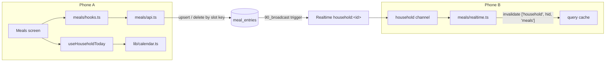
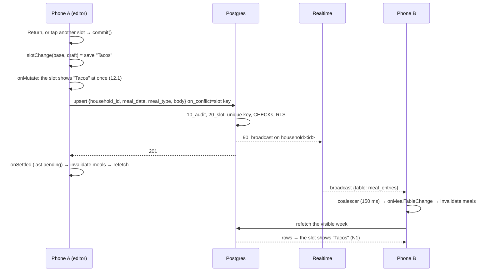

# Kitchin Meal Planning — Design Document

> **Phase 2 of 4** in the EARS spec-driven process: 1-requirements → **2-design** → 3-tasks → 4-test-plan.
> **Status:** Approved by the owner, 2026-10-19, including DD23–DD36 and the 32.7 amendment. Implements [1-requirements.md](./1-requirements.md), also approved 2026-10-19.

## 1. Overview

Meal planning adds one table, one feature module, one tab and a small shared calendar module to the MVP. It reuses everything else in [`specs/mvp/2-design.md`](../mvp/2-design.md) unchanged:

- household isolation through grants, RLS and triggers (§4.1–§4.4)
- the generic broadcast trigger and the household channel (§3.6, §4.5)
- the query client, ordered mutation scopes and offline pausing (§3.5.3, §3.7)
- error classification, reporting and the scrubber (§3.8, §3.9)
- the theme and UI primitives (§3.10)

Nothing in the MVP design is superseded. This document only adds to it.

Three ideas run through the design:

1. **A slot is its key.** An entry is identified by its household, date and meal type, not by its id. Saving is an upsert on that key and clearing is a delete by it, so a retry, a race between the two phones or a stale cache can never create a second entry for a slot (38.2, 38.5).
2. **The editor owns the text while it's open.** Nothing from the network writes into a field being edited. The member's draft is saved when they finish, and the last save wins (35.2, 35.3, K15).
3. **Dates are calendar dates, never moments.** They travel as `YYYY-MM-DD` strings from the database to the screen. Only "today" involves a clock and a time zone, and the app works it out through `Intl` in the household's zone, never through the phone's local `Date` methods (34, finding 2).

**Numbering** continues from the MVP design: decisions start at **DD23** and open items at **OI-15**.

### 1.1 Inputs

Decisions K9–K17 in 1-requirements and DD1–DD22 in the MVP design are inputs to this design, and aren't revisited here.

### 1.2 Design Decisions

This table settles the requirements' Open Items for Design Phase. **Approving this document approves these decisions.** ★ marks a decision that's expensive to reverse.

| # | Decision | Choice | Why | Req |
|---|---|---|---|---|
| DD23 ★ (OI 8) | Table layout | One table, `meal_entries`, keyed by `(household_id, meal_date, meal_type)`. No parent plan table | Nothing to provision, and no parent row to go missing (research.md §2) | 38.7, N24 |
| DD24 (OI 7) | Saving and clearing | Save is a PostgREST upsert on the slot key that never sends `id`. Clearing, and saving empty text, is a delete by the slot key. There's no RPC; the structural tests forbid functions in `public` | One statement for each, and it holds under a race between the phones (finding 1) | 32, 33, 35.4, 38.5 |
| DD25 (OI 1) | Editing UI | Tap to edit, inline. Tapping a slot swaps its text for a multi-line field, and only one field is open at a time. Return means Done (`submitBehavior="blurAndSubmit"`); pasted line breaks are kept | Fast for planning a whole week, as in the legacy grid. One open field keeps typing light (N21) | 32.1–32.3, N21 |
| DD26 (OI 3, 4) | Who owns the draft | The open editor keeps the text in local state, and query data never flows into it. It saves when the member finishes, moves to another slot, week or tab, or the app leaves the foreground. It doesn't save during pauses in typing | Satisfies 35.2 by construction, with the fewest writes | 32.3, 35.2 |
| DD27 | What counts as unchanged | The draft, trimmed, equals the text the slot had **when editing began**. Comparing with the current entry would write stale text back over the other member's newer save | Amends 32.7 (§1.4) | 32.7, K15 |
| DD28 (OI 2) | Showing who last edited | Recorded but not shown, and there's no "changed on the other phone" notice | As DD12 for grocery rows. No surveyed app shows it (research.md §6) | 32.8 |
| DD29 (OI 5) | Moving between weeks | Previous and Next buttons, plus This week while away from it. No swipe paging. The weeks on either side are prefetched once a week loads. Week queries stay cached while the app runs (`gcTime: Infinity`), and sign-out clears them with the rest of the cache | Buttons are simple and accessible. Prefetching makes the next step instant (31.5) | 31 |
| DD30 (OI 6) | Date handling | Calendar dates are `YYYY-MM-DD` strings, and arithmetic uses UTC day numbers. Today comes from `Intl.DateTimeFormat('en-US', { timeZone, year, month: '2-digit', day: '2-digit' }).format(now)`, parsed strictly. It doesn't use `formatToParts`, a date library or the local `Date` methods. A lint rule bans local `Date` getters and setters in `src/` | Hermes on iOS honours `timeZone` through `NSTimeZone`, but its `formatToParts` and its local-time arithmetic have open bugs (finding 2) | 34, N23 |
| DD31 | Where calendar code lives | `src/lib/calendar.ts` for the pure date functions, and `src/features/household/use-household-today.ts` for today | Chores (Phase 3) needs the same household dates | N23, N24 |
| DD32 (OI 9) | Meal-type icons and day accents | Each icon is an SF Symbol on a soft tint. Breakfast is a terracotta glyph on `accentSoft` (3.15:1), lunch an **ink** glyph on `secondarySoft` (10.36:1), and dinner a teal glyph on `primarySoft` (3.58:1). Day accents are a 4 pt left edge, decorative only | Each glyph passes 3:1, and lunch keeps its blush identity in the tint (§3.7) | 36.2–36.4 |
| DD33 (OI 10) | Add to groceries | A header button on Meals (`cart.badge.plus`) that opens the existing `/add-item` sheet. The sheet doesn't change | The sheet already presents over the tabs, so Meals keeps its week and scroll position underneath | 37 |
| DD34 | Mutation ordering | Every meal save and clear for a household shares one TanStack mutation scope, `meals:<householdId>` | In-order replay after being offline (13.3). Two saves to one slot land in the order they were made | 35.1, 35.3 |
| DD35 | Meals toasts | The Meals screen has its own `ToastProvider placement="top"`, as the add-item sheet does | Meals is typed into, so a bottom toast would sit under the keyboard while another slot is open | 35.5 |
| DD36 | Meals tab colour | The Meals screen sets `tabBarActiveTintColor: accent`. The tab bar reads its tint from the focused screen's options | Terracotta for Meals and cactus for Groceries, with no custom tab bar (finding 3) | 36.1 |

### 1.3 Research Findings

These were checked on 2026-10-19 against the installed stack: Expo SDK 58.0.14, React Native 0.88.0, Hermes V1 (`hermes-engine` 260318099.0.4), Supabase CLI 2.121.0, Postgres 17.11 and `postgrest-js` 2.118.0.

1. **The upsert holds under RLS and the existing triggers.** A probe on the local stack ran in one transaction that was rolled back. It created the §4.1 table, triggers and policies, then ran PostgREST's merge-duplicates statement, `insert … on conflict (household_id, meal_date, meal_type) do update set household_id = excluded.household_id, meal_date = …, meal_type = …, body = excluded.body`:
   - As A and then B on the same slot, it left one row with B's text, `created_by` A and `updated_by` B.
   - As C (another household), it failed row-level security (`42501`).
   - Changing `meal_date` failed the slot trigger (`42501`).
   - A plain duplicate insert failed `meal_entries_one_per_slot` (`23505`).
   - A leading space, an empty body, 501 characters and an unknown meal type failed their checks (`23514`).
   - 500 emoji and an inner line break were accepted.
   - A delete that matched no rows succeeded.
   - Spoofed attribution was overwritten.
   - Each write produced a broadcast on the household topic.

   The `SET` list repeats the key columns with their own values, so the audit trigger's immutability check and the slot trigger both pass. Sending `id` would make the `SET` change it, and the audit trigger would reject that, which is why DD24 never sends it. `postgrest-js` sends `on_conflict=<columns>` from `upsert(row, { onConflict })`.
2. **Dates on Hermes V1 (iOS).** Hermes V1's Apple `Intl` is built on Foundation, not ICU ([`PlatformIntlApple.mm`](https://github.com/facebook/hermes/blob/hermes-v260318099.0.4/lib/Platform/Intl/PlatformIntlApple.mm)):
   - `DateTimeFormat` accepts any IANA name that `NSTimeZone` knows, and throws `RangeError` for an unknown one, with no silent fallback ([#1611](https://github.com/facebook/hermes/pull/1611)). It also accepts abbreviations such as `CST`.
   - `formatToParts` exists, but it's a heuristic that splits the formatted string. [#1172](https://github.com/facebook/hermes/issues/1172) (open) reports wrong parts on devices.
   - `toLocaleDateString` with `timeZone: 'UTC'` works, using the device locale when none is given.
   - `resolvedOptions().timeZone` returns the device zone.
   - There's no `Intl.Segmenter` and no `Temporal`.
   - Local `Date` arithmetic has open bugs. The device zone is cached ([#1751](https://github.com/facebook/hermes/issues/1751)), DST at midnight goes wrong ([#2159](https://github.com/facebook/hermes/issues/2159)), and zones with non-hour DST shifts get the wrong offset ([#2246](https://github.com/facebook/hermes/issues/2246)). `Intl` with an explicit `timeZone` hands off to `NSTimeZone` and avoids all three.
   - `@date-fns/tz` and Luxon bundle no zone data and depend on this same `Intl`; Luxon uses `formatToParts`.

   Hence DD30. Simulator and device reports differ, so OI-15 checks on a phone.
3. **Tab tint.** Expo Router's bottom tab bar takes `tabBarActiveTintColor` from the focused screen's options (`BottomTabBar.js`, `focusedOptions`), so each screen can set its own (DD36).
4. **Return in a multi-line field.** React Native's `submitBehavior` defaults to `'newline'` for multi-line fields. `'blurAndSubmit'` makes Return blur the field and fire `onSubmitEditing` instead (`TextInput.flow.d.ts`), which DD25 uses.
5. **Contrast of the icon treatments**, measured with WCAG 2.x relative luminance:
   - `accent` on `accentSoft`: 3.15
   - `primary` on `primarySoft`: 3.58
   - `ink` on `secondarySoft`: 10.36
   - `secondary` on `secondarySoft`: 1.70, which fails
   - `accent` on `background`: 3.53
   - `accent` on `screen`: 3.21

### 1.4 Requirement Amendments

These were found during design and are written into 1-requirements as *(changed during design)*. Approving this design approves them.

| Item | Change | Reason |
|---|---|---|
| 32.7 | "IF the trimmed text is the same as when the member started editing the slot THEN the app SHALL NOT send a write." It previously compared with the slot's saved entry | That entry may have changed on the other phone meanwhile. Comparing with it would write the stale original text back, undoing the other member's save (DD27) |

The MVP amendments listed in 1-requirements (1.5, 11.2, 26.4, the glossary and the out-of-scope list) are written into `specs/mvp/1-requirements.md` when this design is approved.

### 1.5 Changes to Existing Files

N24 requires meal planning to be additive. These are the only existing files that change, and none is a core table, a policy or grocery code.

| File | Change | Why |
|---|---|---|
| `src/app/(app)/(tabs)/_layout.tsx` | Add the Meals tab between Groceries and Settings | R1.5 as amended, K16 |
| `src/app/(app)/_layout.tsx` | `TABLE_HANDLERS` adds `mealTableHandlers` | §3.3.5 |
| `src/ui/theme.ts`, `theme.test.ts` | Add `ICON_PAIRS`, plus two `TEXT_PAIRS` rows for terracotta labels | §3.7, N13 |
| `eslint.config.js`, `eslint-rules.test.ts` | Ban local `Date` getters and setters in `src/`, and make `src/lib/calendar.ts` pure like `domain.ts` | DD30, N23 |
| `jest.config.js` | Put `src/lib/calendar.ts` in the 95/90 group and `src/features/meals/hooks.ts` in the 90/85 group | Same bars as their grocery counterparts |
| `supabase/tests/database/00_structure.test.sql` | Add the `meal_entries` grants to the expected list | §4.3 |
| `supabase/tests/database/30_realtime.test.sql` | Add `meal_entries` broadcast cases | 38.1 |
| `supabase/seed/10_seed_data.sql` | A few entries per household | §4.5 |
| `src/types/database.ts` | Regenerated | 27.2 |
| `src/__tests__/routing.test.tsx` | Expect three tabs | R1.5 |

---

## 2. Architecture

### 2.1 Where Meals Fits



The household channel, coalescer and query client are the MVP's. Meals registers one more table handler.

### 2.2 Repository Layout

New files:

```
src/
  lib/
    calendar.ts                      # pure date functions (§3.1)
    calendar.test.ts
  features/
    household/
      use-household-today.ts         # today in the household's zone (§3.2)
      use-household-today.test.tsx
    meals/
      constants.ts                   # meal types, day accents, copy (§3.3.1)
      domain.ts  domain.test.ts      # week building, text rules (§3.3.2)
      api.ts     api.test.ts         # fetch, save, clear (§3.3.3)
      hooks.ts   hooks.test.tsx      # week query, save mutation (§3.3.4)
      realtime.ts realtime.test.ts   # table handler (§3.3.5)
      components/
        week-header.tsx  day-card.tsx  slot-row.tsx  slot-editor.tsx
        meal-type-icon.tsx  skeleton-week.tsx  week-states.tsx
        add-to-groceries-button.tsx
        *.test.tsx
  app/(app)/(tabs)/meals.tsx         # the Meals screen (§3.4)
  __tests__/meals.test.tsx           # route tests
supabase/
  migrations/<ts>_meals_init.sql     # §4
  tests/database/50_meal_entries.test.sql
```

### 2.3 Key Flows

#### Save a slot on phone A; it appears on phone B



#### Both members edit the same slot

1. A and B both open Thursday's dinner, which reads "Pasta". Each editor records `base = "Pasta"`.
2. B types "Pizza" and taps Done. B's upsert lands, and A's phone refetches.
3. A's cache now says "Pizza", but A's open field still shows A's draft (35.2, DD26).
4. A types "Tacos" and taps Done. `slotChange("Pasta", "Tacos")` is a save, A's upsert lands last, and both phones converge on "Tacos" (35.3, K15).
5. Had A changed nothing, `slotChange("Pasta", "Pasta")` would be `none`, so no write is sent. A's slot would show "Pizza" from the cache (DD27).

#### Offline, then back online

As MVP §2.5. The save pauses in the `meals:<hid>` scope with its optimistic text on screen. It resumes in order when the device reconnects, and the last one to settle refetches (13.2, 13.3).

---

## 3. Components and Interfaces

### 3.1 Calendar (`src/lib/calendar.ts`)

Pure functions with no React or React Native imports. The `domain.ts` lint rule is extended to this file (§1.5). It's the only module that turns instants into dates.

```ts
/** A calendar date, 'YYYY-MM-DD'. Never a moment in time (34.2). */
export type IsoDate = string & { readonly __brand: 'IsoDate' };

export function parseIsoDate(s: string): IsoDate | null;   // shape and a real date: rejects 2026-02-30
export function addDays(d: IsoDate, n: number): IsoDate;    // on UTC day numbers, so DST never applies (34.4)
export function weekday(d: IsoDate): 0 | 1 | 2 | 3 | 4 | 5 | 6; // 0 = Monday (K10)
export function weekStartOf(d: IsoDate): IsoDate;           // the Monday on or before d
export function weekDates(weekStart: IsoDate): IsoDate[];   // seven consecutive dates (30.1, 34.4)

export function isValidTimeZone(tz: string): boolean;       // `new Intl.DateTimeFormat('en-US', { timeZone: tz })` doesn't throw
export function deviceTimeZone(): string;                   // Intl.DateTimeFormat().resolvedOptions().timeZone
export function todayIn(timeZone: string, now?: number): IsoDate; // 34.1, see below

export function formatDay(d: IsoDate): { weekday: string; date: string }; // "Thursday", "23 October" (30.1, 30.12)
export function formatWeekRange(weekStart: IsoDate, today: IsoDate): string; // "20 Oct – 26 Oct" (30.7)
```

**Arithmetic.** A date converts to a UTC day number with `Date.UTC(y, m - 1, d) / 86_400_000` and back with `getUTC*`. Local getters such as `getDate`, `getDay` and `setHours` are never used (finding 2), and the lint rule enforces that.

**`todayIn`.** It formats `now` with a cached `Intl.DateTimeFormat('en-US', { timeZone, year: 'numeric', month: '2-digit', day: '2-digit' })`, one formatter per zone. It parses the result with `/^(\d{2})\/(\d{2})\/(\d{4})$/` and checks it with `parseIsoDate`. If the output doesn't match, it throws `CalendarFormatError`, which §3.2 handles. It doesn't use `formatToParts`.

**Display.** `formatDay` and `formatWeekRange` format the date's UTC midnight with `timeZone: 'UTC'` and the device locale (`undefined`), so the phone's zone can never move the date.
- `formatDay` uses `{ weekday: 'long' }` and `{ day: 'numeric', month: 'long' }`.
- `formatWeekRange` formats each end with `{ day: 'numeric', month: 'short' }` and joins them with " – ". Both ends also get `year: 'numeric'` when the week isn't wholly inside today's year (edge case 10).
- `formatRange` isn't used, because it hasn't been checked on Hermes.

### 3.2 Household Today (`src/features/household/use-household-today.ts`)

```ts
export function useHouseholdToday(): IsoDate;
```

- **Zone (34.1, 34.5).** It uses the household's `timeZone` from `useHousehold()`. If `isValidTimeZone` rejects it, the hook uses `deviceTimeZone()` instead and calls `reportOnce('household_time_zone_invalid')`. The report carries no zone name.
- **Fallback.** If `todayIn` throws `CalendarFormatError`, the hook reports once (`calendar_format_unexpected`) and falls back to the device's local date. That's the only place in the app where local getters are allowed, with a lint suppression and a comment.
- **Rollover (34.3).** It recomputes when `useForegroundSince()` changes, which covers returning to the foreground, and every 60 s while mounted. It sets state only when the date changes, so consumers re-render once at midnight. Only Meals mounts it.

### 3.3 Meals Feature

#### 3.3.1 `constants.ts`

```ts
export type MealType = 'breakfast' | 'lunch' | 'dinner';

export const MEAL_TYPES: readonly {
  key: MealType; label: string; symbol: SFSymbol; glyph: ColourToken; tint: ColourToken;
}[] = [
  { key: 'breakfast', label: 'Breakfast', symbol: 'cup.and.saucer.fill', glyph: 'accent',  tint: 'accentSoft' },
  { key: 'lunch',     label: 'Lunch',     symbol: 'sun.max.fill',        glyph: 'ink',     tint: 'secondarySoft' },
  { key: 'dinner',    label: 'Dinner',    symbol: 'moon.fill',           glyph: 'primary', tint: 'primarySoft' },
];                                                             // fixed order (30.2), DD32

// Monday first. SPEC §4.6 accents (36.3) and static test-ID parts (26.7).
export const DAY_ACCENTS: readonly ColourToken[] = ['primary', 'ink', 'cactus', 'secondary', 'tertiary', 'sand', 'accent'];
export const DAY_KEYS = ['mon', 'tue', 'wed', 'thu', 'fri', 'sat', 'sun'] as const;

export const ENTRY_MAX = 500;        // 32.5, 38.3
export const COUNTER_FROM = 50;      // show what's left below this (32.5)
export const COPY = {
  loadError: "Couldn't load meals",  // 30.10
  saveError: "Couldn't save that meal",
  placeholder: (label: string) => `Add ${label.toLowerCase()}`, // 30.4
  today: 'Today',                    // 30.6
  addToGroceries: 'Add to groceries' // 37.1
};
```

The labels and order come from the legacy `MEAL_TYPES` and `DAYS`.

#### 3.3.2 `domain.ts`

```ts
/** A `meal_entries` row as `api.ts` selects it. `parseEntryRow` checks it at runtime. */
export type MealEntryRow = Pick<Tables<'meal_entries'>, 'id' | 'meal_date' | 'meal_type' | 'body' | 'updated_at'>;
export interface MealEntry { id: string; date: IsoDate; mealType: MealType; body: string; updatedAt: string }
export interface Slot { date: IsoDate; mealType: MealType; entry: MealEntry | null }
export interface Day { date: IsoDate; weekday: 0 | 1 | 2 | 3 | 4 | 5 | 6; slots: Slot[]; planned: number }

export function parseEntryRow(row: MealEntryRow):
  | { ok: true; entry: MealEntry }
  | { ok: false; id: string | null; field: keyof MealEntryRow };   // an unknown meal_type fails on field 'meal_type' (35.7)

export function buildWeek(weekStart: IsoDate, entries: MealEntry[]): Day[];
//   seven Days, Monday first; slots in MEAL_TYPES order; planned = slots with an entry (30.1, 30.2, 30.5).
//   Entries outside the week are ignored.

export function charLength(s: string): number;        // code points, as Postgres char_length counts (32.5)
export function clampEntry(text: string): string;     // the first ENTRY_MAX code points (32.5, edge case 13)
export function charactersLeft(text: string): number | null; // null while COUNTER_FROM or more remain

export type SlotChange = { kind: 'none' } | { kind: 'save'; body: string } | { kind: 'clear' };
export function slotChange(base: string, draft: string): SlotChange;
//   trim (32.4); trimmed draft === base → none (DD27); '' with a non-empty base → clear (33.1);
//   '' with an empty base → none; anything else → save
```

`charLength` repeats the one-line grocery helper rather than importing across features. Clamping works on code points because Hermes has no `Intl.Segmenter` (finding 2). At the limit, it may split a multi-code-point emoji, which is accepted.

#### 3.3.3 `api.ts`

As in groceries, every failure leaves through `toApiError(error, { table, operation, recordId? })`, so raw PostgREST text never reaches the hooks (§3.8 of the MVP design). The app never sends `id`, attribution or timestamps.

```ts
const ENTRIES = 'meal_entries';
const ENTRY_COLUMNS = 'id, meal_date, meal_type, body, updated_at';

/** The household's entries for one week (30.1). */
export function fetchWeek(householdId: string, from: IsoDate, to: IsoDate): Promise<MealEntryRow[]>;
//   from(ENTRIES).select(ENTRY_COLUMNS).eq('household_id', householdId).gte('meal_date', from).lte('meal_date', to)

/** Creates the slot's entry or replaces its text, in one statement (38.5, DD24). */
export function saveEntry(v: { householdId: string; date: IsoDate; mealType: MealType; body: string }): Promise<void>;
//   from(ENTRIES).upsert({ household_id, meal_date, meal_type, body },
//                        { onConflict: 'household_id,meal_date,meal_type' })
//   No `id`: the conflict update would set it, and the audit trigger rejects id changes (finding 1).

/** Removes the slot's entry. No rows deleted still counts as success (33.3). */
export function clearEntry(v: { householdId: string; date: IsoDate; mealType: MealType }): Promise<void>;
//   from(ENTRIES).delete().eq('household_id', …).eq('meal_date', …).eq('meal_type', …)
```

#### 3.3.4 `hooks.ts`

```ts
export const mealKeys = {
  all:  (hid: string) => ['household', hid, 'meals'] as const,
  week: (hid: string, weekStart: IsoDate) => ['household', hid, 'meals', 'week', weekStart] as const,
};
const mutationKey = (hid: string) => ['meal-mutation', hid] as const;
const scope = (hid: string) => ({ id: `meals:${hid}` });          // DD34

export interface MealWeek {
  days: Day[];                                        // buildWeek; empty until loaded
  status: 'loading' | 'ready' | 'error' | 'waiting';  // as GroceryList (30.9, 30.10, 13.1)
  refetch(): Promise<void>;                           // pull to refresh (30.11)
  refreshFailedAt: number | null;                     // a failed reload while data is shown (30.10)
}
export function useMealWeek(weekStart: IsoDate): MealWeek;
export function useSetMeal(): (v: { date: IsoDate; mealType: MealType; body: string | null }) => void; // null clears
```

**`useMealWeek`:**
- `gcTime: Infinity` (DD29).
- `select` runs `parseEntryRow` and `buildWeek`. A row that fails to parse is left out and reported once as `invalid_row:<id>:<field>` (35.7, 14.8).
- Once the week is ready, it prefetches the weeks before and after with `staleTime: 60_000` (31.5, DD29).
- Status and the refresh-failed signal work exactly as in `useGroceryList`.

**`useSetMeal`** follows the grocery mutation lifecycle (MVP §3.5.3), written separately for meals so that no grocery code changes (N24):

| Phase | Behaviour |
|---|---|
| Options | `mutationKey(hid)`, `scope(hid)` and `networkMode: 'online'` (13.2). `retry` allows up to 3 attempts, for `network` errors only |
| `mutationFn` | `body === null` calls `clearEntry`; anything else calls `saveEntry` |
| `onMutate` | `cancelQueries` for the week holding `v.date`. Record `before`, the slot's row or none, and `applied = v.body`. Patch that week's cached rows so the slot shows `applied` (12.1). An empty slot gets a placeholder row with id `pending:<date>:<mealType>`, which the refetch replaces |
| `onError` | **Undo only if the slot still shows `applied`**, so a later save is never reverted (DD14). `forbidden` shows "You don't have access to that", with no Retry. Anything else shows "Couldn't save that meal" with **Retry**, which calls `mutate(v)` again with the member's text (35.5). Report if the category is reportable |
| `onSettled` | If this is the last pending meal mutation, invalidate `mealKeys.all(hid)` (12.6) |

There are no known-outcome cases. An upsert can't hit the uniqueness rule, and clearing a missing entry succeeds. A `validation` error means the app and the database disagree about the rules (OI-18). It's undone, toasted without Retry and reported.

#### 3.3.5 `realtime.ts`

```ts
export function onMealTableChange(qc: QueryClient, hid: string): void {
  if (qc.isMutating({ mutationKey: ['meal-mutation'] }) > 0) return;  // the last onSettled refetches (11.5)
  void qc.invalidateQueries({ queryKey: mealKeys.all(hid) });
}
export const mealTableHandlers: TableHandlers = { meal_entries: onMealTableChange };
```

Invalidating `all` refetches the visible week and marks the cached weeks stale. A stale week shows its cache at once and then refreshes when the member returns to it (31.5, 35.6). The (app) layout merges `mealTableHandlers` into `TABLE_HANDLERS`.

#### 3.3.6 Components

| Component | Renders | Notes |
|---|---|---|
| `WeekHeader` | ‹, the date range, ›, and This week when away from the current week | Buttons are at least 44 × 44 pt. The range has `accessibilityRole="header"` |
| `DayCard` | The accent edge, weekday and date, the Today pill, the planned count, and three slots | Memoised, so editing one slot doesn't redraw the other six days |
| `SlotRow` | The icon, the meal-type label, and the entry text or placeholder | A `Pressable` of at least 44 pt. Text wraps without truncating (30.3) |
| `SlotEditor` | A multi-line field, the characters-left counter and Clear | §3.5 |
| `MealTypeIcon` | An SF Symbol on its tint | DD32. Decorative to VoiceOver |
| `SkeletonWeek` | Seven skeleton day cards | 30.9 |
| `WeekStates` | `LoadError` ("Couldn't load meals", Retry) and `WaitingForConnection` | The same layout as the grocery states, with meal copy |
| `AddToGroceriesButton` | `cart.badge.plus`, 44 × 44 pt | DD33 |

None of them touches Supabase. `testID`s are static: `meals-week`, `week-previous`, `week-next`, `week-this`, `day-<mon…sun>`, `slot-<mon…sun>-<mealType>`, `slot-editor`, `slot-clear` and `add-to-groceries`. None contains meal text (26.7).

### 3.4 Meals Screen (`src/app/(app)/(tabs)/meals.tsx`)

```
┌──────────────────────────────────────┐
│ Meals            ● Reconnecting  🛒+ │  pill per 13.4; Add to groceries (37)
│  ‹      20 Oct – 26 Oct      ›       │  30.7, 31.2
│                         [This week]  │  only away from the current week (31.3)
├──────────────────────────────────────┤
│ Offline — changes will send when …   │  banner only while offline (13.1)
│▌Monday              20 October   1/3 │  teal edge (36.3); count (30.5)
│▌ (☕) Breakfast                       │
│▌      ＋ Add breakfast   (inkMuted)  │  30.4
│▌ (☀️) Lunch                           │
│▌      Leftover chili                 │  30.3: wraps, never truncates
│▌ (🌙) Dinner                          │
│▌      ＋ Add dinner                  │
│▌Tuesday   [Today]   21 October   2/3 │  30.6: Today pill, white bold on terracotta
│▌ …                                   │
└──────────────────────────────────────┘
```

- **Structure.** `Meals` renders `<ToastProvider placement="top"><MealsWeek /></ToastProvider>` (DD35). `MealsWeek` holds two pieces of state:
  - `weekStart`, which starts at `weekStartOf(today)`. Tab screens stay mounted, so it lasts while the app runs (31.6), and a restart begins at the current week (31.1).
  - `editing`, the open slot or `null`.
- **List.** A `ScrollView`, not a virtualized list: seven cards with 21 slots render cheaply even at 500 characters each (N22), and every card can be measured. It's set with `automaticallyAdjustKeyboardInsets`, `keyboardShouldPersistTaps="handled"` (so the first tap on another slot opens it), `keyboardDismissMode="interactive"` and a `RefreshControl` (30.11).
- **Scroll to today (31.1, 31.3).** Today's `DayCard` reports its `y` from `onLayout`, and the screen calls `scrollTo({ y, animated: false })` on the first render of the current week after the app starts, and again whenever This week is used. It's unanimated, so it respects N14.
- **Today and the current week.** `useHouseholdToday()` drives the Today pill and whether This week shows. A rollover never changes `weekStart` (34.3).
- **States.**

  | Week state | Shows | Requirement |
  |---|---|---|
  | First load | `SkeletonWeek` | 30.9 |
  | Error with nothing cached | `LoadError` with Retry | 30.10 |
  | Error with the week cached | The week, plus a "Couldn't load meals" toast with Retry | 30.10 |
  | Paused with nothing cached (offline) | The banner, and "Waiting for connection…" | 13.1 |
  | Ready | Seven `DayCard`s, even when nothing is planned | 30.8 |

- **Accessibility (N10–N12).**
  - Day header: "Tuesday 21 October, today, 2 of 3 meals planned".
  - Slot: role button. Labels such as "Tuesday dinner: Tacos" or "Tuesday dinner, not planned", with the hint "Edits this meal". A planned slot has the custom action "Clear" (33.2).
  - Editor field: labelled "Tuesday dinner".
  - The counter is read as "12 characters left". The app announces once when the counter first appears, and again at zero.
  - Nothing has a fixed height, so the largest standard text size wraps rather than clips (N12).

### 3.5 Slot Editing

`SlotEditor` holds `base`, the trimmed text when editing began, and `draft`. Everything below is local to it, so a keystroke re-renders only the editor (N21).

| Event | What happens | Req |
|---|---|---|
| Tap a slot | The screen sets `editing`. That `SlotRow` becomes a `SlotEditor` with `base = draft = entry?.body ?? ''`, `autoFocus`, and the cursor at the end | 32.1 |
| Typing | `draft = clampEntry(text)`. The counter appears below 50 characters left | 32.5 |
| Return (Done) | `blurAndSubmit` blurs the field, then commit and close | 32.3 |
| Tap another slot, or change week | `editing` changes, and this editor commits in its unmount cleanup | 32.3 |
| Switch tab | The screen's `useFocusEffect` cleanup sets `editing = null`, so the editor commits on unmount | 32.3 |
| Open Add to groceries | The sheet's Name field takes focus, so this field blurs and commits | 32.3, 37 |
| The app leaves `active` (`inactive` or `background`) | Commit, and stay open. `base` becomes the committed text | 32.3 |
| Clear, or the VoiceOver Clear action on a row | Commit `{ kind: 'clear' }` at once and close | 33.2 |
| A remote change to this slot | The slot's `entry` prop changes, but `draft` and `base` don't (35.2). Once closed, the row shows the cache | 35.2, DD27 |

**`commit()`** runs `slotChange(base, draft)`. Unless the result is `none`, it calls `setMeal({ date, mealType, body })`, with `body` set to `null` for a clear. Then it sets `base` to the trimmed draft. A second commit, such as blur followed by unmount, or React's development double-invoke, then finds nothing changed, so commits are idempotent without a flag.

### 3.6 Tabs and Add to Groceries

- **Tabs.** `(tabs)/_layout.tsx` lists `groceries`, `meals` and `settings` in that order, and still opens on Groceries (K16). Meals has the title "Meals", the `fork.knife` symbol and `tabBarActiveTintColor: theme.accent` (DD36). Labels stay bold (DD19).
- **Header.** `headerRight` holds `ReconnectingPill` (13.4) and `AddToGroceriesButton`, which calls `router.push('/add-item')` (37.1).
- **The sheet.** It doesn't change. Items follow Requirements 5 and 6 (37.2). Meals stays mounted underneath, so closing the sheet returns to the same week and scroll position (37.3). Nothing is read from meal text (37.4).

### 3.7 Theme Additions

```ts
/** Icon glyphs on their backgrounds. Icons need 3:1 (N13); theme.test.ts measures each. */
export const ICON_PAIRS: readonly Pick<TextPair, 'fg' | 'bg'>[] = [
  { fg: light.accent,  bg: light.accentSoft },    // breakfast, 3.15
  { fg: light.ink,     bg: light.secondarySoft }, // lunch, 10.36
  { fg: light.primary, bg: light.primarySoft },   // dinner, 3.58
  { fg: light.accent,  bg: light.background },    // Meals tab icon, Add to groceries, 3.53
];
```

`TEXT_PAIRS` adds `accent` on `background` (3.53) and on `screen` (3.21), both bold with a minimum of 3, for the active Meals tab label. The Today pill uses `onBrand` on `accent`, which is already listed. Day accents are decorative and aren't measured, like the `tertiary` card borders (36.3, 36.4).

---

## 4. Data Model

Migration `meals_init`, created with `npx supabase migration new meals_init`.

### 4.1 Table

```sql
create table public.meal_entries (
  id           uuid primary key default gen_random_uuid(),
  household_id uuid not null references public.households(id) on delete cascade,
  meal_date    date not null,                                                   -- 34.2, 38.4
  meal_type    text not null check (meal_type in ('breakfast', 'lunch', 'dinner')),       -- 38.3
  body         text not null check (char_length(body) between 1 and 500
                                    and body !~ '^\s' and body !~ '\s$'),       -- 38.3, as DD16
  created_at   timestamptz not null default now(),
  updated_at   timestamptz not null default now(),
  created_by   uuid references auth.users(id) on delete set null,
  updated_by   uuid references auth.users(id) on delete set null,
  constraint meal_entries_one_per_slot unique (household_id, meal_date, meal_type)  -- 38.2, DD24
);
```

- **Naming.** `meal_date` and `body` avoid the type names `date` and `text` as column names. SPEC §5.6 called the table `meal_plan_entries` and the text `notes`.
- **Indexes.** The unique constraint's index leads with `household_id`. It serves the RLS filter and the week query (`household_id = … and meal_date between …`), so there's no separate `household_id` index. As on the grocery tables, `created_by` and `updated_by` aren't indexed.
- **No parent and no provisioning (DD23, 38.7).** A household starts with no rows.

### 4.2 Triggers

```sql
-- 38.6: an entry stays in its slot. The upsert's SET repeats the key with the same values, which passes.
create function private.handle_meal_entry_slot()
returns trigger language plpgsql set search_path = '' as $$
begin
  if new.meal_date is distinct from old.meal_date or new.meal_type is distinct from old.meal_type then
    raise exception 'immutable column changed' using errcode = '42501';
  end if;
  return new;
end $$;
revoke all on function private.handle_meal_entry_slot() from public, anon, authenticated;

create trigger meal_entries_10_audit     before insert or update on public.meal_entries
  for each row execute function private.handle_audit_fields();          -- 19.5, 19.7, 19.8, 32.8
create trigger meal_entries_20_slot      before update on public.meal_entries
  for each row execute function private.handle_meal_entry_slot();         -- 38.6
create trigger meal_entries_90_broadcast after insert or update or delete on public.meal_entries
  for each row execute function private.broadcast_household_change();     -- 11, 22, 35.1
```

Both existing functions are reused unchanged.

### 4.3 Grants and Policies

| Table | `authenticated` grants | SELECT | INSERT | UPDATE | DELETE |
|---|---|---|---|---|---|
| `meal_entries` | `select, insert, update, delete` | member | member (`WITH CHECK`) | member (`USING` + `WITH CHECK`) | member |

These are the four template policies from MVP §4.4, named `"meal_entries: members read"` and so on. `anon` gets nothing (19.3). An upsert's conflict path runs under the UPDATE policy, and finding 1 confirms that it passes for members and fails for other households.

### 4.4 Realtime

No change to `realtime.messages` or its policy. The 90 trigger broadcasts on the existing `household:<id>` topic. Payloads include `body`, but only that household's members can receive them (22.1), and the handler reads only `payload.table`.

### 4.5 Seed

`10_seed_data.sql` adds entries relative to the reset date, using `date_trunc('week', current_date)::date`, which is the ISO Monday:
- Household One gets Monday dinner, Wednesday lunch and Thursday dinner this week, and one entry last week, attributed to member A.
- Household Two gets one entry this week.

Local development then opens on a week with data. Seeds never run in production.

### 4.6 App Types and Device Storage

Regenerate `src/types/database.ts` (27.2). Meals stores nothing on the device. The viewed week lives in memory only (31.1, 31.6), and `prefs:v1` stays unused.

---

## 5. Migration Strategy

| Order | Migration | Contents |
|---|---|---|
| 4 | `<ts>_meals_init.sql` | `meal_entries`, `handle_meal_entry_slot`, the three triggers, grants, RLS and the four policies |

- **Additive (28.5).** The installed TestFlight build never reads `meal_entries`, so the migration deploys first through `deploy-db.yml`, and the build with the Meals tab follows (Constraint 3).
- **No data migration** from the legacy app (Constraint 2).
- **Later changes.** Loosening the meal-type CHECK or the slot trigger is backward compatible. Tightening them follows expand → migrate → contract.

---

## 6. Error Handling

The MVP table (§6 of the MVP design) applies. These rows are specific to meals.

| Case | Detected from | What the member sees | Reported? | Requirement |
|---|---|---|---|---|
| Save or clear, offline | `network` | The banner, and the optimistic text, held until reconnecting | No | 13.2, 35.1 |
| Save or clear fails | `server`, or retries exhausted | The slot reverts if it still shows this save, and a "Couldn't save that meal" toast with Retry, which resends the member's text | Yes | 35.5 |
| Not allowed | `forbidden` (RLS or the slot trigger, `42501`) | The slot reverts, and a "You don't have access to that" toast | Yes | 14.3 |
| Rejected as invalid | `validation` (`23514`) | The slot reverts, and the toast without Retry. The app checks the same rules first, so this means app and database disagree (OI-18) | Yes | 14.4, 26.1 |
| Load fails | `useMealWeek` error | `LoadError` with Retry, or a toast over the cached week | If reportable | 30.10 |
| Unknown meal type or bad row | `parseEntryRow` | Left out | Once per id and field | 35.7, 14.8 |
| Invalid household time zone | `isValidTimeZone` is false | Nothing; the phone's zone is used | Once (`household_time_zone_invalid`) | 34.5 |
| Unexpected date format | `todayIn` throws `CalendarFormatError` | Nothing; the device's local date is used | Once (`calendar_format_unexpected`) | 34.1 |

Toast text stays on the device. Reports carry only `SafeExtras`, never meal text or a time-zone name (26.3, 26.4).

---

## 7. Testing Strategy

`4-test-plan.md` will list the cases and their IDs. This section fixes what each layer covers.

| Layer | Tool | Covers |
|---|---|---|
| Unit: `calendar.test.ts` | Jest | `todayIn` at fixed instants either side of midnight in `America/Chicago`, `Pacific/Auckland`, `Asia/Kolkata` and `Pacific/Chatham`; US DST weeks 2026-03-08 and 2026-11-01; Southern Hemisphere DST; weeks across a month end and a year end (2026-12-28 → 2027-01-03); 2028-02-29; `parseIsoDate` rejections; `isValidTimeZone`; the strict parse failing into `CalendarFormatError` |
| Unit: `domain.test.ts` | Jest | `buildWeek` order and counts; `parseEntryRow` (unknown type, missing field); `charLength`, `clampEntry` and `charactersLeft` with emoji and pasted 600-character text; every branch of `slotChange` |
| Unit: `api.test.ts` | Jest, stub client | The upsert payload has no `id`, attribution or timestamps, and `onConflict` is the slot key; the delete filters on all three key columns; failures arrive as `ApiError` without server text |
| Hooks: `hooks.test.tsx` | Jest, a real `QueryClient`, mocked `api.ts` | Immediate optimistic save and clear; undo only while the slot still shows the save; Retry resends the same text; scope order; pause offline and resume in order; only the last to settle refetches; prefetching the weeks either side; `gcTime`; invalid rows reported once |
| Hooks: `use-household-today.test.tsx` | Jest, fake timers | Rollover at midnight in the household's zone; the invalid-zone fallback reported once; recompute when the app returns to the foreground |
| Realtime: `realtime.test.ts` | Jest | Deferral while meal mutations are pending; otherwise invalidates `meals` |
| Components | RNTL 14 (async) | Each commit trigger in §3.5; no write when nothing changed (DD27); a prop change while editing leaves the field alone (35.2); clamping and the counter; Clear and the VoiceOver action; labels; static test IDs |
| Routes: `meals.test.tsx`, `routing.test.tsx` | `renderRouter` | Seven days in order with dates; Today; planned counts; Previous, Next and This week; every state in §3.4; pull to refresh; Add to groceries opens `/add-item`; three tabs in order |
| Lint: `eslint-rules.test.ts` | ESLint | Local `Date` getters fail in `src/`; `calendar.ts` purity |
| Theme: `theme.test.ts` | Jest | `ICON_PAIRS` at 3:1 or better; the new `TEXT_PAIRS` |
| DB structural: `00_structure` | pgTAP | The new grants. The existing checks (RLS, `household_id`, audit and broadcast triggers, no `public` functions) cover the new table automatically |
| DB behavioural: `50_meal_entries` | pgTAP as A–D and anon | Isolation (A reads H1 only; C's inserts, upserts, updates and deletes on H1 fail or affect nothing; anon has no access); one entry per slot under an upsert from A and then B; a plain duplicate fails `23505`; validation (empty, untrimmed, 501 characters, 500 emoji, an inner newline, an unknown type); the slot trigger; spoofed attribution; deleting an auth user nulls attribution; members can't null `created_by` |
| DB realtime: `30_realtime` | pgTAP | `meal_entries` writes broadcast on H1's topic; C can't read them |
| Manual | Owner and Simulator | Two-device live updates; concurrent edits of one slot; airplane mode; a slot open while the other phone saves it; `todayIn` on a **physical iPhone** set to a different zone, just after midnight in the household's zone (OI-15) |

**Notes:**

- Jest runs on Node's full ICU, not Hermes's Foundation-based `Intl`, so the unit tests prove the logic but not the engine. OI-15 covers the engine.
- pgTAP can't run two sessions at once. A true simultaneous first save (35.4) is checked manually; pgTAP checks the upsert semantics it relies on.
- Coverage thresholds are in §1.5.

---

## 8. Security Controls

The MVP controls (§8 of the MVP design) apply to `meal_entries` unchanged. These are the meal-specific checks.

| Threat | Control | Proven by |
|---|---|---|
| Read or write another household's meals | The template policies through `my_household_ids()` | pgTAP behavioural |
| Upsert into another household's slot | INSERT `WITH CHECK`, plus UPDATE `USING` on the conflict path | pgTAP (finding 1) |
| Move an entry to another household or slot | The audit trigger (`household_id`) and the slot trigger (`meal_date`, `meal_type`) | pgTAP |
| Spoof who edited a meal | The audit trigger sets `created_by` and `updated_by` from `auth.uid()` | pgTAP |
| Receive another household's meal events | The existing topic policy | pgTAP realtime |
| Meal text in error reports | `ApiError` drops server text, including a CHECK's "Failing row contains (…)" detail; the scrubber; static test IDs | Unit tests |

---

## 9. Requirements Traceability

| Requirement | Design sections |
|---|---|
| 30 Week view | §3.3.2, §3.3.4, §3.3.6, §3.4 |
| 31 Moving between weeks | DD29, §3.3.4, §3.4 |
| 32 Plan or change a meal | DD24–DD27, §3.3.2–§3.3.4, §3.5 |
| 33 Clear a meal | DD24, §3.3.3, §3.5 |
| 34 Household calendar | DD30, DD31, §3.1, §3.2 |
| 35 Sync, conflicts and offline | DD26, DD27, DD34, DD35, §2.3, §3.3.4, §3.3.5, §3.5, §6 |
| 36 Visual identity | DD32, DD36, §3.6, §3.7 |
| 37 Add groceries while planning | DD33, §3.6 |
| 38 Meal data integrity | DD23, DD24, §4, §8 |
| MVP amendments (1.5, 11.2, 26.4) | §1.5, §3.3.5, §3.6, §6 |
| N21, N22 Performance | DD25, DD26, §3.3.6, §3.4, §3.5 |
| N23 Date rules | DD30, §3.1, §7 |
| N24 Additive | §1.5, DD23 |

---

## 10. Open Items / TBD During Implementation

Each item names the fallback if the assumption fails.

- **OI-15. `Intl` on a phone.** Confirm `todayIn` and the display formats on a physical iPhone running the dev build. Set the phone to a zone other than the household's and check an instant just after midnight in the household's zone; Simulator and device reports of Hermes `Intl` differ (finding 2). Fallback: bundle `@formatjs/intl-datetimeformat` with zone data and keep `todayIn`'s interface.
- **OI-16. Clamping a controlled field.** Confirm that `clampEntry` in `onChangeText` doesn't flicker or move the cursor on iOS when typing or pasting at the limit. Fallback: `maxLength={500}`, which counts UTF-16 units and so is stricter for emoji, with `clampEntry` still applied on commit.
- **OI-17. Scroll to today at large text sizes.** Confirm that one `onLayout` pass places today correctly at the largest standard text size (N12). Fallback: scroll again after the first content-size change.
- **OI-18. Whitespace agreement.** JavaScript's `trim()` and Postgres's `\s` may disagree on rare characters, the same exposure as grocery names under DD16. A pgTAP case and a unit case cover the common ones (space, tab, newline, NBSP). A disagreement would show as a reported `validation` error (§6).
- **OI-19. SF Symbols.** Confirm that `cup.and.saucer.fill`, `sun.max.fill`, `moon.fill`, `fork.knife` and `cart.badge.plus` render on iOS 16.4. Fallback: the matching `MaterialCommunityIcons` glyphs that the grocery states already use.
