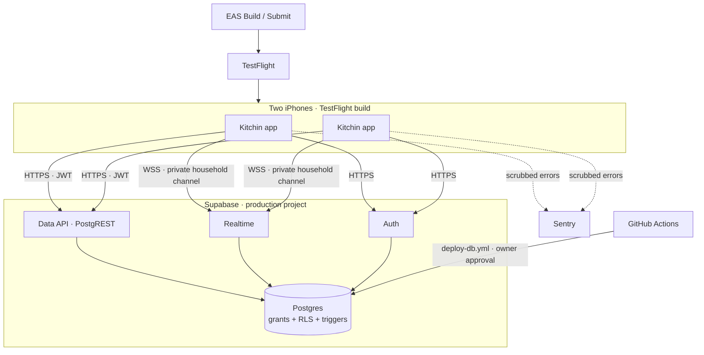
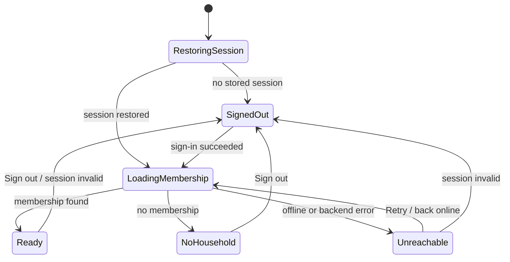
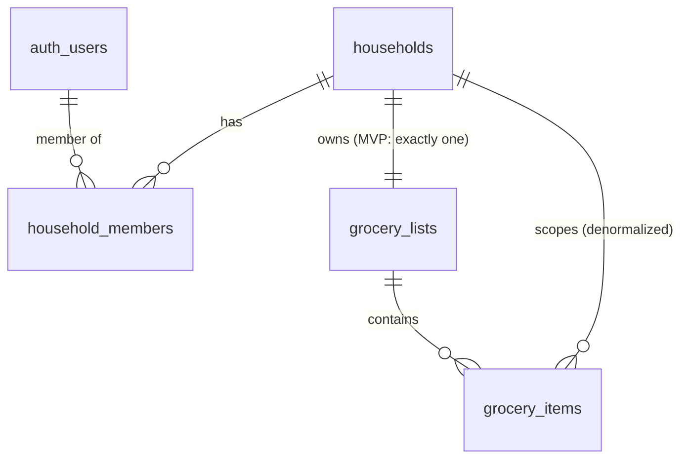

# Kitchin MVP — Design Document

> **Phase 2 of 4** in the EARS spec-driven process: 1-requirements → **2-design** → 3-tasks → 4-test-plan.
> **Status:** Approved by the owner, 2026-10-18. Implements [1-requirements.md](./1-requirements.md), also approved 2026-10-18. After approval, DD9 and the `app.config.ts` sketch were updated to match the EAS and Supabase projects that the owner had already created.

## 1. Overview

This design implements [1-requirements.md](./1-requirements.md): one shared grocery list for a two-person household on two iPhones, plus the foundation that meal planning, chores and notes will reuse.

There is no custom server. The system has three parts:

- **The app:** Expo SDK 58, React Native 0.88, TypeScript (strict) and Expo Router. It talks to Supabase directly through `supabase-js`, keeps server state in TanStack Query v5, and reports errors to Sentry.
- **The backend:** one Supabase project per environment, the local CLI stack and the production cloud project. Postgres enforces every access rule through grants, row-level security (RLS), constraints and triggers. Realtime sends per-household change events on private channels.
- **Delivery:** GitHub Actions for CI and a gated database deploy; EAS Build and Submit for TestFlight.

Three ideas run through the design:

1. **The database is the security boundary.** Postgres enforces Requirements 18–23, and pgTAP tests in CI prove it. The app's route guards are user experience only.
2. **The database is the only source of truth; the app's cache is disposable.** Live events only tell the app to reload. The app also reloads when it returns to the foreground, reconnects or resubscribes, so a missed event never leaves it wrong (N4, N6).
3. **Every write is idempotent and shown instantly.** Four mechanisms combine (§3.5.3):
   - item IDs generated on the phone
   - checks that set a state instead of toggling
   - updates that send only the changed field
   - one ordered mutation queue per list

   Together they give instant feedback (Requirement 12), clean rollback, and in-order replay after being offline (13.3).

**Relationship to SPEC.md.** This document supersedes `docs/SPEC.md` §3–§11 for the MVP. SPEC.md stays as the research record: the legacy assessment (§2), risk register (§14), costs (§15) and documentation links (Appendix A). Where the two disagree, this document wins. §1.5 lists the corrections.

### 1.1 Inputs

Decisions K1–K8 in 1-requirements are inputs to this design and aren't revisited here: password sign-in with admin-created accounts, a new Expo project with no data migration, the grouped list, one open item per name, a household time zone, TestFlight, the desert palette in light appearance, and the app names.

### 1.2 Design Decisions

This table settles the remaining SPEC §16 decisions and the design-phase open items from 1-requirements. **Approving this document approves them.** ★ marks decisions that are expensive to reverse.

| # | Decision | Choice | Why | Req |
|---|---|---|---|---|
| DD1 (D2) | Realtime mechanism | Broadcast from Database on private `household:<id>` channels, authorized by an RLS policy on `realtime.messages` | It authorizes every event, deletions included. Postgres Changes doesn't apply RLS to DELETE events | 11, 22 |
| DD2 (D3) | Server state | TanStack Query v5 | Retries, refetch on focus and reconnect, optimistic mutations, ordered mutation scopes, and mutations that pause while offline | 11–13 |
| DD3 (D5) ★ | Repository visibility | **Stay public** | Security doesn't depend on secrecy (N9). On GitHub Free, public repos get free Actions minutes and Environments with required reviewers; private repos get neither | 25, 28 |
| DD4 (D8) | Styling | React Native `StyleSheet` with typed tokens in `src/ui/theme.ts` | No build plugins, and easy for agents to get right | 16 |
| DD5 (D10) | Environments | The local CLI stack plus production. No staging | A staging project on Free pauses and uses the second free project slot | 24 |
| DD6 (D11) | Backups | A monthly manual `supabase db dump` (schema and data), encrypted and kept outside the repo. Move to Pro once the data matters more | Meets N20 at no cost | N20 |
| DD7 (D14) | Tracing | Off (`tracesSampleRate: 0`) | Saves free-tier quota; performance tracing isn't needed yet | 26 |
| DD8 (D15) | Expo SDK | SDK 58, created with `--template default@sdk-58`. Drop to 57 only if a required library isn't compatible at M1 | Current release. Development builds don't depend on Expo Go | — |
| DD9 (D6, D7) ★ | Owner-supplied values | **D6:** the owner still chooses the bundle-identifier prefix at M0. **D7 is settled:** the production project `kitchin` exists in East US (Ohio), `us-east-2` (its ref is in `docs/TASKS.md` 7.1). The EAS project `@dustinwalkup/kitchin` exists too (`docs/TASKS.md` 1.11). All of these are permanent | They're the owner's choices, not design choices | 24.1 |
| DD10 | Add-item UI | A native form sheet (`(app)/add-item`) holding the name, category chips, quantity and the quick-add chips. It stays open for adding several items in a row | Native iOS sheet, no third-party bottom-sheet library | 5, 6 |
| DD11 | Delete gesture | Swipe left to delete, plus a VoiceOver "Delete" action. No Undo in the MVP | iOS convention; 9.1 rules out a confirmation | 9, N10 |
| DD12 | Showing who added or checked an item | Recorded but not shown on rows in the MVP | Keeps rows uncluttered; easy to add later | 5.8, 7.1 |
| DD13 | Sign-out scope | `signOut({ scope: 'local' })`, which revokes only this device's session | The default (`global`) signs the member out on every device | 3.5, 3.7 |
| DD14 | Optimistic rollback | Reverse only the affected item, then reload. No whole-list snapshots | Restoring a snapshot would also undo other changes still in flight | 12.2 |
| DD15 | Mutation ordering | All grocery mutations for a list share one TanStack mutation `scope`, so they run one at a time, in order | Gives in-order replay after being offline (13.3), and a check can't run before the add it depends on | 12, 13 |
| DD16 | Name normalization | The app trims names. The database rejects untrimmed names and enforces uniqueness on `lower(name)` | The app and the database agree on what counts as the same name | 5, 21.3 |
| DD17 | Provisioning function | `SECURITY INVOKER`, executable only by `postgres` | Only the owner runs it, in the SQL editor, so it needs no elevated rights | 23 |
| DD18 | Single-category view (Requirement 17) | Not included in the MVP | SPEC's default was "only if you want it". The per-device preference store (§4.8) keeps it a small change later | 17 |
| DD19 | Contrast | White text on brand colours is always bold. Secondary text uses `inkMuted` (`#606b71`) | Apple's guidelines require only 3:1 for bold text (§3.10) | N13 |
| DD20 | Immediate session revocation | Not in the MVP. Option for later: make `private.my_household_ids()` also check `auth.jwt()->>'session_id'` against `auth.sessions` | 3.8 accepts up to 1 hour of residual access | 3.8 |
| DD21 | Least-privilege grocery lists | `grocery_lists` is read-only to the app (no insert, update or delete) | 21.1 requires exactly one list, created at provisioning | 21.1 |
| DD22 | Variant source of truth | `APP_VARIANT` (set at build time) becomes `expo.extra.appVariant`, which the app reads at runtime. SPEC's separate `EXPO_PUBLIC_APP_ENV` is dropped | A single source can't disagree with itself | 24 |

### 1.3 Research Findings

These were checked on 2026-10-18. Everything else is carried over from SPEC.md's research (links in its Appendix A).

1. **Sign-out scope.** `supabase.auth.signOut()` accepts `global`, `local` or `others`, and defaults to `global`, which "signs the user out of every device". Hence DD13. ([reference](https://supabase.com/docs/reference/javascript/auth-signout))
2. **Access tokens can't be revoked.** The same reference says: "There is no way to revoke a user's access token jwt until it expires." Access tokens last 1 hour by default. A session can be checked through the JWT's `session_id` against `auth.sessions` (DD20). ([sessions guide](https://supabase.com/docs/guides/auth/sessions))
3. **Mutation scopes.** In TanStack Query v5, mutations with the same `scope.id` run one at a time, in the order they started, and `networkMode` defaults to `'online'`. Hence DD15. ([useMutation](https://tanstack.com/query/latest/docs/framework/react/reference/useMutation))
4. **Form sheets.** Expo Router supports `presentation: 'formSheet'` with `sheetAllowedDetents`, `sheetGrabberVisible` and `sheetInitialDetentIndex`. With numeric detents, `flex: 1` works on iOS from SDK 55. The docs say nothing about keyboard behaviour, so this goes in Open Items. ([modals](https://docs.expo.dev/router/advanced/modals/))
5. **Supabase CLI 2.121.0**, checked with `--help`:
   - `db advisors` takes `--fail-on none|info|warn|error`. SPEC.md wrote `--fail-on warning`, which the CLI rejects.
   - `db lint` takes `--fail-on none|warning|error`.
   - `test db`, `gen types typescript --local` and `db reset` exist as SPEC.md describes.
   - `start -x` can exclude individual containers.
   - `db start` runs only Postgres. It doesn't start Realtime, which creates `realtime.messages`, so CI uses `supabase start` with exclusions instead (§3.12).
6. **Apple's contrast and control-size guidance.** Text up to 17 pt needs 4.5:1. Text at 18 pt or larger, or bold text at any size, needs 3:1. The default control size on iOS is 44 × 44 pt. ([HIG, Accessibility](https://developer.apple.com/design/human-interface-guidelines/accessibility))
7. **Password AutoFill.** The keyboard's key icon offers "all the credentials saved on the device". Suggesting the app's own credentials and saving new ones are tied to an associated domain. Requirement 2.2 was amended to match (§1.4). ([About the Password AutoFill workflow](https://developer.apple.com/documentation/security/about-the-password-autofill-workflow))
8. **Palette contrast.** All ratios are measured against WCAG 2.x relative luminance (§3.10).

### 1.4 Requirement Amendments

These were found during design and written into 1-requirements as *(added/changed during design)*. Approving this design approves them.

| Item | Change | Reason |
|---|---|---|
| 1.7 | New state: "Can't reach Kitchin" with Retry, shown when membership can't load at launch | A signed-in launch with no connection had no defined screen (§2.4) |
| 2.2 | Autofill from the key icon; no promise of an automatic save prompt | That prompt needs an Associated Domain (finding 7) |
| 3.9 | Sign out needs a connection; offline, the app says so and stays signed in | `supabase-js` keeps the local session when the server call fails, so the app would otherwise show a misleading result (§3.3) |
| Edge cases 20–21 | Added for 1.7 and 3.9 | — |
| Out of Scope | Associated Domains | — |

### 1.5 Corrections to SPEC.md

| SPEC.md | This design | Why |
|---|---|---|
| `db advisors … --fail-on warning` | `--fail-on warn` | The CLI rejects `warning` (finding 5) |
| CI runs `supabase db start` | CI runs `supabase start -x …` | `db start` doesn't run Realtime, which creates `realtime.messages` |
| `provision_household` is `SECURITY DEFINER` | `SECURITY INVOKER` (DD17) | It has no non-owner caller, so it needs no elevated rights |
| `grocery_lists`: members can insert, update and delete | Select only (DD21) | 21.1 |
| The checked trigger always overwrites `checked_by` | It also lets the `ON DELETE SET NULL` foreign-key action through (§4.3) | Otherwise deleting an auth user would fail on the foreign key |
| Optimistic rollback restores a snapshot | Reverse only the affected item (DD14) | Overlapping mutations |
| The Sentry scrubber relies on regexes | The API layer never forwards raw PostgREST messages, and the scrubber is the second line (§3.9) | PostgREST `message` and `details` include row values (for example `Key (list_id, lower(name))=(…, milk)`) |
| `signOut()` with its default scope | `scope: 'local'` (DD13) | Finding 1 |
| Session key in the Keychain as `WHEN_UNLOCKED` | `WHEN_UNLOCKED_THIS_DEVICE_ONLY` | The key never moves to another device through a backup, so a restored phone has to sign in again |
| `EXPO_PUBLIC_APP_ENV` | Dropped; the app reads `extra.appVariant` (DD22) | A single source of truth |

---

## 2. Architecture

### 2.1 System Context



The app talks only to Supabase and Sentry (N8).

### 2.2 App Layers and Dependency Rules

```
src/app/                 routes; thin screens that compose feature hooks and ui primitives
src/features/<feature>/  api.ts      the only place that builds Supabase queries
                         hooks.ts    TanStack Query queries and mutations (uses api.ts)
                         domain.ts   pure logic; no React or Supabase imports
                         realtime.ts how this feature's table events affect the cache
                         constants.ts, components/
src/lib/                 supabase client, session storage, query client, realtime channel,
                         errors, sentry and scrubbing, env and env-guard, toast
src/ui/                  theme tokens and accessible primitives
src/types/database.ts    generated by `supabase gen types`; never edited by hand
```

ESLint enforces these rules with `no-restricted-imports` and `no-restricted-syntax`:

- `src/app/**` and `**/components/**` can't import `@/lib/supabase`.
- `**/domain.ts` can't import `react`, `react-native`, `@supabase/*` or `@tanstack/*`.
- Colour literals (`/^#[0-9a-f]{3,8}$/i`, `rgb(`, `rgba(`) are allowed only in `src/ui/theme.ts` (16.7).

### 2.3 Repository Layout

```
kitchin-native/
├── src/
│   ├── app/
│   │   ├── _layout.tsx               # Sentry.wrap, providers, guards, splash, DEV badge, ErrorBoundary
│   │   ├── sign-in.tsx
│   │   ├── no-household.tsx
│   │   ├── unreachable.tsx           # 1.7
│   │   └── (app)/
│   │       ├── _layout.tsx           # household realtime channel, Stack, ErrorBoundary
│   │       ├── add-item.tsx          # formSheet (DD10)
│   │       ├── theme.tsx             # development variant only (15.3)
│   │       └── (tabs)/
│   │           ├── _layout.tsx       # Groceries, Settings
│   │           ├── groceries.tsx
│   │           └── settings.tsx
│   ├── features/
│   │   ├── auth/                     # AuthProvider, sign-in form logic
│   │   ├── household/                # HouseholdProvider, membership api
│   │   └── groceries/                # constants, domain, api, hooks, realtime, components
│   ├── lib/                          # supabase.ts, secure-session-storage.ts, query-client.ts,
│   │                                 # realtime/household-channel.ts, realtime/coalescer.ts,
│   │                                 # errors.ts, sentry.ts, sentry-scrub.ts, env.ts, env-guard.ts, toast.tsx
│   ├── ui/                           # theme.ts, primitives
│   └── types/database.ts
├── supabase/
│   ├── config.toml
│   ├── migrations/                   # §5
│   ├── seed/00_test_helpers.sql      # tests schema (local and CI only)
│   ├── seed/10_seed_data.sql         # users A–D, households H1/H2 (local and CI only)
│   └── tests/database/*.test.sql     # pgTAP
├── scripts/
│   ├── provision-household.sql       # placeholders only (23.2, 23.6)
│   └── check-secrets.mjs             # 25.3
├── assets/                           # icon.png (1024², no alpha), icon-dev.png, splash-icon.png
├── .github/workflows/{ci.yml,deploy-db.yml} · .github/dependabot.yml
├── app.config.ts · eas.json · metro.config.js · eslint.config.js · jest.config.js
├── .env.example · .nvmrc
└── docs/ · specs/
```

### 2.4 App State Machine



| State | Screen | Requirement |
|---|---|---|
| RestoringSession, LoadingMembership | Splash stays visible | 1.1 |
| SignedOut | `sign-in` (shows "Please sign in again" if the session expired) | 1.2, 3.6 |
| NoHousehold | `no-household` | 1.3 |
| Unreachable | `unreachable` | 1.7 |
| Ready | `(app)` tabs, opening on Groceries | 1.4, 1.5 |

### 2.5 Key Flows

#### Add an item on phone A; it appears on phone B

```mermaid
sequenceDiagram
  actor A as Member A
  participant AppA as App (phone A)
  participant API as PostgREST
  participant DB as Postgres
  participant RT as Realtime
  participant AppB as App (phone B)

  A->>AppA: "Milk", Dairy
  AppA->>AppA: domain: validate; no open item with that name
  AppA->>AppA: onMutate: insert optimistic row (client UUID)
  AppA->>API: POST grocery_items {id, household_id, list_id, name, category}
  API->>DB: INSERT (RLS WITH CHECK, CHECKs, unique index, triggers)
  DB->>DB: audit trigger sets created_by, timestamps
  DB-->>RT: broadcast_changes → topic household:H1 (AFTER trigger)
  API-->>AppA: 201
  AppA->>AppA: onSettled: last pending mutation? → refetch list
  RT-->>AppB: broadcast INSERT (channel authorized by realtime.messages policy)
  AppB->>AppB: coalesce 150 ms → no pending mutation → invalidate
  AppB->>API: GET grocery_lists + items
  API-->>AppB: rows → sections re-render (N1: < 2 s)
```

#### Offline, then back online

```mermaid
sequenceDiagram
  participant UI
  participant TQ as TanStack Query
  participant Net as NetInfo / onlineManager
  participant API

  Net-->>TQ: offline
  UI->>UI: offline banner (13.1)
  UI->>TQ: check "Eggs"; add "Bread"
  TQ->>UI: onMutate: both applied optimistically (13.2)
  TQ->>TQ: both mutations paused; scope grocery:<list> keeps their order
  Net-->>TQ: online
  TQ->>API: PATCH Eggs is_checked=true
  API-->>TQ: 200
  TQ->>API: POST Bread
  API-->>TQ: 201
  TQ->>API: refetch list (onSettled of the last mutation) (13.3)
```

#### Launch

1. The root layout calls `SplashScreen.preventAutoHideAsync()` at module load.
2. `AuthProvider` subscribes to `onAuthStateChange`. `INITIAL_SESSION` resolves RestoringSession.
3. When there's a session, `HouseholdProvider` runs the membership query (§3.3) and resolves to Ready, NoHousehold or Unreachable.
4. The splash hides once the state is neither RestoringSession nor LoadingMembership.
5. In Ready, `(app)/_layout` starts the household channel (§3.6), and Groceries runs the list query.

### 2.6 Layer Responsibilities

| Layer | Files | Responsibility | Requirements |
|---|---|---|---|
| Config | `app.config.ts`, `eas.json`, `src/lib/env.ts`, `src/lib/env-guard.ts` | Variants, bundle IDs, build-time and startup guards, validated public config | 24, 25.1, 29 |
| Session | `src/lib/supabase.ts`, `src/lib/secure-session-storage.ts` | Typed client, encrypted session at rest, refresh only in the foreground | 3.1–3.4 |
| Access | `src/features/auth/*`, `src/features/household/*`, `src/app/_layout.tsx` | Auth state machine, membership, guards, sign-in and sign-out | 1, 2, 3 |
| Groceries | `src/features/groceries/*`, `src/app/(app)/(tabs)/groceries.tsx`, `src/app/(app)/add-item.tsx` | Domain rules, queries, optimistic mutations, screens | 4–10, 12 |
| Sync | `src/lib/query-client.ts`, `src/lib/realtime/*`, `src/features/groceries/realtime.ts` | Connectivity, focus, channel lifecycle, coalesced invalidation | 11, 13 |
| Errors | `src/lib/errors.ts`, `src/lib/toast.tsx`, ErrorBoundary exports | Classification, member-facing messages, crash screen | 14 |
| Reporting | `src/lib/sentry.ts`, `src/lib/sentry-scrub.ts` | Privacy-first Sentry setup, scrubbing, report-once | 26 |
| UI | `src/ui/*` | Tokens, accessible primitives, contrast rules | 16, N10–N14 |
| Database | `supabase/migrations/*` | Tables, constraints, triggers, grants, policies, realtime policy, provisioning | 18–23 |
| DB tests | `supabase/seed/*`, `supabase/tests/database/*` | Test helpers, seed, structural and behavioural pgTAP tests | 27.3–27.6 |
| CI/CD | `.github/workflows/*`, `scripts/check-secrets.mjs`, `.github/dependabot.yml` | Gates, secrets scan, gated production deploy | 25.3, 27, 28 |

---

## 3. Components and Interfaces

### 3.1 Configuration and Environment Guards

**`src/lib/env-guard.ts`** is a plain TypeScript module shared by `app.config.ts` (build time) and `env.ts` (startup), so the rules can't drift apart (24.3–24.5). It parses URLs with a regex rather than `URL`, because React Native's `URL` implementation is incomplete.

```ts
export type AppVariant = 'development' | 'production';

export function parseVariant(raw: string | undefined): AppVariant; // default 'development'; anything else throws

const PRIVATE_HOST =
  /^(localhost|127\.0\.0\.1|\[::1\]|10\.\d{1,3}\.\d{1,3}\.\d{1,3}|192\.168\.\d{1,3}\.\d{1,3}|172\.(1[6-9]|2\d|3[01])\.\d{1,3}\.\d{1,3}|[a-z0-9-]+\.local)$/i;

/** Throws an Error that names the variable, never its value (24.5). */
export function assertBackendUrl(variant: AppVariant, url: string): void;
// development: http or https, and the host must match PRIVATE_HOST (a LAN IP lets a physical device reach the laptop)
// production:  https only, and the host must be <ref>.supabase.co

/** Rejects anything that looks like a privileged key (25.1). */
export function assertPublishableKey(variant: AppVariant, key: string): void;
// always rejects: keys starting with sb_secret_; JWTs whose payload role is service_role or supabase_admin
// production: must start with sb_publishable_
// development: sb_publishable_, or the local stack's legacy anon JWT
```

**`app.config.ts`** (sketch):

```ts
import type { ConfigContext, ExpoConfig } from 'expo/config';
import { assertBackendUrl, parseVariant } from './src/lib/env-guard';

const BUNDLE_ID_PREFIX = '<owner prefix, DD9>';
const variant = parseVariant(process.env.APP_VARIANT);
const isProd = variant === 'production';

// Some tools (expo-doctor, Jest) evaluate config without env vars, so a missing URL only warns here.
// A wrong URL fails the build. env.ts fails at startup if the URL is missing.
const url = process.env.EXPO_PUBLIC_SUPABASE_URL;
if (url) assertBackendUrl(variant, url);
else console.warn('EXPO_PUBLIC_SUPABASE_URL is not set while evaluating app config');

export default ({ config }: ConfigContext): ExpoConfig => ({
  ...config,
  name: isProd ? 'Kitchin' : 'Kitchin Dev',
  owner: 'dustinwalkup',
  slug: 'kitchin',                                     // the EAS project's slug; the same in both variants
  scheme: isProd ? 'kitchin' : 'kitchin-dev',
  orientation: 'portrait',
  userInterfaceStyle: 'light',                         // 16.6
  icon: isProd ? './assets/icon.png' : './assets/icon-dev.png',
  ios: {
    bundleIdentifier: isProd ? `${BUNDLE_ID_PREFIX}.kitchin` : `${BUNDLE_ID_PREFIX}.kitchin.dev`, // 24.1
    supportsTablet: false,
    config: { usesNonExemptEncryption: false },        // 29.3
    privacyManifests: { NSPrivacyAccessedAPITypes: [/* §3.14 */] }, // 29.4
  },
  plugins: [
    'expo-router',
    'expo-secure-store',
    ['expo-splash-screen', { image: './assets/splash-icon.png', backgroundColor: '#faf3ed', imageWidth: 120 }],
    ['@sentry/react-native/expo', { organization: '<sentry org slug>', project: 'kitchin' }],
  ],
  experiments: { typedRoutes: true, reactCompiler: true },
  extra: {
    appVariant: variant,                                                    // DD22
    eas: { projectId: 'e7d10c82-e824-4b06-b34e-295b4152a6c5' },             // existing project; don't run `eas init`
  },
});
```

**`src/lib/env.ts`** reads each `EXPO_PUBLIC_*` value with dot access (only dot access gets inlined), validates it, and throws a `ConfigError` at import time when something is wrong (24.5):

```ts
export interface Env {
  variant: AppVariant;            // from Constants.expoConfig.extra.appVariant
  supabaseUrl: string;            // EXPO_PUBLIC_SUPABASE_URL
  supabasePublishableKey: string; // EXPO_PUBLIC_SUPABASE_PUBLISHABLE_KEY
  sentryDsn: string | null;       // EXPO_PUBLIC_SENTRY_DSN, required when variant is production
}
export const env: Env;
```

**`eas.json`:**

```json
{
  "cli": { "version": ">= 25.0.0", "appVersionSource": "remote" },
  "build": {
    "development": {
      "developmentClient": true, "distribution": "internal", "ios": { "simulator": true },
      "environment": "development", "env": { "APP_VARIANT": "development" }
    },
    "production": {
      "distribution": "store", "autoIncrement": true,
      "environment": "production", "env": { "APP_VARIANT": "production" }
    }
  },
  "submit": { "production": {} }
}
```

**Where configuration values live:**

| Value | Where | Secret? | Requirement |
|---|---|---|---|
| `EXPO_PUBLIC_SUPABASE_URL`, `EXPO_PUBLIC_SUPABASE_PUBLISHABLE_KEY` | `.env.local` (local stack); EAS env `production` | No | 24.6, 25.1 |
| `EXPO_PUBLIC_SENTRY_DSN` | EAS env `production`; optional in `.env.local` | No | 25.1 |
| `APP_VARIANT` | `eas.json` profile env; unset locally (defaults to development) | No | 24.1 |
| `SENTRY_AUTH_TOKEN` | EAS env `production`, **secret** visibility | Yes | 25.4 |
| `SUPABASE_ACCESS_TOKEN`, `SUPABASE_DB_PASSWORD` | GitHub Environment `production` secrets | Yes | 25.4 |
| `SUPABASE_PROJECT_ID` | GitHub Environment variable | No | 28 |

`.env.example` lists the three `EXPO_PUBLIC_*` names with dummy values. Don't use `eas integrations:supabase:connect`: it writes the same values to every EAS environment.

### 3.2 Supabase Client and Session Storage

**`src/lib/secure-session-storage.ts`** follows the "LargeSecureStore" pattern from Supabase's Expo tutorial. A fresh random 256-bit key goes in the Keychain on every write, and the AES-CTR ciphertext goes in AsyncStorage (3.2):

```ts
const KEYCHAIN: SecureStore.SecureStoreOptions = {
  keychainAccessible: SecureStore.WHEN_UNLOCKED_THIS_DEVICE_ONLY,
};

export const secureSessionStorage = {
  getItem(key: string): Promise<string | null>,
  // Missing key, decryption failure, or plaintext that isn't JSON → remove both halves and return null (treated as signed out)
  setItem(key: string, value: string): Promise<void>,
  // getRandomBytes(32) from expo-crypto → Keychain (hex); aes-js CTR ciphertext → AsyncStorage (hex)
  removeItem(key: string): Promise<void>,
};
```

Because each write uses a fresh key, CTR's fixed counter never repeats under the same key. CTR has no integrity check, so the decrypted text is parsed as JSON before it's returned; anything that doesn't parse is discarded.

**`src/lib/supabase.ts`:**

```ts
export const supabase = createClient<Database>(env.supabaseUrl, env.supabasePublishableKey, {
  auth: {
    storage: secureSessionStorage,
    persistSession: true,       // 3.1
    autoRefreshToken: true,
    detectSessionInUrl: false,  // no URL-based auth flows on native
  },
});

// Refresh only while in the foreground (3.3). Registered once, in the root layout.
AppState.addEventListener('change', (s) =>
  s === 'active' ? supabase.auth.startAutoRefresh() : supabase.auth.stopAutoRefresh(),
);
```

Tokens leave secure storage only inside `Authorization` headers to Supabase (3.4). Nothing logs them, and the scrubber redacts JWT-shaped strings (§3.9).

### 3.3 Auth and Household Providers

**`src/features/auth/auth-provider.tsx`**

```ts
type AuthState =
  | { status: 'restoring' }
  | { status: 'signedOut'; reason: 'none' | 'expired' }
  | { status: 'signedIn'; session: Session };

type SignInResult = { ok: true } | { ok: false; reason: 'invalid_credentials' | 'offline' | 'server' };
type SignOutResult = { ok: true } | { ok: false; reason: 'offline' | 'server' };

interface AuthApi {
  state: AuthState;
  signIn(email: string, password: string): Promise<SignInResult>;
  signOut(): Promise<SignOutResult>;
}
```

- **Events:** a single `onAuthStateChange` subscription handles them.
  - `INITIAL_SESSION` resolves `restoring`.
  - `SIGNED_IN`, `TOKEN_REFRESHED` and `USER_UPDATED` set `signedIn`.
  - `SIGNED_OUT` sets `signedOut`, with reason `'expired'` unless `signOut()` is in progress (3.6).
- **No Supabase calls in the callback:** supabase-js warns that awaiting Supabase calls inside the callback can deadlock, so side effects are deferred with `setTimeout(0)`.
- **On entering `signedIn`:** call `Sentry.setUser({ id: session.user.id })` (26.11).
- **On leaving `signedIn`,** `teardownSession()` runs (3.5, 3.6):
  - `removeHouseholdChannel()`
  - `queryClient.clear()`, which also drops paused mutations
  - `Sentry.setUser(null)`
- **`signIn`:** calls `signInWithPassword({ email: email.trim(), password })` and maps the result:
  - an `AuthApiError` with status 400 → `invalid_credentials`, one generic message (2.5)
  - `AuthRetryableFetchError` or a network `TypeError` → `offline` (2.6)
  - anything else → `server`
- **`signOut`:** calls `supabase.auth.signOut({ scope: 'local' })` (DD13).
  - If the server call fails, supabase-js keeps the local session. A network failure therefore returns `{ ok: false, reason: 'offline' }`, and Settings shows "Signing out needs a connection" (3.9).

**`src/features/household/household-provider.tsx`**

```ts
type HouseholdState =
  | { status: 'idle' }                               // signed out
  | { status: 'loading' }
  | { status: 'none' }                               // 1.3
  | { status: 'unreachable'; retry(): void }         // 1.7
  | { status: 'ready'; household: { id: string; name: string; timeZone: string };
      member: { userId: string; displayName: string } };
```

The membership query uses the key `['membership', userId]`:

```ts
supabase
  .from('household_members')
  .select('household_id, display_name, created_at, household:households(id, name, time_zone)')
  .eq('user_id', userId)
  .order('created_at', { ascending: true })
  .limit(2);
```

The filter on `user_id` is needed because RLS lets a member see *all* memberships of their household. The query result maps to a state:

- 0 rows → `none`.
- 1 row → `ready`.
- 2 rows → `ready` using the first row, plus `reportOnce('membership_multiple')` (1.6).
- `fetchStatus === 'paused'` (offline) or a network error → `unreachable`. TanStack resumes the query when the device comes back online.
- `forbidden` or `server` errors → `unreachable`, and the error is reported.

**Root guards (`src/app/_layout.tsx`):**

```tsx
<Stack screenOptions={{ headerShown: false }}>
  <Stack.Protected guard={app === 'signedOut'}><Stack.Screen name="sign-in" /></Stack.Protected>
  <Stack.Protected guard={app === 'noHousehold'}><Stack.Screen name="no-household" /></Stack.Protected>
  <Stack.Protected guard={app === 'unreachable'}><Stack.Screen name="unreachable" /></Stack.Protected>
  <Stack.Protected guard={app === 'ready'}><Stack.Screen name="(app)" /></Stack.Protected>
</Stack>
```

`app` is derived from `AuthState` and `HouseholdState`. A `SplashController` hides the splash once `app` is neither `restoring` nor `loading` (1.1).

### 3.4 Routes and Screens

| Route | File | Guard | Requirements |
|---|---|---|---|
| `/sign-in` | `sign-in.tsx` | signed out | 2 |
| `/no-household` | `no-household.tsx` | no membership | 1.3 |
| `/unreachable` | `unreachable.tsx` | membership can't load | 1.7 |
| `/groceries` | `(app)/(tabs)/groceries.tsx` | ready | 4, 7–10 |
| `/settings` | `(app)/(tabs)/settings.tsx` | ready | 15 |
| `/add-item` | `(app)/add-item.tsx`, `presentation: 'formSheet'`, `sheetAllowedDetents: [0.75, 1]`, grabber visible | ready | 5, 6 |
| `/theme` | `(app)/theme.tsx` | ready **and** development variant (`Stack.Protected guard={env.variant === 'development'}`) | 15.3, 15.4 |

**Sign-in** (2):

- The chef-hat logo on a teal tile, and the title "Kitchin" (16.5).
- The email field uses `textContentType="username"`, `autoComplete="email"`, `keyboardType="email-address"` and `autoCapitalize="none"`.
- The password field uses `textContentType="password"`, `autoComplete="current-password"` and `secureTextEntry` (2.2).
- Sign in is disabled until the email matches `/^\S+@\S+\.\S+$/` and the password is non-empty (2.3). It's disabled again, with a spinner, while a request is pending (2.4).
- Messages: "Email or password is incorrect" (2.5); "You're offline. Connect to sign in." (2.6); "Please sign in again" when `reason === 'expired'` (3.6).

**No household** (1.3): the text "This account isn't linked to a household yet. Ask the owner to set it up." and a Sign out button. It makes no household queries.

**Unreachable** (1.7): "Can't reach Kitchin", Retry, the offline banner when offline, and Sign out. Sign out may fail with 3.9.

**Groceries** (4, 7–10):

```
┌──────────────────────────────────────┐
│ Groceries               ● Reconnecting│  pill only per 13.4
│ 3 of 12 checked  ▓▓▓▓░░░░░░░░   25%  │  4.7; % bold cactus
│                        Clear checked │  10.1
├──────────────────────────────────────┤
│ Offline — changes will send when …   │  banner only while offline (13.1)
│ 🥬 Produce                   [2 left]│  4.3; badge colour pair
│ ☐ Bananas                         6  │  row tap = check; qty is its own target
│ ☐ Spinach                         ＋ │  ＋ = add a quantity
│ ☑ Apples (struck through, inkMuted)  │  4.6; checked rows last (4.4)
│ 🥛 Dairy & Eggs              [1 left]│
│ ☐ Milk                     1 gallon  │  ← swipe left: Delete (DD11)
│                                 (＋) │  opens /add-item
└──────────────────────────────────────┘
```

- **List:** a `SectionList` built from `buildSections()` (4.1–4.4), with pull-to-refresh calling `refetch()` (4.11).
- **Checking:** tapping a row checks or unchecks it, which gives the largest possible target in the store. The quantity is a separate button of at least 44 × 44 pt that opens an inline editor (8). An item without a quantity shows a small "＋" in `inkMuted`.
- **Row accessibility (N10):**
  - Label: "Milk, 1 gallon, not checked".
  - Activating the row toggles its state.
  - Custom actions are "Edit quantity" and "Delete".
- **Quantity editor:** an inline `TextInput`. Return or blur saves; an empty value clears the quantity (8.2, 8.3).
- **Loading and error states:**

  | Data state | Shows | Requirement |
  |---|---|---|
  | First load (`isPending && fetchStatus === 'fetching'`) | Skeleton rows | 4.9 |
  | Error with nothing cached | Inline "Couldn't load groceries" with Retry | 4.10 |
  | Error with cached data | The data stays, plus a toast | 4.10 |
  | Paused with no data (offline at first load) | The offline banner and "Waiting for connection…" | 13.1 |
  | No items | The empty state, and no percentage | 4.8 |

- **Clear checked:** a native confirmation, `Alert.alert('Clear 4 checked items?', …, [Cancel, Clear (destructive)])` (10.2, 10.5).

**Add-item sheet** (5, 6):

```
┌──────────────────────────────────────┐
│                 ───                  │
│ Add item                        Done │
│ [ Name                             ] │  autoFocus; Return = Add
│ (🥬)(🥩)(🥛 Dairy & Eggs)(🥫)(🧊)(🍞)(🛒) │  category chips; one selected
│ [ Quantity (optional)              ] │
│ [               Add                ] │  cactus bg, white bold
│ Milk is already on the list.         │  5.6, inline, not an error
│ Quick add                            │
│ 🥬 Produce                           │
│ (Bananas)(Apples ✓)(Spinach)(…)      │  6.2: ✓ + disabled while open
└──────────────────────────────────────┘
```

- **Category preselection (5.2):** while the member types, the category follows `suggestCategory(name)` until the member taps a category chip. After that the app stops changing it.
- **Duplicates (5.6):** if `hasOpenItemNamed(items, name)` is true, Add is disabled and the inline message appears.
- **After Add:** the fields clear, focus returns to Name, and VoiceOver announces "Added <name>". The sheet stays open (DD10).
- **Quick-add chips:** tapping one calls the same mutation with that item's category and no quantity (6.3).

**Settings** (15): a grouped list.

- Signed in as `session.user.email`.
- Version: `Application.nativeApplicationVersion (nativeBuildVersion)`.
- Environment: `env.variant`.
- Sign out: confirmed with `Alert.alert` (15.2).
- In the development variant only: "Theme preview" (`/theme`) and "Send test error", which calls `Sentry.captureException(new Error('Kitchin test error'))`.

**DEV badge** (24.2): an absolutely positioned overlay in the root layout, rendered only when `env.variant === 'development'`. It sets `pointerEvents="none"` and `accessibilityLabel="Development build"`.

### 3.5 Groceries Feature

#### 3.5.1 `constants.ts` and `domain.ts`

`constants.ts` ports `CATEGORIES` (key, label, emoji, in the fixed order of 4.1) and `COMMON_ITEMS` (78 names) verbatim from `kitchin-app/src/lib/constants.ts`, along with the empty-state copy.

```ts
export type CategoryKey = 'produce' | 'meat' | 'dairy' | 'pantry' | 'frozen' | 'bakery' | 'other';

export interface GroceryItem {
  id: string; listId: string; name: string; category: CategoryKey;
  quantity: string | null; isChecked: boolean; checkedAt: string | null; createdAt: string;
}
export interface Section { category: CategoryKey; openCount: number; items: GroceryItem[] }
export interface Progress { checked: number; total: number; percent: number | null }

export function normalizeName(name: string): string;           // name.trim().toLowerCase()
export function charLength(s: string): number;                 // code points, which is what Postgres char_length counts
export function validateItemInput(i: { name: string; quantity: string }):
  | { ok: true; name: string; quantity: string | null }
  | { ok: false; field: 'name' | 'quantity'; message: string }; // 5.3, 5.4, 8.2
export function suggestCategory(name: string): CategoryKey;     // a COMMON_ITEMS lookup by normalized name, else 'other' (5.2)
export function hasOpenItemNamed(items: GroceryItem[], name: string): boolean; // 5.6, 6.2
export function buildSections(items: GroceryItem[]): Section[]; // fixed order; empty sections hidden;
                                                                // within a section: open first, then createdAt ascending, then id (4.1–4.4)
export function progress(items: GroceryItem[]): Progress;      // percent = round(checked / total * 100); null when total is 0 (4.7, 4.8)
export function quickAddGroups(items: GroceryItem[]):
  { category: CategoryKey; chips: { name: string; disabled: boolean }[] }[]; // 6.1, 6.2
export function parseItemRow(row: GroceryItemRow):
  | { ok: true; item: GroceryItem; unknownCategory: boolean }   // unknown category → 'other' (14.7)
  | { ok: false; id: string | null; field: string };            // skipped and reported once (14.8)
```

#### 3.5.2 `api.ts`

Every function wraps failures with `toApiError(error, { table, operation, recordId })` (§3.8), so a raw PostgREST error never leaves `api.ts`.

```ts
const ITEM_COLUMNS = 'id, list_id, name, category, quantity, is_checked, checked_at, created_at';

/** One round trip: the household's list with its items embedded (through the composite FK). */
export function fetchList(householdId: string): Promise<{ listId: string; rows: GroceryItemRow[] }>;
//   from('grocery_lists').select(`id, grocery_items(${ITEM_COLUMNS})`)
//   .eq('household_id', householdId).order('created_at').limit(1).single()

export function insertItem(v: { id: string; householdId: string; listId: string;
  name: string; category: CategoryKey; quantity: string | null }): Promise<void>;
//   from('grocery_items').insert({ id, household_id, list_id, name, category, quantity })

export function setItemChecked(id: string, isChecked: boolean): Promise<void>;
//   .update({ is_checked }).eq('id', id).select('id') → [] means NotFound (12.5)

export function setItemQuantity(id: string, quantity: string | null): Promise<void>;
//   .update({ quantity }).eq('id', id).select('id') → [] means NotFound

export function deleteItem(id: string): Promise<void>;
//   .delete().eq('id', id). Zero rows deleted counts as success (9.3)

export function clearCheckedItems(listId: string): Promise<string[]>;
//   .delete().eq('list_id', listId).eq('is_checked', true).select('id'): one statement (10.3, 10.4)
```

Each call sends only the column it changes (12.4). The app never sends `created_by`, `updated_by`, `checked_at` or `checked_by`, and the database would overwrite them anyway (19.7, 21.4).

#### 3.5.3 `hooks.ts`

```ts
export const groceryKeys = {
  all:  (hid: string) => ['household', hid, 'grocery'] as const,
  list: (hid: string) => ['household', hid, 'grocery', 'list'] as const,
};
const mutationKey = (listId: string) => ['grocery-mutation', listId] as const;
const scope = (listId: string) => ({ id: `grocery:${listId}` });           // DD15

export function useGroceryList(): {
  listId: string | undefined; items: GroceryItem[]; sections: Section[]; progress: Progress;
  status: 'loading' | 'ready' | 'error' | 'waiting'; refetch(): void; isRefetching: boolean;
};
export function useAddItem(): (v: { name: string; category: CategoryKey; quantity: string | null }) => void;
export function useSetChecked(): (v: { id: string; isChecked: boolean }) => void;
export function useSetQuantity(): (v: { id: string; quantity: string | null }) => void;
export function useDeleteItem(): (v: { id: string }) => void;
export function useClearChecked(): () => void;
```

`useGroceryList` uses `select` to run `parseItemRow`, `buildSections` and `progress`. Invalid rows trigger `reportOnce('invalid_row:'+id+':'+field)`.

**Shared mutation lifecycle.** A factory, `useGroceryMutation`, implements it for every mutation:

| Phase | Behaviour |
|---|---|
| Options | `mutationKey(listId)`, `scope(listId)` and `networkMode: 'online'`, so the mutation pauses while offline (13.2). `retry`: up to 3 attempts with backoff, only for `network` errors |
| `onMutate` | `await cancelQueries(list)`. Capture an **undo record** for the affected item only (DD14), apply the optimistic change with `setQueryData`, and return `{ undo }` (12.1) |
| `onError` | Handle the known outcomes in the table below. For anything else, apply `undo`, show a toast with **Retry** (which calls `mutate(sameVariables)`; the same ID keeps it idempotent, 12.3), and report if the error's category is reportable (12.2) |
| `onSettled` | If `isMutating({ mutationKey }) === 1` (this is the last one), invalidate `groceryKeys.list(hid)` (12.6). The refetch also picks up any remote changes that were deferred meanwhile (11.5) |

| Mutation | Undo record | Known outcomes in `onError` |
|---|---|---|
| add | remove `id` | `conflict_duplicate` on constraint `grocery_items_one_open_per_name`: remove the optimistic row and show the toast "<name> is already on the list" (5.6, 6.4). Same error on `grocery_items_pkey`: an earlier attempt succeeded, so treat it as success |
| check / uncheck | restore `isChecked` and `checkedAt` on `id` | `not_found`: remove the row and show the toast "That item was removed on another device" (12.5). `conflict_duplicate` on `grocery_items_one_open_per_name` (unchecking while an open item with that name exists): apply `undo`, so the item stays checked, and show the toast "<name> is already on the list" with nothing reported (edge case 22; added during test planning) |
| quantity | restore `quantity` on `id` | `not_found`: as above |
| delete | re-insert the captured item | none (0 rows already counts as success) |
| clear checked | re-insert the captured checked items | none |

An undo record only applies to items as they are now. A patch is skipped if the item is gone, and a re-insert is skipped if the item already exists, so undoing never overwrites other changes still in flight.

Toast text is shown on the device only. It never goes to logs or Sentry (§3.9).

#### 3.5.4 `realtime.ts`

```ts
export const groceryTables = ['grocery_items', 'grocery_lists'] as const;
export function onGroceryTableChange(qc: QueryClient, hid: string): void {
  if (qc.isMutating({ mutationKey: ['grocery-mutation'] }) > 0) return;  // the last onSettled will refetch (11.5)
  void qc.invalidateQueries({ queryKey: groceryKeys.all(hid) });
}
```

The household channel calls this through the coalescer (§3.6), so a burst of 20 delete events produces one refetch (11.4).

#### 3.5.5 Components

`ProgressHeader`, `ClearCheckedButton`, `CategorySectionHeader`, `ItemRow` (swipeable via `ReanimatedSwipeable` from react-native-gesture-handler), `QuantityEditor`, `SkeletonRows`, `LoadError`, `GroceriesEmptyState`, `AddItemForm`, `CategoryChips` and `QuickAddChips`. Each one renders data and calls hooks; none touches Supabase.

`testID`s are static, for example `item-row` or `quick-add-chip`. They never contain item names (26.7).

### 3.6 Household Realtime Channel

**`src/lib/realtime/household-channel.ts`**

```ts
export type RealtimeStatus = 'connecting' | 'connected' | 'disconnected';

export interface HouseholdChannelDeps {
  supabase: SupabaseClient<Database>;
  householdId: string;
  onTableChange(table: string): void;            // dispatched to the feature handlers by table name
  onResubscribed(): void;                        // invalidate ['household', hid] (11.3)
  onStatus(status: RealtimeStatus, since: number): void;
}
export function startHouseholdChannel(deps: HouseholdChannelDeps): {
  ensureJoined(): Promise<void>;                 // called when the app becomes active
  stop(): Promise<void>;                         // supabase.removeChannel
};
```

**Joining:**

```ts
await supabase.realtime.setAuth();
const channel = supabase
  .channel(`household:${householdId}`, { config: { private: true } })   // 22.1, 22.2
  .on('broadcast', { event: '*' }, ({ payload }) => onTableChange(payload?.table))
  .subscribe((status) => { /* map to RealtimeStatus; see below */ });
```

**Status handling:**

| Channel status | What happens |
|---|---|
| `SUBSCRIBED` | Mark connected. If this follows a disconnect, call `onResubscribed()` (11.3) |
| `CHANNEL_ERROR`, `TIMED_OUT`, `CLOSED` | Mark disconnected, recording `since`. supabase-js retries with backoff (13.5) |

**Lifecycle:**

- **Foreground:** when `AppState` becomes `active`, `ensureJoined()` re-creates the channel if it isn't joined. The query client's `focusManager` refetches stale queries (11.3).
- **Sign-out:** `teardownSession()` calls `stop()` before the cache is cleared (3.5).

**`src/lib/realtime/coalescer.ts`** is a pure, unit-tested trailing debounce: 150 ms quiet time, flushing within 500 ms at most. It collects table names and flushes each one once (11.4).

**`useRealtimeStatus()`** feeds two consumers:

- **Reconnecting pill:** `useReconnectingIndicator()` is true when the channel is disconnected, has been for at least 3 s, and the app is active (13.4).
- **Degraded report:** a timer calls `reportOnce('realtime_degraded', { channelStatus })` after 120 s disconnected in the foreground (26.1).

**Event payloads.** The handler reads only the table name, never record contents, and the app never logs payloads. They include row data, but only household members can receive them (22.1).

### 3.7 Query Client, Connectivity and Focus

**`src/lib/query-client.ts`:**

```ts
export const queryClient = new QueryClient({
  defaultOptions: {
    queries: {
      staleTime: 0,                              // foreground and reconnect always refetch (11.3)
      refetchOnWindowFocus: true,
      refetchOnReconnect: true,
      retry: (n, e) => isRetryable(classifyError(e)) && n < 2,
    },
    mutations: { networkMode: 'online' },
  },
});

onlineManager.setEventListener((setOnline) =>
  NetInfo.addEventListener((s) => setOnline(s.isConnected === true && s.isInternetReachable !== false)),
);
// In the root layout:
AppState.addEventListener('change', (s) => focusManager.setFocused(s === 'active'));
```

`useIsOnline()` reads `useSyncExternalStore(onlineManager.subscribe, onlineManager.isOnline)` and drives `OfflineBanner`. The banner renders inside the `Screen` primitive, so it appears on every screen (13.1).

### 3.8 Error Classification

**`src/lib/errors.ts`**

```ts
export type ErrorCategory =
  | 'network' | 'auth_expired' | 'forbidden' | 'conflict_duplicate'
  | 'not_found' | 'validation' | 'server' | 'realtime_degraded' | 'crash';

export class ApiError extends Error {
  // message is always the category or a code. It never contains server-provided text.
  constructor(
    readonly category: ErrorCategory,
    readonly meta: { code?: string; status?: number; constraint?: string;
                     table?: string; operation?: string; recordId?: string },
  );
}
export function toApiError(e: unknown, ctx: { table: string; operation: string; recordId?: string }): ApiError;
export function classifyError(e: unknown): ApiError;   // idempotent on ApiError
export function isRetryable(e: ApiError): boolean;     // network only
export const REPORTABLE: Record<ErrorCategory, boolean>;
```

`constraint` is pulled from the PostgREST message with `/unique constraint "([^"]+)"/` and only the constraint name is kept. The rest of the message, `details` and `hint` are discarded, because they can contain row values. §6 has the full mapping.

### 3.9 Error Reporting (Sentry)

**`src/lib/sentry.ts`:**

```ts
Sentry.init({
  dsn: env.sentryDsn ?? undefined,
  enabled: !__DEV__ && env.sentryDsn !== null,      // 26.8
  environment: env.variant,                          // 26.8
  sendDefaultPii: false,                             // set explicitly; Sentry's Expo snippet sets true
  attachScreenshot: false,
  attachViewHierarchy: false,                        // 26.6
  tracesSampleRate: 0,                               // DD7
  integrations: [Sentry.breadcrumbsIntegration({ console: false })], // 26.6 (no Replay integration)
  beforeSend: scrubEvent,
  beforeBreadcrumb: scrubBreadcrumb,
});
export function report(e: ApiError | Error, extras?: SafeExtras): void;
export function reportOnce(key: string, extras?: SafeExtras): void;  // once per app session
export type SafeExtras = Partial<{ table: string; operation: string; recordId: string;
  code: string; status: number; channelStatus: RealtimeStatus }>;     // 26.3: no free-form strings
```

The root layout exports `Sentry.wrap(RootLayout)`. Expo Router's `ErrorBoundary` exports in `_layout.tsx` and `(app)/_layout.tsx` render `CrashScreen` ("Something went wrong", Try again) and call `Sentry.captureException` in an effect (14.6). The `(app)` boundary keeps a failure in a tab from taking down the root.

**The pure functions in `src/lib/sentry-scrub.ts` are unit-tested (26.4, 26.5):**

1. **Event fields:** delete `event.request` entirely, everything on `event.user` except `id`, and `event.server_name`.
2. **Breadcrumbs:**
   - `xhr` and `fetch` keep only `{ method, url: stripQuery(url), status_code }`.
   - `console` breadcrumbs are dropped.
   - `navigation` keeps the path without its query string.
3. **Strings, recursively** (message, exception values, extra, contexts, tags, breadcrumb messages), redact:
   - JWTs: `eyJ[\w-]+\.[\w-]+\.[\w-]+`
   - Supabase keys: `sb_(publishable|secret)_[\w-]+`
   - `apikey=[^&\s]+`
   - `Bearer\s+\S+`
   - email addresses
4. **Postgres row markers:** replace any exception value matching `/Failing row contains|Key \(|DETAIL:/` with `[redacted]`. It's a second line of defence; the first is §3.8.

**Server-side settings** (26.10, an owner step): Data Scrubber and the default scrubbers on, and "Prevent Storing of IP Addresses" on.

**Source maps** (26.9): the config plugin uploads them during EAS production builds, using `SENTRY_AUTH_TOKEN` (EAS secret). `metro.config.js` uses `getSentryExpoConfig(__dirname)`.

### 3.10 Theme and UI Primitives

**`src/ui/theme.ts`** (16.1, 16.7, N13):

```ts
const palette = {
  primary: '#3d8b82', secondary: '#f2a6b3', tertiary: '#aabba1', accent: '#d16c48',
  sand: '#eed6c4', cactus: '#ce5a67', ink: '#2b3a42',
} as const;

const light = {
  ...palette,
  background: '#ffffff', screen: '#faf3ed', text: '#0a0a0a', border: '#e5e5e5', destructive: '#e7000b',
  inkMuted: '#606b71',        // ink at 75 % over white: secondary text, checked items, empty states
  controlBorder: '#80898e',   // ink at 60 % over white: input and checkbox outlines (3:1 for boundaries)
  onBrand: '#ffffff',         // only with fontWeight '700' (DD19)
  primarySoft: '#ecf3f3', secondarySoft: '#fcedf0', accentSoft: '#faf0ed', cactusSoft: '#f5dee1', // legacy 10–20 % tints, precomputed opaque
  category: {
    produce: { bg: '#dcfce7', fg: '#166534' }, meat:   { bg: '#fee2e2', fg: '#991b1b' },
    dairy:   { bg: '#dbeafe', fg: '#1e40af' }, pantry: { bg: '#fef9c3', fg: '#854d0e' },
    frozen:  { bg: '#cffafe', fg: '#155e75' }, bakery: { bg: '#ffedd5', fg: '#9a3412' },
    other:   { bg: '#f3f4f6', fg: '#1f2937' },
  },
  radius: { base: 10, card: 14 },
  space: { xs: 4, sm: 8, md: 12, lg: 16, xl: 24, xxl: 32 },
} as const;

export const themes = { light, dark: light } as const;  // dark = light until a dark palette is designed (K7)
export const TEXT_PAIRS: { fg: string; bg: string; min: 3 | 4.5; bold?: true }[];  // checked by theme.test.ts
```

The soft tints are computed when the theme is written; the test checks them against their source colours.

**Text pairs and measured contrast.** `TEXT_PAIRS` encodes this table, and a unit test asserts each pair (N13):

| Foreground on background | Ratio | Allowed use |
|---|---|---|
| `ink` on `background` / `screen` | 11.75 / 10.70 | Any text |
| `text` on `screen` | 18.01 | Any text |
| `inkMuted` on `background` / `screen` | 5.47 / 4.98 | Secondary text, checked items, empty states |
| `onBrand` on `primary` | 4.03 | Bold only (logo, checked checkbox icon) |
| `onBrand` on `cactus` | 3.98 | Bold only (primary buttons, selected chips) |
| `onBrand` on `accent` | 3.53 | Bold only (reserved for Meals) |
| `onBrand` on `destructive` | 4.77 | Any text (swipe Delete) |
| `cactus` on `screen` / `background` | 3.62 / 3.98 | Bold only (progress %, active tab label) |
| `primary` on `screen` | 3.66 | Bold only |
| Category `fg` on `bg` (7 pairs) | 6.38–13.34 | Any text |
| `controlBorder` on `background` | 3.57 | Control boundaries |
| `tertiary` on `background` | 2.03 | Decorative card borders only, never a control's only boundary |

**Primitives (`src/ui/`).** All of them take colours only from tokens:

- **`Text`:** the iOS text styles: largeTitle 34, title 22, headline 17 semibold, body 17, subhead 15, footnote 13. It keeps `allowFontScaling` and sets `maxFontSizeMultiplier={2}`, which covers xxxLarge at about 1.35× (N12).
- **`Button`:** at least 44 pt tall. The `primary` variant is cactus with white bold text.
- **`Checkbox`:** `accessibilityRole="checkbox"` and `accessibilityState={{ checked }}`. A 22 pt rounded square inside a 44 pt hit area. Unchecked, it has a `controlBorder` outline; checked, a `primary` fill with a white check.
- **`TextField`:** a visible label, a `controlBorder` outline, and the error message in `destructive`.
- **`Chip`:** selected chips use cactus with white bold text. Disabled chips use `inkMuted` with ✓ and `accessibilityState={{ disabled: true }}`.
- **Feedback:** `Banner` (offline), `Pill` (reconnecting), and `Toast`, which calls `AccessibilityInfo.announceForAccessibility`.
- **Other primitives:** `Skeleton`, `Card` (14 pt radius, sage border on white over `screen`, 16.2), `CategoryBadge`, `LogoTile` (MaterialCommunityIcons `chef-hat`, white on `primary`), `DevBadge` and `Screen` (safe area, `screen` background, offline banner).
- **Tab bar:** cactus active tint with bold labels, and `inkMuted` inactive tint. SF Symbols via `expo-symbols`: `cart.fill` and `gearshape.fill`.
- **Reduce Motion (N14):** with it on, `Skeleton` drops its shimmer, and list moves don't animate. Detected with `useReducedMotion()` from Reanimated.

### 3.11 Database Functions

| Function | Kind | Security | `EXECUTE` granted to | Purpose |
|---|---|---|---|---|
| `private.my_household_ids()` | `sql stable` | definer, `search_path = ''` | `authenticated` | Membership lookup for every policy; definer avoids recursive RLS on `household_members` |
| `private.handle_audit_fields()` | trigger | invoker | — | Timestamps, attribution, immutability (19.5, 19.7, 19.8) |
| `private.handle_household_write()` | trigger | invoker | — | IANA zone validation, immutability, `updated_at` (20.4, 20.5) |
| `private.handle_grocery_item_checked()` | trigger | invoker | — | Server-owned `checked_at` / `checked_by` (7.1, 7.2, 7.4, 21.4) |
| `private.broadcast_household_change()` | trigger | definer (writes `realtime.messages`) | — | Per-household events; never fails the write (22.1, 22.5) |
| `private.provision_household(text, text, text[], text[])` | plpgsql | **invoker** (DD17) | `postgres` only | Atomic provisioning (23.2, 23.3, 23.5) |

Triggers fire whatever the `EXECUTE` grants say, so every function except `my_household_ids` has execute revoked from `public`, `anon` and `authenticated` (19.11). The `private` schema isn't exposed through the Data API; `authenticated` has only `USAGE` on it, which policies need in order to call `my_household_ids()`. The full SQL is in §4.

### 3.12 CI (`.github/workflows/ci.yml`)

```yaml
name: CI
on: { pull_request: {}, push: { branches: [main] } }
permissions: { contents: read }
concurrency: { group: ci-${{ github.ref }}, cancel-in-progress: true }
jobs:
  app:                                   # 27.1
    runs-on: ubuntu-latest
    steps:
      - uses: actions/checkout@<pinned>
      - uses: actions/setup-node@<pinned>
        with: { node-version-file: .nvmrc, cache: npm }
      - run: npm ci
      - run: npm run lint                # includes the import-boundary and colour-literal rules
      - run: npm run format:check
      - run: npm run typecheck
      - run: npm test -- --ci
      - run: npm run check:secrets       # 25.3
  database:                              # 27.2–27.6
    runs-on: ubuntu-latest
    steps:
      - uses: actions/checkout@<pinned>
      - uses: actions/setup-node@<pinned>
        with: { node-version-file: .nvmrc, cache: npm }
      - run: npm ci                      # Supabase CLI pinned as a devDependency (2.121.0 today)
      - run: npx supabase start -x studio,imgproxy,mailpit,storage-api,edge-runtime,logflare,vector,supavisor
        # Runs Postgres, Auth (auth schema), Realtime (realtime.messages), PostgREST and postgres-meta (type generation).
        # Applies every migration from scratch, then the seed files (§4.9).
      - run: npx supabase db advisors --local --type security --fail-on warn
      - run: npx supabase db lint --local --fail-on error
      - run: npx supabase test db
      - run: |
          npx supabase gen types typescript --local > src/types/database.ts
          git diff --exit-code src/types/database.ts
```

The CLI comes from `package.json` rather than `supabase/setup-cli`, so local runs, CI and Dependabot all use one pinned version.

**`scripts/check-secrets.mjs`** (25.3) scans `git ls-files`. It fails on:

- `sb_secret_[\w-]{20,}`
- `sbp_[0-9a-f]{40}` (Supabase personal access token)
- `sntrys_[\w+/=-]{20,}` (Sentry token)
- `gh[pousr]_[A-Za-z0-9]{36}`
- `-----BEGIN [A-Z ]*PRIVATE KEY-----`
- any JWT whose decoded payload `role` is `service_role` or `supabase_admin`

It matches token shapes, not words, so documents that mention "service_role" pass. Its unit tests build their fixtures at runtime, so the test files don't trip the scanner themselves.

**`.github/dependabot.yml`** (27.8): weekly updates for `npm` and `github-actions`.

The branch ruleset, secret scanning and push protection are owner steps (27.7, 25.7).

### 3.13 Production Database Deploy (`.github/workflows/deploy-db.yml`)

```yaml
name: Deploy database
on:
  push: { branches: [main], paths: ['supabase/migrations/**'] }
  workflow_dispatch: {}
concurrency: { group: deploy-db, cancel-in-progress: false }
permissions: { contents: read }
jobs:
  deploy:
    if: github.ref == 'refs/heads/main'                 # 28.3
    runs-on: ubuntu-latest
    environment: production                              # required reviewer = owner (28.2, DD3)
    env:
      SUPABASE_ACCESS_TOKEN: ${{ secrets.SUPABASE_ACCESS_TOKEN }}
      SUPABASE_DB_PASSWORD:  ${{ secrets.SUPABASE_DB_PASSWORD }}
      SUPABASE_PROJECT_ID:   ${{ vars.SUPABASE_PROJECT_ID }}
    steps:
      - uses: actions/checkout@<pinned>
      - uses: actions/setup-node@<pinned>
        with: { node-version-file: .nvmrc, cache: npm }
      - run: npm ci
      - run: npx supabase link --project-ref "$SUPABASE_PROJECT_ID"
      - run: npx supabase db push --dry-run              # 28.4: lists pending migrations
      - run: npx supabase db push
      - run: npx supabase db advisors --linked --type security --fail-on error   # 28.6
```

`supabase link` appears only in this workflow (24.8).

**Expand → migrate → contract** (28.5): a destructive change goes in a later migration, after both phones run a build that no longer needs the old shape. PR descriptions for migrations state which installed build they're compatible with.

### 3.14 Build and Distribution

- **Production builds:** `eas build --platform ios --profile production --auto-submit` (29.1). Build numbers come from `autoIncrement` with `appVersionSource: remote` (29.2).
- **Export compliance:** `ios.config.usesNonExemptEncryption: false` writes `ITSAppUsesNonExemptEncryption = NO` (29.3).
- **Privacy manifest (29.4):** start with the reasons React Native and AsyncStorage commonly need:
  - `NSPrivacyAccessedAPICategoryUserDefaults`: `CA92.1`
  - `NSPrivacyAccessedAPICategoryFileTimestamp`: `C617.1`
  - `NSPrivacyAccessedAPICategorySystemBootTime`: `35F9.1`
  - `NSPrivacyAccessedAPICategoryDiskSpace`: `E174.1`

  Adjust them to whatever Apple's post-upload email asks for.
- **Icons:** `assets/icon.png` is 1024 × 1024 with no alpha channel (29.5). `assets/icon-dev.png` is the same with a "DEV" ribbon, so the variants are easy to tell apart.
- **Local development builds:** `npx expo run:ios` uses no EAS quota (24.9).
- **TestFlight expiry:** a fresh build at least every 80 days (N19) is a recurring owner task.

**Dependencies.** Install Expo-managed packages with `npx expo install`, the rest with `npm i`:

- Expo-managed: `expo-secure-store`, `expo-crypto`, `expo-application`, `expo-symbols`, `@react-native-async-storage/async-storage`, `@react-native-community/netinfo`, `react-native-gesture-handler`, `react-native-reanimated`, `@sentry/react-native`
- npm: `@supabase/supabase-js`, `@tanstack/react-query`, `aes-js`, `@types/aes-js`
- devDependencies: `supabase`, `jest-expo`, `@testing-library/react-native`, `prettier`

---

## 4. Data Models

### 4.1 Conventions (every household-data table)

| Convention | Rule | Requirement |
|---|---|---|
| Primary key | `id uuid primary key default gen_random_uuid()`. The client may supply it | 12.3 |
| Tenancy | `household_id uuid not null references households on delete cascade`, on child tables too | 19.1 |
| Child consistency | The parent declares `unique (id, household_id)`; the child has a composite foreign key to it | 19.6 |
| Attribution | `created_by` and `updated_by` reference `auth.users on delete set null`; triggers set them | 19.7 |
| Timestamps | `created_at` and `updated_at`, both `timestamptz not null default now()`; triggers maintain them | 19.8 |
| Immutability | A trigger rejects changes to `id`, `household_id`, `created_at` and `created_by` | 19.5 |
| Enumerations | `text` plus `CHECK (col in (…))`, not Postgres `ENUM` | 28.5 (values can be added) |
| Text limits | A `CHECK` on the length of every user-entered column | 21.2 |
| Indexes | `household_id` and every foreign-key column | N3 |
| Naming | `snake_case`, plural, with a feature prefix (`grocery_*`) | N16 |

### 4.2 Entity Relationships



### 4.3 Tables

**Migration `core_households`:**

```sql
-- Per-schema default privileges: nothing new in public is exposed unless granted explicitly.
alter default privileges for role postgres in schema public revoke all on tables    from anon, authenticated;
alter default privileges for role postgres in schema public revoke all on sequences from anon, authenticated;
alter default privileges for role postgres in schema public revoke all on functions from anon, authenticated;

create schema if not exists private;
revoke all on schema private from public, anon, authenticated;
grant usage on schema private to authenticated;

create table public.households (
  id         uuid primary key default gen_random_uuid(),
  name       text not null check (char_length(name) between 1 and 100),
  time_zone  text not null default 'UTC' check (char_length(time_zone) between 1 and 64),
  created_at timestamptz not null default now(),
  updated_at timestamptz not null default now()
);

create table public.household_members (
  household_id uuid not null references public.households(id) on delete cascade,
  user_id      uuid not null references auth.users(id) on delete cascade,
  display_name text not null check (char_length(display_name) between 1 and 50),
  created_at   timestamptz not null default now(),
  primary key (household_id, user_id)
);
create index household_members_user_id_idx on public.household_members (user_id);

create function private.my_household_ids()
returns setof uuid language sql stable security definer set search_path = '' as $$
  select hm.household_id from public.household_members hm where hm.user_id = (select auth.uid())
$$;
revoke all on function private.my_household_ids() from public, anon;
grant execute on function private.my_household_ids() to authenticated;

create function private.handle_household_write()
returns trigger language plpgsql set search_path = '' as $$
begin
  if not exists (select 1 from pg_catalog.pg_timezone_names where name = new.time_zone) then
    raise exception 'invalid time zone' using errcode = '23514';             -- 20.5 → validation
  end if;
  if tg_op = 'INSERT' then
    new.created_at := now(); new.updated_at := now();
  else
    if new.id is distinct from old.id or new.created_at is distinct from old.created_at then
      raise exception 'immutable column changed' using errcode = '42501';    -- 20.4
    end if;
    new.updated_at := now();
  end if;
  return new;
end $$;
revoke all on function private.handle_household_write() from public, anon, authenticated;
create trigger households_10_write before insert or update on public.households
  for each row execute function private.handle_household_write();

create function private.handle_audit_fields()
returns trigger language plpgsql set search_path = '' as $$
begin
  if tg_op = 'INSERT' then
    new.created_at := now();
    new.updated_at := now();
    if auth.uid() is not null then          -- app users always get auth.uid(); seeds (run as postgres) may set attribution
      new.created_by := auth.uid();
      new.updated_by := auth.uid();
    end if;
  else
    if new.id is distinct from old.id
       or new.household_id is distinct from old.household_id
       or new.created_at is distinct from old.created_at
       or (new.created_by is distinct from old.created_by and new.created_by is not null) then
      raise exception 'immutable column changed' using errcode = '42501';    -- 19.5
    end if;
    new.updated_at := now();
    new.updated_by := auth.uid();
  end if;
  return new;
end $$;
revoke all on function private.handle_audit_fields() from public, anon, authenticated;
-- (The `new.created_by is not null` clause lets ON DELETE SET NULL through when an auth user is deleted.)
```

**Migration `groceries_init`:**

```sql
create table public.grocery_lists (
  id           uuid primary key default gen_random_uuid(),
  household_id uuid not null references public.households(id) on delete cascade,
  name         text not null default 'Groceries' check (char_length(name) between 1 and 100),
  created_at   timestamptz not null default now(),
  updated_at   timestamptz not null default now(),
  created_by   uuid references auth.users(id) on delete set null,
  updated_by   uuid references auth.users(id) on delete set null,
  unique (id, household_id)
);
create index grocery_lists_household_id_idx on public.grocery_lists (household_id);

create table public.grocery_items (
  id           uuid primary key default gen_random_uuid(),
  household_id uuid not null references public.households(id) on delete cascade,
  list_id      uuid not null,
  name         text not null check (char_length(name) between 1 and 200 and name !~ '^\s' and name !~ '\s$'),  -- DD16
  category     text not null default 'other'
               check (category in ('produce','meat','dairy','pantry','frozen','bakery','other')),
  quantity     text check (quantity is null or (char_length(quantity) between 1 and 50
                                                 and quantity !~ '^\s' and quantity !~ '\s$')),
  notes        text check (notes is null or char_length(notes) <= 1000),
  is_checked   boolean not null default false,
  checked_at   timestamptz,
  checked_by   uuid references auth.users(id) on delete set null,
  created_at   timestamptz not null default now(),
  updated_at   timestamptz not null default now(),
  created_by   uuid references auth.users(id) on delete set null,
  updated_by   uuid references auth.users(id) on delete set null,
  check (is_checked = (checked_at is not null)),
  foreign key (list_id, household_id)
    references public.grocery_lists (id, household_id) on delete cascade        -- 19.6, 21.5
);
create index grocery_items_household_id_idx on public.grocery_items (household_id);
create index grocery_items_list_id_idx      on public.grocery_items (list_id);
create unique index grocery_items_one_open_per_name
  on public.grocery_items (list_id, lower(name)) where not is_checked;          -- 21.3, K4

create function private.handle_grocery_item_checked()
returns trigger language plpgsql set search_path = '' as $$
begin
  if tg_op = 'INSERT' or new.is_checked is distinct from old.is_checked then
    if new.is_checked then new.checked_at := now(); new.checked_by := auth.uid();
    else new.checked_at := null; new.checked_by := null; end if;
  else
    new.checked_at := old.checked_at;                                           -- client can't rewrite the history
    if new.checked_by is not null then new.checked_by := old.checked_by; end if; -- but ON DELETE SET NULL works
  end if;
  return new;
end $$;
revoke all on function private.handle_grocery_item_checked() from public, anon, authenticated;

-- Same-timing triggers fire in name order, so the numeric prefixes set the order.
create trigger grocery_lists_10_audit   before insert or update on public.grocery_lists
  for each row execute function private.handle_audit_fields();
create trigger grocery_items_10_audit   before insert or update on public.grocery_items
  for each row execute function private.handle_audit_fields();
create trigger grocery_items_20_checked before insert or update on public.grocery_items
  for each row execute function private.handle_grocery_item_checked();
```

Edge case 4 works without special handling. When both members check the same item, the second update doesn't change `is_checked`, so the first checker stays recorded (7.4).

### 4.4 Grants and Policies

| Table | `authenticated` grants | SELECT | INSERT | UPDATE | DELETE |
|---|---|---|---|---|---|
| `households` | `select, update` | member | — | member (`USING` + `WITH CHECK`); trigger allows only `name` and `time_zone` | — |
| `household_members` | `select` | same household | — | — | — |
| `grocery_lists` | `select` (DD21) | member | — | — | — |
| `grocery_items` | `select, insert, update, delete` | member | member (`WITH CHECK`) | member (`USING` + `WITH CHECK`) | member |
| `realtime.messages` | (managed by Supabase) | member of the topic's household | — (no client publishing, 22.3) | — | — |
| anything else in `public` | none | — | — | — | — |

"Member" means `household_id in (select private.my_household_ids())`; for `households` it's `id in (…)`. `anon` gets nothing anywhere (19.3).

Policy template for each household table (§7.4 of SPEC.md, unchanged):

```sql
alter table public.grocery_items enable row level security;
revoke all on public.grocery_items from anon, authenticated;
grant select, insert, update, delete on public.grocery_items to authenticated;

create policy "grocery_items: members read"   on public.grocery_items for select to authenticated
  using (household_id in (select private.my_household_ids()));
create policy "grocery_items: members insert" on public.grocery_items for insert to authenticated
  with check (household_id in (select private.my_household_ids()));
create policy "grocery_items: members update" on public.grocery_items for update to authenticated
  using (household_id in (select private.my_household_ids()))
  with check (household_id in (select private.my_household_ids()));
create policy "grocery_items: members delete" on public.grocery_items for delete to authenticated
  using (household_id in (select private.my_household_ids()));
```

Wrapping the calls in `(select …)` lets Postgres evaluate them once per statement rather than once per row.

The MVP creates no views. Any future view in `public` must use `with (security_invoker = true)`, and a structural test checks this (19.10).

### 4.5 Realtime (migration `realtime_household_broadcast`)

```sql
create function private.broadcast_household_change()
returns trigger language plpgsql security definer set search_path = '' as $$
begin
  begin
    perform realtime.broadcast_changes(
      'household:' || coalesce(new.household_id, old.household_id)::text,
      tg_op, tg_op, tg_table_name, tg_table_schema, new, old);
  exception when others then
    raise warning 'household broadcast failed: %', sqlstate;   -- 22.5: never roll back the write
  end;
  return null;
end $$;
revoke all on function private.broadcast_household_change() from public, anon, authenticated;

create trigger grocery_lists_90_broadcast after insert or update or delete on public.grocery_lists
  for each row execute function private.broadcast_household_change();
create trigger grocery_items_90_broadcast after insert or update or delete on public.grocery_items
  for each row execute function private.broadcast_household_change();

create policy "household members receive household broadcasts"
  on realtime.messages for select to authenticated
  using (
    realtime.messages.extension = 'broadcast'
    and (select realtime.topic()) in (select 'household:' || h::text from private.my_household_ids() as h)
  );
-- No INSERT policy, so clients can't publish on household topics (22.3).
-- realtime.messages already has RLS enabled; enabling it again fails with 42501.
```

Production also needs Realtime's "Allow public access" turned off in the dashboard (22.4). That's an owner step.

### 4.6 Provisioning (DD17)

```sql
create function private.provision_household(
  p_name text, p_time_zone text, p_member_emails text[], p_display_names text[]
) returns uuid language plpgsql set search_path = '' as $$
declare v_household uuid; v_user uuid;
begin
  if coalesce(array_length(p_member_emails, 1), 0) = 0
     or array_length(p_member_emails, 1) is distinct from array_length(p_display_names, 1) then
    raise exception 'emails and display names must be non-empty and the same length';
  end if;
  insert into public.households (name, time_zone) values (p_name, p_time_zone) returning id into v_household;
  for i in 1 .. array_length(p_member_emails, 1) loop
    select u.id into v_user from auth.users u where lower(u.email) = lower(p_member_emails[i]);
    if v_user is null then raise exception 'no auth user for member %', i; end if;
    insert into public.household_members (household_id, user_id, display_name)
      values (v_household, v_user, p_display_names[i]);
  end loop;
  insert into public.grocery_lists (household_id) values (v_household);        -- added in groceries_init
  return v_household;
end $$;
revoke all on function private.provision_household(text, text, text[], text[]) from public, anon, authenticated;
```

`core_households` creates the function without the list insert. `groceries_init` replaces it (`create or replace`) to add the list.

A function call runs inside one statement, so any exception rolls everything back (23.3).

`scripts/provision-household.sql` holds only placeholders (23.2, 23.6):

```sql
-- Run once in the production SQL editor, after creating both users (Auth → Users → Add user, Auto Confirm).
-- Replace the placeholders here, in the editor. Never commit the filled-in version.
select private.provision_household('<HOUSEHOLD_NAME>', '<IANA_TIME_ZONE>',
  array['<EMAIL_1>', '<EMAIL_2>'], array['<DISPLAY_NAME_1>', '<DISPLAY_NAME_2>']);
```

### 4.7 App Types

`src/types/database.ts` is generated and is the only source of row types. Feature code maps rows to camel-cased domain types in `domain.ts` (`GroceryItem`, §3.5.1). Generated types never reach components.

### 4.8 Device-Local Storage

| Key | Store | Contents | Requirement |
|---|---|---|---|
| `sb-<ref>-auth-token` | AsyncStorage (ciphertext) + Keychain (key) | The Supabase session | 3.1, 3.2 |
| `prefs:v1` | AsyncStorage | Per-device UI preferences. The MVP stores none, so this key is reserved for Requirement 17 | N15 |

### 4.9 Local Stack Config and Seed

`supabase/config.toml` makes the local stack's auth settings match production (Requirement 18, 24.7) and points at the seed files:

```toml
[auth]
enable_signup = false
enable_anonymous_sign_ins = false
minimum_password_length = 12
jwt_expiry = 3600
enable_refresh_token_rotation = true
refresh_token_reuse_interval = 10

[auth.email]
enable_signup = false

[db.seed]
sql_paths = ['./seed/*.sql']
```

The seed files never reach production, because `db push` doesn't run seeds.

- **`00_test_helpers.sql`:** a `tests` schema that the Data API never exposes.
  - `tests.create_user(email, password) returns uuid` inserts into `auth.users` (with `crypt(password, gen_salt('bf'))`, `email_confirmed_at = now()`, and the empty-string token columns GoTrue expects) and into `auth.identities`.
  - `tests.authenticate_as(email)` calls `set_config('role','authenticated',true)` and `set_config('request.jwt.claims', {sub, role}, true)`.
  - `tests.authenticate_as_anon()`.
  - `tests.set_topic(household_id)` sets `realtime.topic`.
  - `tests.user_id(email)`, `tests.household_id(name)` and `tests.list_id(household_name)` are **security definer** lookups, with `EXECUTE` granted to `authenticated` and `anon`. They let a test look up IDs while acting as a user that RLS would block. `authenticate_as` uses `tests.user_id`, because a security definer function can't set `role` itself. *(Added during test planning.)*
- **`10_seed_data.sql`:** users `member-a@example.com` and `member-b@example.com` in Household 1, `member-c@example.com` in Household 2, and `member-d@example.com` with no membership. All use local-only throwaway passwords documented in the file. Households are created through `private.provision_household`, with a few items each.

---

## 5. Migration Strategy

| Order | Migration | Milestone | Contents |
|---|---|---|---|
| 1 | `<ts>_core_households.sql` | M2 | Default privileges, `private` schema, `households`, `household_members`, `my_household_ids`, `handle_household_write`, `handle_audit_fields`, `provision_household` (no list yet), grants, RLS, policies |
| 2 | `<ts>_groceries_init.sql` | M4 | `grocery_lists`, `grocery_items`, indexes, checked trigger, audit triggers, grants, RLS, policies; `provision_household` replaced to also create the list |
| 3 | `<ts>_realtime_household_broadcast.sql` | M5 | `broadcast_household_change`, broadcast triggers, the `realtime.messages` policy |

- **Creating them:** each one is created with `npx supabase migration new <name>` and never edited after merge (28.1). Types are regenerated after each (27.2).
- **No data migration.** Production starts empty apart from the provisioned household and list (K2).
- **Compatibility:** all three migrations are additive. Expand → migrate → contract applies from the first TestFlight build on (28.5).

---

## 6. Error Handling

| Category | Detected from | What the member sees | Reported? | Requirement |
|---|---|---|---|---|
| `network` | `TypeError: Network request failed`, timeout, `AuthRetryableFetchError`, NetInfo offline | Offline banner; queries and mutations pause or retry | No (breadcrumb only) | 13.1, 14.1, 26.2 |
| `auth_expired` | HTTP 401, `PGRST301`/`PGRST303`, refresh failure, `SIGNED_OUT` not started by the member | Sign-in screen with "Please sign in again" | No | 3.6, 14.2 |
| `forbidden` | Postgres `42501` or HTTP 403 | Toast "You don't have access to that"; optimistic change undone | Yes | 14.3, 26.1 |
| `conflict_duplicate` | `23505`; constraint `grocery_items_one_open_per_name` or `grocery_items_pkey` | "… is already on the list", or silent success | No | 5.6, 6.4, 12.3 |
| `not_found` | Update returned 0 rows | Item removed; toast "That item was removed on another device" (silent for delete) | No | 9.3, 12.5 |
| `validation` | `23514`, `22001`, `23502`; client validation | Inline field message | Database codes only | 5.4, 14.4, 26.1 |
| `server` | 5xx, other `PGRST*`, `23503`, anything unrecognized | Toast with Retry; optimistic change undone | Yes | 12.2, 14.5 |
| `realtime_degraded` | Channel disconnected for 120 s or more in the foreground | "Reconnecting…" pill (from 3 s) | Once per session | 13.4, 26.1 |
| `crash` | Render error, unhandled rejection, native crash | `CrashScreen` with Try again | Yes (automatic) | 14.6 |
| Invalid row | `parseItemRow` fails | Row left out | Once per id and field | 14.8 |
| Unknown category | `parseItemRow` | Shown under Other | Once per value | 14.7 |
| Multiple memberships | Membership query returns 2 rows | Nothing (the oldest is used) | Once | 1.6 |
| Offline sign-out | `signOut` network error | "Signing out needs a connection" | No | 3.9 |

Member-facing text never includes codes or stack traces (14.9). Reports carry only the fields in `SafeExtras` (26.3).

---

## 7. Testing Strategy

`4-test-plan.md` will define the individual cases and map each one to an acceptance criterion. This section fixes the layers and tools.

| Layer | Tool | Covers | Where it runs |
|---|---|---|---|
| Types | `tsc --noEmit` (strict) | Whole project, including generated database types | CI `app` |
| Lint and format | `expo lint` (ESLint flat config) + Prettier | Hooks rules, import boundaries, no colour literals | CI `app` |
| Unit | Jest (`jest-expo`) | Every `domain.ts` function; `env-guard`; `errors.ts` mapping; the coalescer; the realtime deferral rule; the mutation undo and known-outcome logic; `sentry-scrub` (tokens, keys, emails, query strings and row markers removed); `theme` contrast pairs; `check-secrets` patterns | CI `app` |
| Component | React Native Testing Library 14 (async API: `await render`, `await fireEvent`) + `expo-router/testing-library` `renderRouter` | Guard routing for every state in §2.4; sign-in messages; Groceries add, check, quantity, delete and clear with a mocked `api.ts`; rollback and toast on failure; duplicate message; offline banner; VoiceOver labels and actions; development-only routes absent in production | CI `app` |
| Database, structural | pgTAP (`supabase test db`) | RLS enabled on every `public` table; `household_id` everywhere except the allowlist; no `anon`/`public` policies and no `true` quals; `anon` holds no table privileges; `authenticated` holds exactly the §4.4 grants; definer functions have a fixed `search_path`; nothing in `private` is executable by `anon`; `provision_household` isn't executable by `authenticated`; no functions in `public`; any views are `security_invoker` | CI `database` |
| Database, behavioural | pgTAP, acting as users A–D and anon | Every criterion of 19–23 that can be tested in SQL, including cross-household reads and writes, moving rows, a cross-household parent, spoofed attribution, the duplicate open name, checked-trigger behaviour, time-zone validation, realtime topic access (A allowed on H1, denied on H2), and provisioning atomicity | CI `database` |
| Broadcast never blocks a write | pgTAP | Inside the test transaction, rename `realtime.broadcast_changes` so the trigger's call fails, then assert the insert succeeds and the warning path ran (22.5) | CI `database` |
| Migrations and advisors | `supabase start`, `db advisors --fail-on warn`, `db lint --fail-on error`, type-drift check | 27.2 | CI `database` |
| Two-device | Manual checklist | 11, 13 and the success criteria, first on two simulators against the local stack, then on two phones against production | Owner, at M5 and M8 |

**Test-design notes:**

- **Realtime policy tests** create today's `realtime.messages` partition inside the test transaction if it's missing, insert one broadcast row per household topic as `postgres`, then assert what A and C can see with `tests.set_topic(...)`.
- **Component tests** mock at the `api.ts` boundary, never at `supabase-js`, so the hooks' optimistic logic runs for real.
- **No end-to-end UI tests in CI** in the MVP (Out of Scope).

---

## 8. Security Controls

| Threat (caller holds a valid session for some account, or calls the API directly) | Control | Proven by |
|---|---|---|
| Read another household's rows | SELECT policies through `my_household_ids()` | pgTAP behavioural |
| Write a row into another household | INSERT/UPDATE `WITH CHECK` | pgTAP |
| Move a row between households | UPDATE `WITH CHECK` + immutability trigger | pgTAP |
| Point a child at another household's parent | Composite foreign key | pgTAP |
| Join a household or edit a membership | No write grants or policies on `household_members` | pgTAP structural + behavioural |
| Spoof `created_by` or `checked_by` | Triggers overwrite them from `auth.uid()` | pgTAP |
| Call provisioning or a trigger function through RPC | `private` isn't exposed; execute is revoked; no functions in `public` | pgTAP structural |
| Use the publishable key without signing in | No grants or policies for `anon` | pgTAP structural + behavioural |
| Sign up a new account | Signups disabled (config + dashboard); a new account without a membership still sees nothing | Config review + pgTAP (user D) |
| Subscribe to another household's events | Private channels + the `realtime.messages` policy; public access off in production | pgTAP + manual check at M5 |
| A secret leaks into the bundle or repo | `env-guard` key check, `check-secrets` in CI, push protection | Unit tests + CI |
| Household content leaks to Sentry | `ApiError` drops server text; scrubber; no screenshots, replay or console breadcrumbs | Unit tests + manual check at M6 |
| A development build writes to production | `env-guard` at build and startup; the CLI is never linked locally | Unit tests |
| A stolen phone keeps access | Owner revokes sessions; access ends by token expiry (≤ 1 h); `WHEN_UNLOCKED_THIS_DEVICE_ONLY` keychain key | Manual (owner runbook) |

---

## 9. Requirements Traceability

| Requirement | Design sections |
|---|---|
| 1 App states and routing | §2.4, §3.3, §3.4 |
| 2 Sign in | §3.3, §3.4 |
| 3 Session lifetime and sign out | §3.2, §3.3, §3.6, DD13, DD20 |
| 4 List view | §3.4, §3.5.1, §3.5.3 |
| 5 Add an item | §3.4, §3.5.1–§3.5.3, §4.3 |
| 6 Quick-add | §3.4, §3.5.1, §3.5.3 |
| 7 Check and uncheck | §3.4, §3.5.2, §4.3 |
| 8 Edit quantity | §3.4, §3.5.2 |
| 9 Delete an item | §3.4, §3.5.2, DD11 |
| 10 Clear checked items | §3.4, §3.5.2 |
| 11 Live updates | §2.5, §3.5.4, §3.6, §3.7, §4.5 |
| 12 Instant feedback and conflicts | §3.5.3, §6 |
| 13 Offline and connection states | §2.5, §3.6, §3.7 |
| 14 Error handling | §3.8, §3.9, §6 |
| 15 Settings | §3.4 |
| 16 Visual identity | §3.10 |
| 17 View preference (optional) | DD18, §4.8 |
| 18 Account policy | §4.9 (`config.toml`); production settings are owner steps |
| 19 Household data isolation | §3.11, §4.1–§4.4, §8 |
| 20 Households and memberships | §4.3, §4.4 |
| 21 Grocery data integrity | §4.3, DD16, DD21 |
| 22 Realtime authorization | §3.6, §4.5 |
| 23 Provisioning | §4.6 |
| 24 Variants and environments | §3.1, §3.4 (DEV badge) |
| 25 Secrets and configuration | §3.1, §3.12 |
| 26 Error reporting and privacy | §3.8, §3.9, §6 |
| 27 Continuous integration | §3.12, §7 |
| 28 Production database changes | §3.13, §5 |
| 29 iOS build and distribution | §3.14 |
| N1–N3 Performance | §2.5, §3.5.3, §3.6 (150 ms coalesce + one refetch) |
| N4–N7 Reliability | §1 (idea 2), §3.5.3, §4.5 |
| N8–N9 Security and privacy | §2.1, §8 |
| N10–N15 Accessibility | §3.4, §3.10 |
| N16–N17 Maintainability | §2.2, §4.1, §3.5.1 |
| N18–N20 Cost and operability | DD5, DD6, §3.14 |

---

## 10. Open Items / TBD During Implementation

Each item names the milestone where it gets resolved and the fallback if the assumption fails.

1. **`app.config.ts` importing `src/lib/env-guard.ts`** (M1). Confirm that Expo's config loader transpiles a local TypeScript import. Fallback: make `env-guard` a CommonJS `.js` file with JSDoc types.
2. **App config evaluated without EAS env vars** (M7). Confirm what `eas build` sees on the laptop. The guard warns rather than failing on a missing URL (§3.1); EAS's remote build still evaluates config with the production variables.
3. **React Native `URL` and supabase-js** (M2). Confirm whether supabase-js still needs `react-native-url-polyfill` on React Native 0.88. Add it if the current Supabase Expo guide does.
4. **Broadcast payload shape** (M5). Confirm the payload carries `table`, using a captured fixture. The handler only needs the table name; fall back to invalidating every grocery key.
5. **Form sheet with keyboard and ScrollView** (M4). Test on a device. Fallback: `presentation: 'modal'`.
6. **Sentry Expo Router integration** (M6). Use `Sentry.expoRouterIntegration()` if the installed v8 exports it; otherwise skip it, since tracing is off and navigation breadcrumbs are optional.
7. **Realtime partitions in pgTAP** (M5). Confirm that creating today's `realtime.messages` partition inside the test transaction works on the pinned CLI's Realtime version.
8. **Security Advisor and `private.my_household_ids()`** (M2). Confirm that `--fail-on warn` passes with a definer function executable by `authenticated` in a schema the API doesn't expose. If it warns, document why the warning is accepted, or switch to the advisor's suggested pattern.
9. **supabase-js sign-out when offline** (M3). Confirm with a unit test that a network error leaves the session in place, which is the basis for 3.9.
10. **Default template contents** (M1). Check whether `react-native-gesture-handler` and `react-native-reanimated` are already present, and add any that are missing with `npx expo install`.
11. **Privacy manifest reasons** (M8). Adjust them after Apple's post-upload email.
12. **Local publishable key format** (M2). Confirm that the pinned CLI prints an `sb_publishable_…` key; `env-guard` also accepts the legacy local anon JWT.
13. **Swipe and VoiceOver** (M4). Confirm that `ReanimatedSwipeable` doesn't swallow the row's accessibility actions.
14. **Docs follow-up** (M1). Point `CLAUDE.md` at `specs/mvp/` as the authoritative design, and fix the advisors flag in SPEC.md, or mark SPEC.md §3–§11 as superseded.
